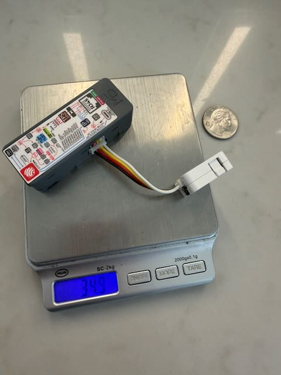
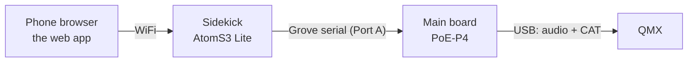

# Micro-FT8

[](https://github.com/kb2slo/micro-ft8/actions/workflows/ci.yml)
[](LICENSE)


**A headless FT8 station for the QRP Labs QMX that keeps working when you put your phone away.**

Micro-FT8 is firmware for two small ESP32 boards that sit beside the radio. The main board decodes,
calls CQ, works the stations that answer and keeps the log. A sidekick runs its own WiFi network and
serves a web app, so any phone, tablet or laptop browser is the remote. There is nothing to install,
and nothing in the field needs internet.



**Operating a station?** The site is for you: what it does, screenshots, getting started and downloads
are at **[micro-ft8.kalikstein.com](https://micro-ft8.kalikstein.com/)**. This README is for people who
want to build, change or contribute to it.

## Status

**Pre-alpha.** It has completed real FT8 QSOs on the air, and it changes fast. Anything can change or
break between commits, and nothing is carried forward from an older state. What has and has not been
checked on hardware is in [docs/TEST_PLAN.md](docs/TEST_PLAN.md).

## Hardware

| Part | Role |
|---|---|
| [M5Stack Unit PoE-P4](https://shop.m5stack.com/products/unit-poe-with-esp32-p4) (ESP32-P4) | Main board: USB host to the radio, decode, transmit, sequencing, log |
| [M5Stack AtomS3 Lite](https://shop.m5stack.com/products/atoms3-lite-esp32s3-dev-kit) (ESP32-S3) | Sidekick: WiFi access point, web server, the app |
| Grove cable (ships with the PoE-P4) | The link between the two boards |
| QRP Labs QMX | The radio, over one USB-C cable (audio and CAT) |

A QDX backend exists but has never run against a real QDX. Testing it is a good first contribution if
you own one.

## How it works

The phone is the only screen, the sidekick is a peripheral, and the main board is the station. The
main board talks to the radio over USB (audio in and out, CAT control) and runs everything that keys
the transmitter. The sidekick talks to the main board over a serial link on the Grove cable, and serves the web app and its API to the browser over its own access point or your home WiFi.
The browser reaches the internet for optional extras (QRZ lookups, space weather, POTA/SOTA spots,
PSKReporter) and the station never needs it.



The full picture, and the rules about who may key the transmitter:
[docs/architecture/system.md](docs/architecture/system.md).

## Repository layout

| Path | What is there |
|---|---|
| [`poe_p4/`](poe_p4/README.md) | Main board firmware (ESP-IDF, target `esp32p4`) |
| [`sidekick/`](sidekick/README.md) | Sidekick firmware (ESP-IDF, target `esp32s3`) |
| `components/` | Shared, mostly host-testable logic: sequencing, decode pipeline, logging, radio control, the board-to-board protocol. `ft8_lib` is a submodule |
| `webapp/` | The browser app (`webapp/app/`) and the public site |
| `host_mock/`, `tests/` | Host tests that run the firmware's logic without hardware |
| `tools/` | `check.sh` and the checks it runs, release and flashing helpers |
| [`docs/`](docs/README.md) | Architecture, roadmap, RFCs, style guide, test plan |

## Build and test

```bash
git clone --recurse-submodules https://github.com/kb2slo/micro-ft8.git
cd micro-ft8
tools/check.sh
```

`tools/check.sh` runs every check CI runs: the host tests, the web app's build and tests, decode recall
and the docs. `tools/check.sh --changed` runs only the checks your change can affect. The firmware needs
ESP-IDF v5.5.5; without `idf.py` on the PATH the two firmware builds report **SKIP**. Building and
flashing each board: [poe_p4/README.md](poe_p4/README.md) and [sidekick/README.md](sidekick/README.md).

Prebuilt images of the tip of `main` are on the
[`continuous`](https://github.com/kb2slo/micro-ft8/releases/tag/continuous) release, and are flashed at
`0x0`. How releases are made: [docs/RELEASE_PROCESS.md](docs/RELEASE_PROCESS.md).

## Contributing

Contributions are welcome, and you do not need the hardware to make a useful one: much of the logic in
`components/` and the web app is covered by host tests. [CONTRIBUTING.md](CONTRIBUTING.md) is the whole
path from setup to a merged pull request. In short:

- **Bug fixes** can go straight to a pull request.
- **Features and behaviour changes** start as an issue, so we can agree on what and why before you build.
  [docs/ROADMAP.md](docs/ROADMAP.md) is the plan.
- **Field reports** are as valuable as code. If you own a PoE-P4, an AtomS3 Lite and a QMX (or a QDX),
  the **Pending** checks in [docs/TEST_PLAN.md](docs/TEST_PLAN.md) are written to be run step by step.
- **AI coding agents are welcome.** [AGENTS.md](AGENTS.md) is the working agreement, and most agents read
  it on their own.

Everyone taking part follows the [code of conduct](CODE_OF_CONDUCT.md). C and C++ follow
[docs/STYLE.md](docs/STYLE.md). How things work, area by area:
[docs/architecture/](docs/architecture/system.md).

## Acknowledgements

- **[Mini-FT8](https://github.com/wcheng95/Mini-FT8)**, by Wei Cheng AG6AQ, with Zhenxing N6HAN.
  Micro-FT8 began as a fork of Mini-FT8, which ran on the M5Stack Cardputer ADV. The sequencer, ADIF
  logging and ft8_lib integration here grew from that code. Mini-FT8 was itself inspired by
  [DX FT8](https://github.com/WB2CBA/DX-FT8-FT8-MULTIBAND-TABLET-TRANSCEIVER) (Barb WB2CBA, Charley
  W5BAA and Paul G8KIG).
- **[ft8_lib](https://github.com/kgoba/ft8_lib)**, by Karlis Goba, encodes and decodes every message, with
  non-standard callsign support from Shawn Rutledge.
- **[WSJT-X](https://wsjt.sourceforge.io/wsjtx.html)**, by Joe Taylor K1JT and the WSJT Development Group,
  is the on-air standard Micro-FT8 follows. Its source was the reference for message sequencing and the
  signal-report scale.
- **[qmx-panadapter](https://github.com/SteffenLav/qmx-panadapter)**, by SteffenLav, showed that an
  ESP32-P4 can run FT8 with a live QMX, and was the working reference for driving the QMX over USB audio
  and CAT.

WSJT-X and qmx-panadapter are GPL-3.0 projects that were read as references. No code from either is in
this repository.

## License

MIT: see [LICENSE](LICENSE). The `ft8_lib` submodule carries its own license.
