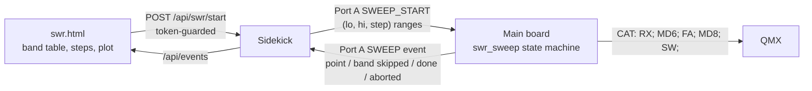

# Radio control: backends behind one table of operations

The core (slot loop, TX scheduler, HUD) talks to the radio only through `components/radio_control`. It never asks which radio it is.

## How it works

* **One table of operations per radio**, `radio_control_ops_t` (`components/radio_control/include/radio_control_backend.h`): `ready`, `on_audio_start`, `sync_frequency_mode`, `begin_tx`, `set_tone_hz`, `end_tx`, `set_tune`, `set_time`, the TX power/SWR trio `reset_tx_power_swr` / `poll_tx_power_swr` / `get_tx_power_swr`, and `begin_cpfsk_tx`. A null pointer means "not supported", never a crash.
* **Capabilities** (`radio_control_capabilities_t`, `radio_control.h`) are what the core and HUD ask instead of the radio's name: `has_wattmeter`, `has_swr`, `can_set_time`, `audio_is_uac`, `can_md8_tune`, `can_ps0`.
* **One `.cpp` per radio**: `radio_control_qmx.cpp`, `radio_control_qdx.cpp`. QMX and QMX+ are one backend until their CAT differs.
* **CAT replies are read by one parser**, `cat_reply_parser` (`components/radio_control`, host-tested), fed from the CDC callback (`poe_p4/main/qmx_transport.cpp`). It keeps the last `PC`, `SW` and `FA` reply, and drops the terminal display codes (`ESC[7m` ...) the radio appends to some replies, which would otherwise glue onto the next reply and hide its prefix. `FA` exists so a sweep can tell a frequency the radio refused (it answers `?;` and `FA;` still reads the old one) from one that took.
* **The radio is fixed to the QMX** (`radio_control_set_backend(RADIO_CONTROL_QMX)` in `poe_p4/main/main.cpp`). Following the Station `radio` setting is row cgc4.

## Rules

* **No `if (QMX)` in the core** — not in `poe_p4/main` or the dispatcher in `radio_control.cpp`. Radio-specific behaviour is an operation or a capability.
* **QMX-only features go through a capability flag.** The SWR sweep calls `MD8;` only where `can_md8_tune` is set; a CAT power-off (`PS0;`) only where `can_ps0` is set.
* **Adding a radio** means filling in a new operations table and capabilities, — no edit to the slot loop. This is the design's test; no second radio family has been added yet to prove it.
* **Why a table, not `class Radio`:** the variants are a closed set, and a C struct of function pointers is what the rest of this ESP-IDF tree already uses. [STYLE.md](../STYLE.md) (**Structure**) allows inheritance only for closed sets like this one, and the table is the lighter form of it.

## TX timing on a QMX

The QMX takes its tones over CAT, so the main board sets the timing (`tx_scheduler.cpp`; the constants and arithmetic in `components/radio_control/include/tx_timing.h`, which the host model in `tests/tx_e2e/tx_state_machine.cpp` shares):

* **`MD6;`, `TX;` at the slot boundary.** `TX;` keys PTT and emits no RF (bench-verified, below).
* **Tone *n* at `slot_start + 500 ms + n * symbol`**, FT8 and FT4 alike. The first `TA` is the first RF, 0.5 s after PTT, which is the gap an amplifier keyed from the QMX's PTT output needs to switch its relay before RF arrives, and WSJT-X's own start time.
* **The first `TA` is never sooner than the minimum TX delay after `TX;` returned**, however late the TX is armed, so an amplifier keyed from the QMX's PTT has its switching time before RF and the QMX's SWR protection never sees the transient. The delay is Settings › Radio › **Min TX delay**, `tx_min_delay_ms` in Station.txt: 0 to 500 ms, default 50, refused outside that; it is separate from the 0.5 s start above, which is the convention. A late start skips `(slot_ms + delay − 500) / symbol` tones (`tx_skip_tones()`): the first RF is the later of tone 0's due time and `TX;` + delay, sounding the tone due then, and later tones are slot-anchored again. At the default a reply armed up to 450 ms into the slot loses nothing; one armed at 3 s loses 17 of 79. A larger delay trades tones on late starts for relay time.
* **After the last tone: `TA0;`, 50 ms, `RX;`.** RF stops before PTT drops. FT8 ends at about 13.19 s of 15 s. A cancel sends `RX;` at once.
* **Both waits are states of the 10 ms tick**, not sleeps, and `tx_active` stays true from `TX;` to `RX;`.
* **A radio with CPFSK audio (QDX) is unchanged:** `radio_control_tone_lead_ms()` is 0 where `begin_cpfsk_tx` exists, so neither the 0.5 s start nor the minimum delay applies, and with no `key_up` it goes straight to `RX;`.

## SWR protection trips on a QMX

The P4 reads the radio's SWR-protection lock (**The SWR-protection latch**, below) and handles a trip itself, so a trip costs one slot rather than every slot until someone presses a button on the radio. The policy is `components/swr_trip` (host-tested); the radio side is `radio_swr_lock_t` in `radio_control.h`; the sequencing is `poe_p4/main/tx_scheduler.cpp`.

* **A setting, off by default:** Station `amp_swr_guard` (Settings > Amplifier, beside the minimum TX delay, which is the other half of running an amplifier from the QMX's PTT). Off, the P4 never sends `SR;` and a trip goes unseen as before. Turning it off mid-run drops the stopped state; the radio's lock is left as it is.
* **Needs `SR`:** QMX 1_04_004 or later, and 1_04_010 is the newest the panadapter reports working over CAT (**Firmware**, below). At each CAT connect, while idle, the P4 sends `SR;` and waits a second. No `SR0;`/`SR1;` reply (the parser ignores the `?;` a refusal sends) turns this off for that connection and logs why; `SR1;`, locked before we keyed, starts in the stopped state below. A new connection starts clean.
* **Detect.** The TX meter poll, every 500 ms while keyed, becomes `PC;SW;SR;`; `tx_tick()` reads the latest `SR` reply every 10 ms, so a trip is seen up to a poll after it happens (the reply to a poll is read on the next). A band-change trip comes on the first RF, 0.5 s into the slot.
* **A tripped transmission** ends at once (`RX;`) and is handled like a TX cancel ([autoseq.md](autoseq.md), **The slot cycle**): not counted, no try charged, and the entry re-armed for its next slot. As with a cancel, the RX/TX log line and an RR73/73 ADIF record were written when the transmission started. The phone shows `TX ABORTED: SWR protection` for the rest of that slot, through the TX HUD event's existing `aborted` and `reason` fields, so Port A does not change. After `RX;` the P4 sends `SR0;SR;` and reads the reply back, logging if the lock is still set.
* **Stop on a repeat.** A clean transmission resets the count. A second tripped transmission in a row leaves the lock set: the P4 ends the CQ and cancels every QSO as a band change does, and skips each later slot (`skipped, not counted: SWR protection`) until the operator calls CQ, replies or presses Tune, which sends `SR0;` first (`tx_scheduler_swr_operator_start()`). A band change trips once and then transmits; an antenna fault trips every time, and this tells the two apart. The skipped slot shows in the debug log; **not yet built: row ybav** (its Not keyed state is what will show it on the phone).
* **Tune** ends on a trip and shows it the same way, and never clears the lock itself; the next Tune press does. A lock left set by a Tune trip is met by the next transmission as a first trip.
* **The SWR sweep is unchanged.**
* **Why not set Protection reset to TX->RX over `MM`:** the write persists in the radio's EEPROM and changes it for every use, and TX->RX also clears a real fault after every transmission, silently. Clearing it from the P4 lets a second trip stop the station.

## QMX SWR Tune over CAT

Measured on a QMX at firmware 1_04_003 with `tools/qmx_swr_probe.py` (2026-09-30); `tools/qmx_swr_sweep.py` and `tools/qmx_swr_plot.py` are the bench prototype of the sweep and its plot. The sweep is built on it: see **The SWR sweep on the main board** below.

* **`MD8;` enters SWR Tune and keys the radio by itself** (`KD;`/`TQ;` read `1`; `MD;` then reads `3`). `SW;` returns the SWR in hundredths while keyed, and an empty `SW;` in receive. No `TX;` is needed, and a plain `TX;` does not measure: `KD;` stays `0` and `SW;` returns noisy, meaningless values.
* **`TX;` asserts PTT and emits no RF; the first `TA` does (bench-verified, QMX 1_04_003, Micro PA100+ keyed from the QMX's grounded PTT output).** After `TX;` the PA relay clicks and both radios read ~0 W. RF appears on the first `TA`, `TA0;` keys down, and `RX;` releases PTT. With a gap between `TX;` and the first `TA` the QMX no longer trips SWR protection on the relay's switching transient. Found by test; the CAT manual for 1_04_004 says the same ("The first TA command does key-down"). Its PDF text extracts with macOS PDFKit (`PDFDocument(url:).string`, a few lines of Swift).
* **The frequency is taken when SWR Tune is entered.** `FA` while keyed is refused (`?;`), and `MD8;` sent while already in SWR Tune keeps the old frequency. Per point: `RX;`, `MD6;`, `FA<hz>;`, `MD8;`, then read `SW;`. Afterwards `RX;`, `MD6;` and the original `FA`.
* **Timing:** setters return nothing, and the next query answers within a few ms, so the radio's own latency is small. With a 300 ms discard after `MD8;` the first read was already steady, and three reads 50 ms apart plus a median absorb the odd outlier (one in ~20 reads strays 0.1-0.3). A point costs about 0.7 s keyed: 15 points in 11 s.
* **The reading depends on the Tune %.** The same dummy load on 20 m read 1.14-1.15 at 50%, 1.19-1.22 at 25%, 1.28-1.32 at 10%; at 10% the noise hides the small rise across the band. So 25% is the floor, and a curve must be labelled with its Tune %. The real antenna at 25% read a smooth 1.37-1.43 across 20 m, lowest at 14.175-14.200 MHz.
* **`FA` is limited to the radio's configured bands.** A 6-17 MHz sweep in 200 kHz steps was refused (`?;`) everywhere except inside 40 m (7.000, 7.200) and 20 m (14.000, 14.200); 6.8, 7.4, 13.8 and 14.4 MHz were refused. A CAT sweep is therefore bounded by the band table, not by us. The QMX's own terminal sweep plot spans 6-17 MHz by some other path; unexplained.
* **Not available on 1_04_003:** `SR;` (the SWR-protection lock, added in 1_04_004, below) returns `?;`, `MD0;` is not a mode, and `PC;` is get-only. The CAT timeout is on (`QB1;`), 120 s (`QC120;`), which a sweep's polling keeps alive.
* **Firmware: only 1_04_003 is tested here.** The QMX panadapter project (`SteffenLav/qmx-panadapter`, watched in [README.md](../README.md)) warns off QMX firmware **1.04.011** (2026-09-19): one operator reports no transmit output when the radio is keyed over CAT, and others the radio's own SWR Tune screen freezing; it reports 1.04.010 as fine. Second-hand and not verified by us, but the sweep is built on exactly that mode, so check a sweep on any firmware newer than 1_04_003 before trusting it. QRP Labs' changelog for 1_04_015 (beta, 2026-09-24) fixes "SWR Tune showing SWR but was not outputting RF"; whether that is the same fault is untested.
* **The SWR-protection latch** (QMX operating manual and CAT manual, 1_04_004; not yet tried here). The radio samples SWR every 1 ms and, above the Protection menu's **SWR threshold** (default 3), stops transmitting and shows `S` beside the frequency. It does not check below 0.5 W. The lock stays until **Protection reset** clears it: None (power cycle or a visit to the menu), Button (the next press of any button), Timer (a set time after the next TX-to-RX), or TX->RX (the next TX-to-RX); these options date from 1_03_000. From 1_04_004, `SR;` reads the lock (`SR1;` locked) and `SR` with any digit (`SR0;`) clears it. The manual says protection is off while the radio's SWR tools run; whether CAT's `MD8;` counts as one is untested. The panadapter still clears the lock with `TX;`, 150 ms, `RX;` after a burst that read over 4.0, which `SR` makes unnecessary. Through a PA100+, which picks its filter from the RF it senses, the first RF on a new band can trip it (operator, 2026-10-23).
* **Menu Manager** (CAT manual 1_04_004; not yet tried here). `MM<path>;` reads any configuration menu item, `MM<path>=<value>;` writes it, and `MM<path>?;` with `ML<n>;` lists an item's allowed values; a path is menu names joined by `|`, such as `MMProtection|Tune %;`. **A write is stored in EEPROM**, unlike the two-letter commands, and takes effect at once only when System config › CAT config › **MM Effect** is Immediate; On demand waits for a menu visit or `MU;`.
* **Leaving the "Band config." menus moves the radio (unverified).** The panadapter reads each band's settings by walking those menus over CAT, and found that leaving them drops the radio on 160 m, in whatever mode the menus left (its v1.16.10, 2026-10-02); it now restores band and mode afterwards. Not tried here. Rows vu8t (the Tune % on the sweep plot) and B57 (band capability) both plan Menu Manager (`MM`/`ML`) reads of these menus, so each must put the radio back and check by read-back that it did.
* **The radio appends terminal display codes** (`ESC[7m` and similar) after some replies; a parser must strip them and read a reply by pattern.

## The SWR sweep on the main board

A phone page ([webapp.md](webapp.md), **The SWR sweep**) asks the main board to sweep SWR over the bands the operator ticks; the wire is Port A v4 ([sidekick.md](sidekick.md), **Port A**). **Not yet built: row vu8t (reading the Tune %).**

* **The state machine** is `components/swr_sweep`: non-blocking, one radio command per `swr_sweep_tick()`, so USB, audio and Port A keep running. It talks to the radio only through `radio_swr_io_t` (`radio_control_swr_io()`, QMX only, behind `can_md8_tune`; a QDX returns none), so `host_mock` tests it against a fake QMX: a refused `FA`, a refused band, cancel at any state, a silent radio, the restore, the caps. The sequence per point and the bench facts behind it are in the section above.
* **The phone owns the plan.** The firmware takes `(lo, hi, step)` kHz ranges and holds no band table, so there is nothing to keep in agreement between C and JavaScript. The radio's own refusal of a frequency outside its configured bands is the hardware-side limit, and it is not ours to duplicate. A band whose first and last frequency are both refused is reported skipped and never keys; a silent probe is not a refusal.
* **Caps.** A request is refused above `SWR_SWEEP_MAX_POINTS` (200) points or `SWR_SWEEP_MAX_RANGES` (12) ranges. Every keyed phase is bounded by the reply timeouts and by aborting after three silent queries in a row, so the point cap bounds the keyed time (200 points at about 0.85 s is under three minutes). *Why no keyed-time cap:* it would be a second rule that can never fire.
* **Threads.** `swr_sweep_start()`, `_tick()` and `_cancel()` belong to one task. Port A handlers use `swr_sweep_request_start()`, `_request_cancel()` and `swr_sweep_busy()`, which hand the work to that task's next tick. The tick runs at least every 100 ms (the P4's main loop: 10 ms); one more than a second late while the radio is keyed, and the next tick un-keys and aborts (STALLED). If ticks stopped altogether, only the radio's own CAT timeout (120 s on the bench unit) would un-key it.
* **What the P4 refuses over** (`porta_host_sweep_start`, `poe_p4/main/porta_host.cpp`): CAT not ready, a transmission, a queued CQ or QSO, Tune on, no band frequency, a sweep already running. While one runs, `tx_start()` does not key and Tune is refused. The page asks the operator first and ends what is running through the existing endpoints, then starts again.
* **The restore** goes to the station's band frequency, not a typed dock frequency, through `radio_control_sync_frequency_mode()`'s own steps (`MD6;`, `FR0;`, `FT0;`, `FA`).
* **Stop is `PORTA_ACT_TX_CANCEL`.** It already means "stop transmitting", so one stop control ends a sweep on every surface: the P4's `porta_host_tx_cancel()` also requests a sweep cancel, and the next tick de-keys.
* **The main board does not hold the result.** Events are polled and the sidekick's ring holds 64 rows, so a phone that sleeps through a sweep misses points; the page shows them as missing, never as zero, and ends a run itself when the host's end never arrives ([webapp.md](webapp.md)).
* **Why not a band table in firmware, or a saved plan:** two copies to drift, and a plan the phone can change is the point. **Why not `TX;`:** it does not measure (above).
* **Decoding stops while it runs:** the radio is keyed and out of digital mode, so the slots a full run spans (two or three) are not decoded.
* **The simulator** (`host_mock/sim_station.cpp`) runs the real state machine behind `/api/swr/start` against a fake QMX that reads like a 40 m end-fed half-wave, so the page can be built and tested without a radio.
