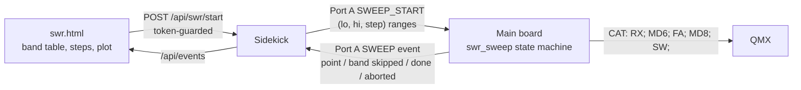

# Radio control: backends behind one table of operations

The core (slot loop, TX scheduler, HUD) talks to the radio only through `components/radio_control`. It never asks which radio it is.

## How it works

* **One table of operations per radio**, `radio_control_ops_t` (`components/radio_control/include/radio_control_backend.h`): `ready`, `on_audio_start`, `sync_frequency_mode`, `begin_tx`, `set_tone_hz`, `end_tx`, `set_tune`, `set_time`, the TX power/SWR trio `reset_tx_power_swr` / `poll_tx_power_swr` / `get_tx_power_swr`, and `begin_cpfsk_tx`. A null pointer means "not supported", never a crash.
* **Capabilities** (`radio_control_capabilities_t`, `radio_control.h`) are what the core and HUD ask instead of the radio's name: `has_wattmeter`, `has_swr`, `can_set_time`, `audio_is_uac`, `can_md8_tune`, `can_ps0`.
* **One `.cpp` per radio**: `radio_control_qmx.cpp`, `radio_control_qdx.cpp`. QMX and QMX+ are one backend until their CAT differs.
* **CAT replies are read by one parser**, `cat_reply_parser` (`components/radio_control`, host-tested), fed from each board's CDC callback (`poe_p4/main/qmx_transport.cpp`, `main/audio/stream_uac.cpp`). It keeps the last `PC`, `SW` and `FA` reply, and drops the terminal display codes (`ESC[7m` ...) the radio appends to some replies, which would otherwise glue onto the next reply and hide its prefix. `FA` exists so a sweep can tell a frequency the radio refused (it answers `?;` and `FA;` still reads the old one) from one that took.
* **The product picker** is the table in `main/radio/radio_profile.h`: one row per radio, binding its name, audio source and backend.

## Rules

* **No `if (QMX)` in the core** — not in `main.cpp`, `poe_p4/main`, or the dispatcher in `radio_control.cpp`. Radio-specific behaviour is an operation or a capability.
* **QMX-only features go through a capability flag.** The SWR sweep calls `MD8;` only where `can_md8_tune` is set; a CAT power-off (`PS0;`, I10) only where `can_ps0` is set.
* **Adding a radio** means filling in a new operations table and capabilities, and adding a row to `radio_profile.h` — no edit to the slot loop. This is the design's test; no second radio family has been added yet to prove it.
* **Why a table, not `class Radio`:** the variants are a closed set, and a C struct of function pointers is what the rest of this ESP-IDF tree already uses. [STYLE.md](../STYLE.md) (**Structure**) allows inheritance only for closed sets like this one, and the table is the lighter form of it.

## QMX SWR Tune over CAT

Measured on a QMX at firmware 1_04_003 with `tools/qmx_swr_probe.py` (2026-09-30); `tools/qmx_swr_sweep.py` and `tools/qmx_swr_plot.py` are the bench prototype of the sweep and its plot. The sweep is built on it: see **The SWR sweep on the main board** below.

* **`MD8;` enters SWR Tune and keys the radio by itself** (`KD;`/`TQ;` read `1`; `MD;` then reads `3`). `SW;` returns the SWR in hundredths while keyed, and an empty `SW;` in receive. No `TX;` is needed, and a plain `TX;` does not measure: `KD;` stays `0` and `SW;` returns noisy, meaningless values.
* **The frequency is taken when SWR Tune is entered.** `FA` while keyed is refused (`?;`), and `MD8;` sent while already in SWR Tune keeps the old frequency. Per point: `RX;`, `MD6;`, `FA<hz>;`, `MD8;`, then read `SW;`. Afterwards `RX;`, `MD6;` and the original `FA`.
* **Timing:** setters return nothing, and the next query answers within a few ms, so the radio's own latency is small. With a 300 ms discard after `MD8;` the first read was already steady, and three reads 50 ms apart plus a median absorb the odd outlier (one in ~20 reads strays 0.1-0.3). A point costs about 0.7 s keyed: 15 points in 11 s.
* **The reading depends on the Tune %.** The same dummy load on 20 m read 1.14-1.15 at 50%, 1.19-1.22 at 25%, 1.28-1.32 at 10%; at 10% the noise hides the small rise across the band. So 25% is the floor, and a curve must be labelled with its Tune %. The real antenna at 25% read a smooth 1.37-1.43 across 20 m, lowest at 14.175-14.200 MHz.
* **`FA` is limited to the radio's configured bands.** A 6-17 MHz sweep in 200 kHz steps was refused (`?;`) everywhere except inside 40 m (7.000, 7.200) and 20 m (14.000, 14.200); 6.8, 7.4, 13.8 and 14.4 MHz were refused. A CAT sweep is therefore bounded by the band table, not by us. The QMX's own terminal sweep plot spans 6-17 MHz by some other path; unexplained.
* **Not available:** `SR;` (the SWR-protection lock) returns `?;`, `MD0;` is not a mode, and `PC;` is get-only. The CAT timeout is on (`QB1;`), 120 s (`QC120;`), which a sweep's polling keeps alive.
* **Firmware: only 1_04_003 is tested here.** The QMX panadapter project (`SteffenLav/qmx-panadapter`, watched in [README.md](../README.md)) warns off QMX firmware **1.04.011** (2026-09-19): one operator reports no transmit output when the radio is keyed over CAT, and others the radio's own SWR Tune screen freezing; it reports 1.04.010 as fine. Second-hand and not verified by us, but the sweep is built on exactly that mode, so check a sweep on any firmware newer than 1_04_003 before trusting it.
* **The SWR-protection latch (unverified).** `SR;` cannot be read on 1_04_003. The panadapter clears a tripped latch after a burst reading over 4.0 by sending `TX;`, waiting 150 ms, then `RX;`. Not tried here. If a sweep on a badly mismatched band ever leaves the radio refusing to key, that is the thing to try, and it becomes a fix in the sweep's slice.
* **The radio appends terminal display codes** (`ESC[7m` and similar) after some replies; a parser must strip them and read a reply by pattern.

## The SWR sweep on the main board

A phone page ([webapp.md](webapp.md), **The SWR sweep**) asks the main board to sweep SWR over the bands the operator ticks; the wire is Port A v4 ([sidekick.md](sidekick.md), **Port A**). Built for the P4; the ADV answers "SWR sweep is not built for this board". **Not yet built: rows uqu2 (the ADV), vu8t (reading the Tune %).**

* **The state machine** is `components/swr_sweep`: non-blocking, one radio command per `swr_sweep_tick()`, so USB, audio and Port A keep running. It talks to the radio only through `radio_swr_io_t` (`radio_control_swr_io()`, QMX only, behind `can_md8_tune`; a QDX returns none), so `host_mock` tests it against a fake QMX: a refused `FA`, a refused band, cancel at any state, a silent radio, the restore, the caps. The sequence per point and the bench facts behind it are in the section above.
* **The phone owns the plan.** The firmware takes `(lo, hi, step)` kHz ranges and holds no band table, so there is nothing to keep in agreement between C and JavaScript. The radio's own refusal of a frequency outside its configured bands is the hardware-side limit, and it is not ours to duplicate. A band whose first and last frequency are both refused is reported skipped and never keys; a silent probe is not a refusal.
* **Caps.** A request is refused above `SWR_SWEEP_MAX_POINTS` (200) points or `SWR_SWEEP_MAX_RANGES` (12) ranges. Every keyed phase is bounded by the reply timeouts and by aborting after three silent queries in a row, so the point cap bounds the keyed time (200 points at about 0.85 s is under three minutes). *Why no keyed-time cap:* it would be a second rule that can never fire.
* **Threads.** `swr_sweep_start()`, `_tick()` and `_cancel()` belong to one task. Port A handlers use `swr_sweep_request_start()`, `_request_cancel()` and `swr_sweep_busy()`, which hand the work to that task's next tick. The tick runs at least every 100 ms (the P4's main loop: 10 ms); one more than a second late while the radio is keyed, and the next tick un-keys and aborts (STALLED). If ticks stopped altogether, only the radio's own CAT timeout (120 s on the bench unit) would un-key it.
* **What the P4 refuses over** (`porta_host_sweep_start`, `poe_p4/main/porta_host_stubs.cpp`): CAT not ready, a transmission, the beacon on, a queued QSO, Tune on, no band frequency, a sweep already running. While one runs, `tx_start()` does not key and Tune is refused. The page asks the operator first and ends what is running through the existing endpoints, then starts again.
* **The restore** goes to the station's band frequency, not a typed dock frequency, through `radio_control_sync_frequency_mode()`'s own steps (`MD6;`, `FR0;`, `FT0;`, `FA`).
* **Stop is `PORTA_ACT_TX_CANCEL`.** It already means "stop transmitting", so one stop control ends a sweep on every surface: the P4's `porta_host_tx_cancel()` also requests a sweep cancel, and the next tick de-keys.
* **The main board does not hold the result.** Events are polled and the sidekick's ring holds 64 rows, so a phone that sleeps through a sweep misses points; the page shows them as missing, never as zero, and ends a run itself when the host's end never arrives ([webapp.md](webapp.md)).
* **Why not a band table in firmware, or a saved plan:** two copies to drift, and a plan the phone can change is the point. **Why not `TX;`:** it does not measure (above).
* **Decoding stops while it runs:** the radio is keyed and out of digital mode, so the slots a full run spans (two or three) are not decoded.
* **The simulator** (`host_mock/sim_station.cpp`) runs the real state machine behind `/api/swr/start` against a fake QMX that reads like a 40 m end-fed half-wave, so the page can be built and tested without a radio.
