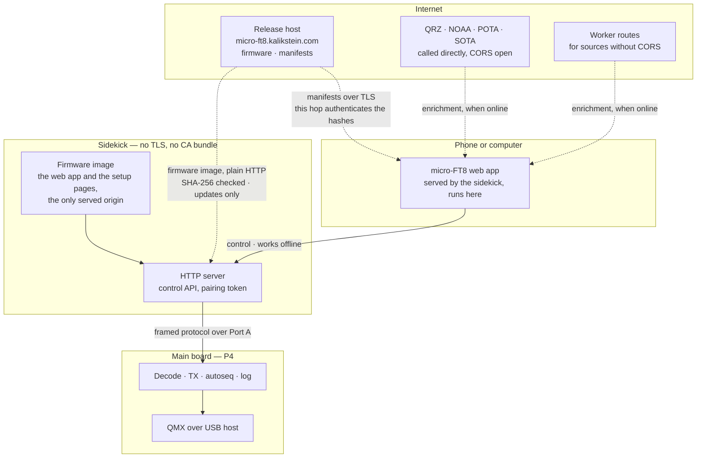

# System architecture: the phone is the UI, the sidekick is a peripheral

How the boards, the phone and the internet divide the work, and who may key the transmitter. Component detail, one doc per area: [sidekick.md](sidekick.md), [webapp.md](webapp.md), [radio.md](radio.md), [hl2.md](hl2.md), [autoseq.md](autoseq.md), [decode.md](decode.md), [ft8_lib.md](ft8_lib.md), [main_board.md](main_board.md), [memory.md](memory.md), [time.md](time.md), [logging.md](logging.md), [updates.md](updates.md).

## The station

The daily station is headless: a **P4 main board** (decode, TX, autoseq, log, the radio over USB host), an **AtomS3 Lite sidekick** (WiFi, HTTP server, web root), and a **phone browser as the only UI**. Updates: [updates.md](updates.md).

## Constraints

1. **Offline field operation is a requirement.** Summits have no cell service and no router, so the only path from phone to sidekick there is the sidekick's own access point. **The whole application runs over AP mode**; station mode (home WiFi, the phone's hotspot) is the convenience case. Nothing may treat AP mode as a transient setup state.
2. **Internet may be required for updates, never for operating, and not for setup.** The app is part of the sidekick's firmware image, so a sidekick flashed over USB serves it with no network (see [sidekick.md](sidekick.md), **Web root**); an update requires the sidekick to be on a network with internet.
3. **No dependency on a board's keyboard or screen.** The sidekick-to-main protocol is specified against the application (decode, transmit, autoseq, config, log), never against board hardware.

## The inversion: the browser is the internet device

The phone already has a cellular radio, a TLS stack, a trust store, a screen and a browser. The sidekick has none of those and would grow them at a cost in flash, maintenance and failure modes. So **third parties are reached by the phone, never by the device**, and **the sidekick never speaks TLS**.

**Firmware is the one thing the sidekick fetches itself** ([sidekick.md](sidekick.md), **Firmware updates**). When the operator starts an update, the web app reads the release manifest over HTTPS, which authenticates it, and hands the sidekick the image's URL and SHA-256 behind the pairing token. The sidekick downloads the image from our own release host over **plain HTTP** and refuses it unless the hash matches, then installs its own image or passes a main board's image down Port A. This keeps the rules above intact: the release host is ours, not a third party; there is no TLS on the device; and trust still comes from the browser's HTTPS fetch, since tampering in transit can only make the download fail. The phone only makes a short request, so a locked screen does not interrupt an update, and a multi-megabyte image never passes through the browser. The cost: an update needs the sidekick on a network with internet (home WiFi or the phone's hotspot), and is refused in AP mode.

Dashed edges need internet; solid edges work without it. **Everything the station needs to operate is solid**, and keeping it that way is the property to defend. The one dashed edge into the sidekick is the firmware download, which serves updates only and is plain HTTP. Why the sidekick has no TLS, in either direction: [sidekick.md](sidekick.md), **Why the sidekick has no TLS**.

## Connectivity

* **On the sidekick's AP, the phone's cellular internet is unreliable: design as though AP mode has none.** The AP is not a captive portal, so iOS can treat it as WiFi without internet, send internet traffic over cellular, and still reach `micro-ft8.local`. It did on an iPhone on 2026-09-23 and for the app install on 2026-10-06, but during the first POTA activation (2026-10-09, iPhone, AP mode) it worked at some times and not at others, while the same phone with WiFi off had internet there. So in a tradeoff, a feature that needs the internet while operating counts as unavailable in the field, not as degraded, and every internet call the app makes must fail fast and leave the page usable. Android is unchecked (`TEST_PLAN.md` Unverified). The likely cause, an AP lease that offered a router with no route out, was removed on 2026-10-10, and a 30-minute session on the AP then had internet throughout ([sidekick.md](sidekick.md), **The access point**). One session does not lift the rule above.
* **The phone's own hotspot is the other route**: the sidekick joins it, and the phone has cellular internet on the same LAN. iPhone hotspots need *Maximize Compatibility* on, because the sidekick's radio is 2.4 GHz only.
* With no cell signal at all, the operator is offline on either route, and the offline-derived tier ([webapp.md](webapp.md), **Tools**) is what works.

## Who may key the transmitter

A headless radio driven by a local HTTP API means any device on the network could start a transmission, and the licensee answers for it. The control is **authorization, not authenticity**: nothing may change the device merely by being on the LAN.

* **The HL2 is keyed over Ethernet with no authentication at all** (Protocol 1), so the pairing token guards our API but not the radio: it sits on a private cable to the P4, with nothing else on it ([hl2.md](hl2.md), **The link**). It receives only today.

* **A pairing token**, minted on the sidekick's first boot, stored in the sidekick's NVS and in the browser's `localStorage`. Every state-changing request carries it, and so does the one read that returns a secret, the QRZ logbook key whole (`GET /api/qrz_key`); requests without it are refused. It is a nuisance control scoped to accidents on a home LAN, not a targeted attacker. Nothing rotates it: re-provisioning keeps it, and only erasing the sidekick's NVS mints a new one. Code: `sidekick/main/pairing_token.h`, `pairing_http.h`.
* **Reads are open on principle.** Anyone may listen to amateur transmissions, and Part 97 forbids obscuring their meaning, so decodes, status and the log are open to anyone who can reach the device. What needs authorization is *changing* the device: transmit control, firmware updates, a bench push of the app, every config write (WiFi credentials included, in AP mode as in station mode), and the clock sync (a write, even though idempotent). This is the reason reads are open, not convenience, and it rules out a read-scoped token: a watch-only guest needs no credential.
* **The carve-out: a credential is not radio data.** A read that would return the WiFi password or the token stays guarded. That is why each route's policy is a required argument where it is registered rather than derived from the HTTP method: "GET is open" is silently wrong for the first route that returns a secret, and an undeclared route is a build error.
* **Retrieving the token is a button press.** The token must be readable on demand, not merely resettable: a new phone, cleared storage, or Safari evicting script-writable storage after seven days unused all lose it. The AtomS3's user button (GPIO41, active low) opens a **one-shot** disclosure window: the first successful read claims and closes it, and it times out after a couple of minutes otherwise. Every page loads `/pairing.js`, which polls for the window and stores the token. The token is not rotated on retrieval, which would log out every paired browser. Gating on the button, not on AP mode, is the point: AP mode is normal operation (constraint 1), so "disclosed only in AP mode" would be no gate at all.
* **The token is kept per address,** since `localStorage` is per origin: `192.168.4.1` and `micro-ft8.local` are two. So the Saved page shown after **Save and join** links to `micro-ft8.local` with the token in the link's fragment (`carryLink()`, applied by `provision.html`), which no request sends, and `pairing.js` on the page that opens stores it and clears it from the address before the app reads its hash routes (`webapp/tests/test_pairing_carry.js`). Any other address takes a press of the button, or the token pasted in Settings › Pairing.
* **One operator, many screens.** Every paired browser holds the same token and is an equal controller; the last command wins. That fits a single licensee. An update locks every browser out of transmitting ([updates.md](updates.md), **Decided**). Reopen if a second operator ever shares a station.
* **Honest limit.** The token travels in clear over plain HTTP, so anyone who can read the traffic can replay it. WPA2/WPA3 per-station encryption makes that materially harder; an open network does not, and the sidekick's own AP is open unless the operator sets a password ([sidekick.md](sidekick.md), **The access point**), so by default the token crosses the air in clear. Raising the bar would need a certificate for a name that resolves on one LAN, which the design declines ([webapp.md](webapp.md), **A non-secure origin**).

### Why not signing

Signed images, verified against a key pinned in firmware, were rejected 2026-09-12:

* **The source is already authenticated one hop earlier**: the browser's HTTPS fetch from the release host. A signature would re-prove what TLS proved.
* **Every inbound path passes through the operator's own browser**, or, for the sidekick's firmware download, is checked against a hash that did.
* **A CI-held key shares the host's trust domain.** Anyone who can push a workflow can use the secret, so whoever can serve a malicious image can sign it. An independent key means offline custody and a manual signing step on every release.
* **The cost is permanent**: a pinned key with no revocation path is a liability for the life of every device.

Kept, and easy to mistake for signing: a **SHA-256 per asset** (catches a corrupted upload, not an adversary) and **version pairing** (skew, not trust). Physical possession remains the trust anchor: first install and recovery are over USB.

**Reopen** when content can reach a device by a path that is not the owner's TLS-authenticated browser: built sidekicks distributed to other operators, or an unattended update path.

## Third-party services

* **Called directly from the browser when the source sends CORS.** QRZ's XML API sends `Access-Control-Allow-Origin: *` (measured 2026-09-10), so each operator's QRZ credentials go from their own browser to QRZ and never touch our infrastructure, which is right for terms of service, privacy and liability. The same holds for NOAA SWPC, POTA and SOTA ([webapp.md](webapp.md), **Tools**).
* **A Worker route only when a source has no CORS**, and it **filters rather than relays**: it re-serves the small subset the app needs as JSON, because a phone on cellular must not pay for a full upstream payload (one PSKReporter query returned 1.25 MB of XML). Routes live in `webapp/worker.js`, and each is also named in `wrangler.jsonc`'s `run_worker_first`, the only paths that run the Worker ([webapp.md](webapp.md), **Serving the site**).
* **QRZ's Logbook API goes through a Worker route, the one place an operator's credential passes through our infrastructure** (maintainer, 2026-11-19, as an exception to the first rule above). The app cannot call it as it calls the XML API: it sends no CORS header, with a valid key or with none, and it asks every application for a User-Agent of its own, which a page cannot set. `worker.js`'s `/qrz/*` makes three calls for the app, status, fetch and insert, and no others: never `REPLACE`, which overwrites confirmed QSOs, and never `DELETE`. The logbook key and the QSOs pass through and are neither stored nor logged, and no reply repeats the key. A fetched record is cut down to what a sync matches on before it is passed on, since QRZ sends about 1,250 bytes a record with the other operator's name, email, town and coordinates in it; cut down, a record is about 150 bytes. What is passed on keeps QRZ's own field names, from one list in `worker.js` (`QRZ_PASS`), so the app coming to need another field is a name added there and no change to the reply's shape.
  * **Why not the sidekick:** a TLS handshake on a board with about 87 KB free and no PSRAM, and no uplink at all on its own AP ([sidekick.md](sidekick.md), **Why the sidekick has no TLS**).
  * **What it costs:** the route is public and nothing tells our app from another caller, so anyone can spend the free plan's 100,000 Worker requests a day, which `/download/*` and `/pskr/report` share; past it both routes answer 429 until midnight UTC, and updates stop with the sync. No rate limit stands in front of it yet. The app holds itself to a budget of calls ([webapp.md](webapp.md), **QRZ sync**). The paid plan (10 million requests a month, no daily limit) is the way out when a peak day passes 50,000.
  * **What QRZ does** (read from a logbook, 2026-11-19; its [API page](https://www.qrz.com/docs/logbook/QRZLogbookAPI.html) says less): a reply is `NAME=value` pairs in no fixed order, the ADIF of a fetch HTML-escaped, a field's length counting characters. Time is kept to the minute. FT4 comes back as `MODE` FT4 with no `SUBMODE`, and a frequency without its trailing zeros. Every record carries `APP_QRZLOG_LOGID`, ascending, and `QRZCOM_QSO_UPLOAD_STATUS` Y. No record in a range is `RESULT=FAIL` with a `COUNT` of 0. A fetch takes a date range, a page size and `AFTERLOGID`, which includes the ID given. An insert it takes answers `RESULT=OK`, `COUNT=1` and the record's `LOGID`; it stores a record sent as `MODE` MFSK with `SUBMODE` FT4 as FT4, keeps the comment, grids and reports sent, and adds the other station's entity, state and zones itself. An insert of a QSO it holds is refused (`REASON=Unable to add QSO to database: duplicate`) and names no ID for it. One logbook belongs to one callsign, `/P` included.
* **PSKReporter** ([pskdev.html](https://pskreporter.info/pskdev.html)) is used the way its author asks: clients record its live MQTT feed rather than query `retrieve.pskreporter.info`, whose load is growing; reports for many receivers may arrive over TCP from one address, each receiver stream with its own observation domain ID; reports older than about an hour are dropped. So the app listens to the feed ([webapp.md](webapp.md), **Who hears me**) and never queries it, as `micro-FT8-<call>-<random>` (`clientIdFor()`, `webapp/app/pskr_core.js`), the client id its terms ask for: the program's name first, then a callsign ([mqtt.pskreporter.info](https://www.mqtt.pskreporter.info/), Terms of use), and our receptions go through a Worker over TCP (**Reporting**, below). The ingest takes IPFIX on `report.pskreporter.info:4739` over UDP or TCP (WSJT-X's `use_tcpip`): at most one message per sender every five minutes unless it is full, not on the clock, each call at most once per five minutes and ideally once an hour while nothing about it changes, `informationSource` 1, the header's send time within a minute of arrival. It caches a sender's templates by source address and port. Its test listener, `pskreporter.info:14739`, resolves to Cloudflare addresses, which a Worker cannot connect to. Its [statistics page](https://pskreporter.info/stats#software_in_use) lists, for the last seven days, each decoding software name and version with the receivers that sent it; a new name appears once its reports arrive, with nothing to register.
  * **Reporting** (`worker.js`'s `/pskr/report`, `webapp/pskr_report.js`; the page's side: [webapp.md](webapp.md), **Spotting**). A page posts `{ call, grid, app, spots }` as JSON in plain text, a simple request. `checkReport()` keeps the spots that are real ones, one a sender, and refuses a post with no call or locator. A Durable Object per receiving station (`PskrGate`, by its call) decides what goes: it holds when the station last sent, the records it has sent, and the senders it reported in the last hour, keyed by call, band and mode, and no spots. Inside five minutes of the last message it answers wait, with the time left, and the page posts again then; a sender reported within the hour on that band and mode is dropped; the rest goes at once. So every page open on a station can post, and a sender goes once, at most one window after a page heard it. The Worker, not the object, opens the TCP connection, since an open socket would keep the object in memory and billed for up to 15 minutes; it sends one message, closed once written, carrying both templates every time, since a fresh connection from Cloudflare never repeats the address and port PSKReporter cached them by. A whole send is one message: at most 200 spots, about 6 KB, far inside IPFIX's 65,535 bytes, which is WSJT-X's own ceiling over TCP (952 bytes over UDP). On the bench (2026-11-23) PSKReporter took every send from us, messages of 1.2 to 2.5 KB among them, its own map holding nearly every spot of each; what looked like lost sends was the MQTT feed (**The MQTT feed drops whole batches**, below). The message's observation domain is the station's (FNV-1a of its call), and its software is `micro-FT8` and the build's version, so every build counts under one name. The gate's state is one value, written once a message: an idle object leaves memory after 70 to 140 s, and posts come minutes apart. A message PSKReporter does not take is not sent again: the gate counted it sent, as a lost UDP report would be. Encoded from pskdev.html, not from any program's code; `webapp/tests/test_worker_pskr.js` holds the message to bytes written out by hand and reads it back as IPFIX, and the route ran in `wrangler dev` against a local listener on 2026-11-23.
  * **What reporting costs and records.** Each page posts about once a window, so a station with two pages open costs about 30 Worker requests an hour and as many Durable Object requests, with one stored write per message: the Worker's 100,000 requests a day are the limit that binds, at about 3,000 station-hours a day, and they are shared with `/download/*` and `/qrz/*` (**QRZ's Logbook API**, above, on what happens past them). Each post is one Analytics Engine data point (`countPskr()`, dataset `micro_ft8_pskr_reports`): the station's call, its locator's square, the app's version, the bands and modes in the post, what came of it (`sent`, `wait`, `none`, `empty`, `send_failed`, `gate_failed`) and how many spots it offered and sent. All of it is what PSKReporter publishes once a report goes, so the switch that publishes it is the consent to it; it is how we see who reports, on which builds, and what the route costs. Kept three months, Analytics Engine's retention.
  * **The MQTT feed drops whole batches** (2026-11-23, our own reports watched on `pskr/filter/v2/+/+/+/KB2SLO/#` for three hours, and for the last 40 minutes on `pskr/filter/v2raw/…` beside it, then compared with PSKReporter's map, received by KB2SLO): of 31 sends, 10 never reached the feed, each whole, while PSKReporter's map held 80 to 100% of the spots of every one checked, those 10 among them (the map thins its own view: sends the feed carried show the same there). A send missing from `v2` was missing from `v2raw` too, so it is not the validity filter `v2` documents, and no spot of ours on `v2raw` had a part `UNKNOWN`. A batch the feed carries arrives whole, 19 to 319 s after transmission. So a spot missing from the feed is not a spot PSKReporter lacks, which bears on **Who hears me** ([webapp.md](webapp.md)) as much as on checking our own reports: check the map before blaming a sender. The feed is M0LTE's, not PSKReporter's.
  * **A grid's feed** (`webapp/tools/pskr_grid_measure.py EM10 20 --skip <call>`, measured from 15:55 UTC on 2026-11-20). The topic's locator levels are 4 characters, so `pskr/filter/v2/+/FT8/+/+/EM10/#` (sent from the grid) and `…/+/+/+/EM10/#` (heard in it) filter on the broker. The two together carried 2,118 spots in 20 minutes, 1.8 a second, about 23.5 KB a minute or 1.4 MB an hour, in bursts: one minute ran at 69 KB. A spot reached the feed a median 93 s after its transmission (90th percentile 245 s, longest 559 s), and receivers upload in batches, so a 15-minute window held only 23–30% of the run's stations at minute 5 and 78–84% at minute 15. The feed keeps no history: a subscriber sees only what is published after it subscribes. Few stations make the numbers: five EM10 stations were spotted transmitting, one of them ours, which was 439 of the 1,141 spots sent from the grid and 34 of 37 receivers beyond 3,000 km on 20 m; ten EM10 receivers made every report heard in it, one of them 578 of 977.
* **CORS headers are observed behaviour, not policy.** Any of them can disappear without notice, so a refused request is a missing optional service, shown as such, never a fatal error. Re-check a source with `curl -sS -D - -o /dev/null -H 'Origin: http://micro-ft8.local' <url> | grep -i access-control`.

## Why not

* **Why a browser, not BLE or a native app.** iOS Safari has no Web Bluetooth, an Apple-wide platform limit, so a companion that needs no install on both iPhone and Android cannot use BLE at all. A page the sidekick serves works on any phone with no app store, no review, and one codebase. Decided 2026-09-05. Reopen only if a native-app phase is opened on purpose.
* **Local network only.** Reaching the station from the internet (port forwarding, dynamic DNS, a cloud tunnel) is out of scope, decided 2026-09-05. A licensed station's control surface is not internet-reachable by default, and the project takes on none of that exposure. An operator who wants remote access sets up their own VPN.
* **Why the sidekick cannot be the main board.** The main board must be a USB host to the radio. An AtomS3 Lite bench-tested as a QMX host (2026-09-05) never changed the radio's frequency, even with its own 5 V supplied over Grove: its USB-C is device mode only. The lesson is **bench-test USB host on the specific board** before relying on it, not trust a vendor description or a chip family. The P4 was first accepted on another project's production use of the same chip, then proven on our own board in daily use ([main_board.md](main_board.md), **P4**).
