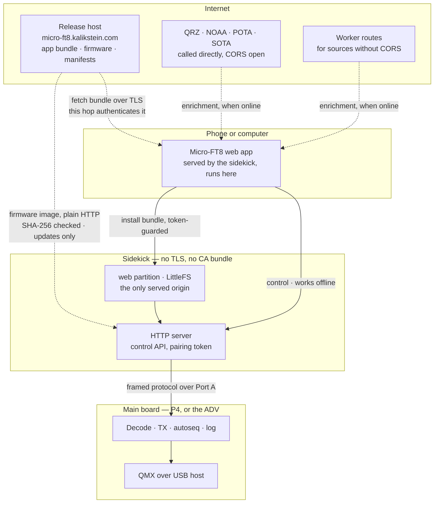

# System architecture: the phone is the UI, the sidekick is a peripheral

How the boards, the phone and the internet divide the work, and who may key the transmitter. Component detail, one doc per area: [sidekick.md](sidekick.md), [webapp.md](webapp.md), [radio.md](radio.md), [autoseq.md](autoseq.md), [decode.md](decode.md), [ft8_lib.md](ft8_lib.md), [main_board.md](main_board.md).

## The station

The daily station is headless: a **P4 main board** (decode, TX, autoseq, log, the radio over USB host), an **AtomS3 Lite sidekick** (WiFi, HTTP server, web root), and a **phone browser as the only UI**. The ADV (Cardputer) runs the same protocol and still has its own screen and keyboard; nothing here depends on them. Updates: [RFC 0007](../rfcs/0007-flash-and-update.md).

## Constraints

1. **Offline field operation is a requirement.** Summits have no cell service and no router, so the only path from phone to sidekick there is the sidekick's own access point. **The whole application runs over AP mode**; station mode (home WiFi, the phone's hotspot) is the convenience case. Nothing may treat AP mode as a transient setup state.
2. **Internet may be required for setup and for updates, never for operating.** This is what lets the firmware carry only a small bootstrap instead of the full UI (see [sidekick.md](sidekick.md), **Web root**), and why an update may require the sidekick to be on a network with internet.
3. **No dependency on a board's keyboard or screen.** The sidekick-to-main protocol is specified against the application (decode, transmit, autoseq, config, log), never against board hardware, so the ADV and the P4 present the same surface.

## The inversion: the browser is the internet device

The phone already has a cellular radio, a TLS stack, a trust store, a screen and a browser. The sidekick has none of those and would grow them at a cost in flash, maintenance and failure modes. So **third parties are reached by the phone, never by the device**, and **the sidekick never speaks TLS**.

**Firmware is the one thing the sidekick fetches itself** (decided 2026-09-25, [RFC 0007](../rfcs/0007-flash-and-update.md) §3.2; **not yet built: rows wanw, v697, hstv**). When the operator starts an update, the web app reads the release manifest over HTTPS, which authenticates it, and hands the sidekick the image's URL and SHA-256 behind the pairing token. The sidekick downloads the image from our own release host over **plain HTTP** and refuses it unless the hash matches, then installs its own image or passes a main board's image down Port A. This keeps the rules above intact: the release host is ours, not a third party; there is no TLS on the device; and trust still comes from the browser's HTTPS fetch, since tampering in transit can only make the download fail. The phone only makes a short request, so a locked screen does not interrupt an update, and a multi-megabyte image never passes through the browser. The cost: an update needs the sidekick on a network with internet (home WiFi or the phone's hotspot), and is refused in AP mode.

Dashed edges need internet; solid edges work without it. **Everything the station needs to operate is solid**, and keeping it that way is the property to defend. The one dashed edge into the sidekick is the firmware download, which serves updates only and is plain HTTP. Why the sidekick has no TLS, in either direction: [sidekick.md](sidekick.md), **Why the sidekick has no TLS**.

## Connectivity

* **The phone keeps its cellular route while joined to the sidekick's AP.** The AP is not a captive portal, so iOS treats it as WiFi without internet, sends internet traffic over cellular, and still reaches `micro-ft8.local`. Operator-validated on an iPhone 2026-09-23; Android is unchecked (`TEST_PLAN.md` Pending). Wherever there is cell signal, online features work on a summit.
* **The phone's own hotspot is the other route**: the sidekick joins it, and the phone has cellular internet on the same LAN. iPhone hotspots need *Maximize Compatibility* on, because the sidekick's radio is 2.4 GHz only.
* With no cell signal at all, the operator is offline on either route, and the offline-derived tier ([webapp.md](webapp.md), **Tools**) is what works.

## Who may key the transmitter

A headless radio driven by a local HTTP API means any device on the network could start a transmission, and the licensee answers for it. The control is **authorization, not authenticity**: nothing may change the device merely by being on the LAN.

* **A pairing token**, minted on the sidekick's first boot, stored in the sidekick's NVS and in the browser's `localStorage`. Every state-changing request carries it; requests without it are refused. It is a nuisance control scoped to accidents on a home LAN, not a targeted attacker. Nothing rotates it: re-provisioning keeps it, and only erasing the sidekick's NVS mints a new one. Code: `sidekick/main/pairing_token.h`, `pairing_http.h`.
* **Reads are open on principle.** Anyone may listen to amateur transmissions, and Part 97 forbids obscuring their meaning, so decodes, status and the log are open to anyone who can reach the device. What needs authorization is *changing* the device: transmit control, bundle install, firmware updates, the release-host URL, every config write (WiFi credentials included, in AP mode as in station mode), and the clock sync (a write, even though idempotent). This is the reason reads are open, not convenience, and it rules out a read-scoped token: a watch-only guest needs no credential.
* **The carve-out: a credential is not radio data.** A read that would return the WiFi password or the token stays guarded. That is why each route's policy is a required argument where it is registered rather than derived from the HTTP method: "GET is open" is silently wrong for the first route that returns a secret, and an undeclared route is a build error.
* **Retrieving the token is a button press.** The token must be readable on demand, not merely resettable: a new phone, cleared storage, or Safari evicting script-writable storage after seven days unused all lose it. The AtomS3's user button (GPIO41, active low) opens a **one-shot** disclosure window: the first successful read claims and closes it, and it times out after a couple of minutes otherwise. Every page loads `/pairing.js`, which polls for the window and stores the token. The token is not rotated on retrieval, which would log out every paired browser. Gating on the button, not on AP mode, is the point: AP mode is normal operation (constraint 1), so "disclosed only in AP mode" would be no gate at all.
* **One operator, many screens.** Every paired browser holds the same token and is an equal controller; the last command wins. That fits a single licensee. An update locks every browser out of transmitting ([RFC 0007](../rfcs/0007-flash-and-update.md) §3.5). Reopen if a second operator ever shares a station.
* **Honest limit.** The token travels in clear over plain HTTP, so anyone who can read the traffic can replay it. WPA2/WPA3 per-station encryption makes that materially harder; an open network does not, and the sidekick's own AP is open, so in the field the token crosses the air in clear. Raising the bar would need a certificate for a name that resolves on one LAN, which the design declines ([webapp.md](webapp.md), **A non-secure origin**).

### Why not signing

Signed images, verified against a key pinned in firmware, were rejected 2026-09-12:

* **The source is already authenticated one hop earlier**: the browser's HTTPS fetch from the release host. A signature would re-prove what TLS proved.
* **Every inbound path passes through the operator's own browser**, or, for the sidekick's firmware download, is checked against a hash that did.
* **A CI-held key shares the host's trust domain.** Anyone who can push a workflow can use the secret, so whoever can serve a malicious bundle can sign it. An independent key means offline custody and a manual signing step on every release.
* **The cost is permanent**: a pinned key with no revocation path is a liability for the life of every device.

Kept, and easy to mistake for signing: a **SHA-256 per asset** (catches a corrupted upload, not an adversary) and **version pairing** (skew, not trust). Physical possession remains the trust anchor: first install and recovery are over USB.

**Reopen** when content can reach a device by a path that is not the owner's TLS-authenticated browser: built sidekicks distributed to other operators, or an unattended update path.

## Third-party services

* **Called directly from the browser when the source sends CORS.** QRZ's XML API sends `Access-Control-Allow-Origin: *` (measured 2026-09-10), so each operator's QRZ credentials go from their own browser to QRZ and never touch our infrastructure, which is right for terms of service, privacy and liability. The same holds for NOAA SWPC, POTA and SOTA ([webapp.md](webapp.md), **Tools**).
* **A Worker route only when a source has no CORS**, and it **filters rather than relays**: it re-serves the small subset the app needs as JSON, because a phone on cellular must not pay for a full upstream payload (one PSKReporter query returned 1.25 MB of XML). Routes live in `webapp/worker.js`.
* **CORS headers are observed behaviour, not policy.** Any of them can disappear without notice, so a refused request is a missing optional service, shown as such, never a fatal error. Re-check a source with `curl -sS -D - -o /dev/null -H 'Origin: http://micro-ft8.local' <url> | grep -i access-control`.

## Why not

* **Why a browser, not BLE or a native app.** iOS Safari has no Web Bluetooth, an Apple-wide platform limit, so a companion that needs no install on both iPhone and Android cannot use BLE at all. A page the sidekick serves works on any phone with no app store, no review, and one codebase. Decided 2026-09-05. Reopen only if a native-app phase is opened on purpose.
* **Local network only.** Reaching the station from the internet (port forwarding, dynamic DNS, a cloud tunnel) is out of scope, decided 2026-09-05. A licensed station's control surface is not internet-reachable by default, and the project takes on none of that exposure. An operator who wants remote access sets up their own VPN.
* **Why the sidekick cannot be the main board.** The main board must be a USB host to the radio. An AtomS3 Lite bench-tested as a QMX host (2026-09-05) never changed the radio's frequency, even with its own 5 V supplied over Grove: its USB-C is device mode only. The lesson is **bench-test USB host on the specific board** before relying on it, not trust a vendor description or a chip family. The P4 was first accepted on another project's production use of the same chip, then proven on our own board in daily use ([main_board.md](main_board.md), **P4**).
