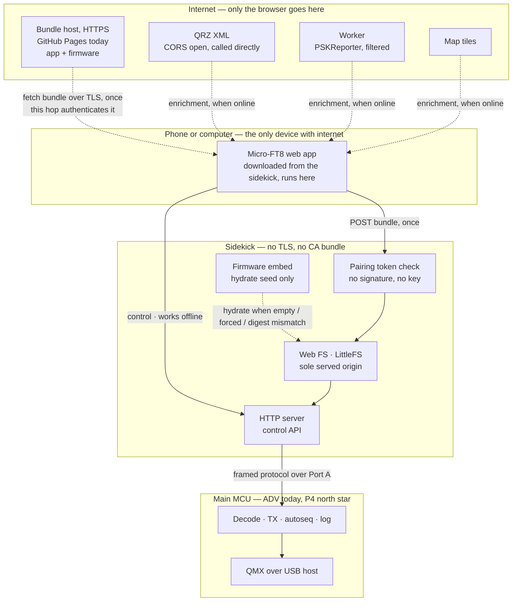
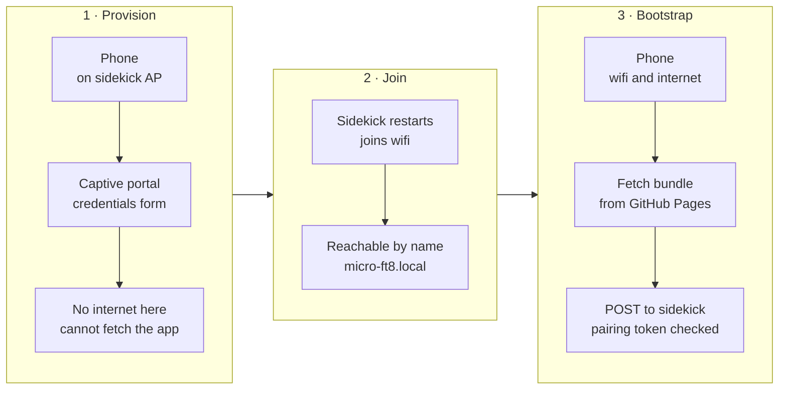
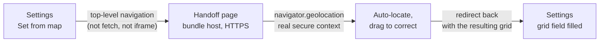

# RFC 0004: Headless Micro-FT8 — the phone is the UI, the sidekick is a peripheral

* **Status:** Draft. Design agreed in chat 2026-09-10; I28a protocol and I28b pairing are in tree (field proof still owed). **Storage model amended 2026-09-13** (§3/§4): the web root is a LittleFS partition, hydrated from firmware embed, not an empty blob filled only by POST. Supersedes nothing; extends [RFC 0001](0001-ble-companion.md) §5.0/§5.2d, which established WiFi-plus-browser as the phone path and moved sidekick updates from a PORTA push to an HTTPS pull. **§11 extended 2026-09-14** (Log's day-file model and third-party sync, a shared offline/online info-expand pattern, and the phone-grid map handoff) — a wireframe design pass ahead of the next I28d slice, same day as the screen-model lock. **§12 added 2026-09-21** (the Tools destination and the test that keeps it one, the per-card offline/online tier rule, and a vector basemap as an amendment to §11's tile ban rather than a reopening of it) — gates [I34–I37](../ROADMAP.md) and the rescoped [I30](../ROADMAP.md).
* **Author / Lead:** Jeff Kalikstein, KB2SLO
* **Covers:** where the web application lives, how it is delivered and trusted, how the browser reaches the radio, and what crosses the sidekick-to-main link.
* **Does not cover:** the ESP32-P4 port itself ([I27](../ROADMAP.md), gated on B26), the decode pipeline, or anything about the ADV's existing screen and keyboard — which this design must not depend on and does not remove.
* **Ask:** do not start the web application before the sidekick-to-main protocol exists. The app is the visible half; the protocol is the half that makes it possible.

---

## 1. Why

Micro-FT8's UI is a 240-pixel screen and a thumb keyboard. The north star ([I27](../ROADMAP.md)) is a
headless two-MCU radio with no screen and no keyboard at all, where a phone is the only interface. That is
not a skin over the current UI — it means every operator-reachable function has to leave the device and
arrive in a browser, and the transport that carries it has to be designed rather than grown.

Three constraints were settled before any of this was drawn, and they decide most of what follows:

1. **Offline field operation is a requirement.** POTA sites and summits routinely have no cell service. A
   radio whose UI lives on the internet is a radio with no UI on a summit. **Followed to its conclusion
   2026-09-12, which this RFC had not done: a summit has no router either.** The only path from phone to
   sidekick there is the sidekick's own access point, so this constraint does not merely require surviving
   without internet — it requires **the whole application to run over AP mode**. §5 and
   [I19](../ROADMAP.md) each call that "the AP-mode fallback", which is backwards: station mode is the
   convenience case, and AP mode is the one this first constraint names. Nothing in this design may assume AP
   mode is a transient setup state. [B55](../ROADMAP.md) carries the investigation and the list of ways that
   assumption could get baked in before anyone notices.
2. **Internet may be required for initial station setup.** Not for operating. This is what makes the design
   affordable — the firmware does not need to carry a full UI as a fallback.
3. **No dependency on the ADV's keyboard or screen.** A build that works on P4 must also work on ADV, so the
   protocol is specified against the application, not the board.

## 2. The inversion this rests on

**The browser is the internet-connected device; the sidekick is a local peripheral.**

That is the whole idea, and everything good here follows from it. The phone already has a cellular radio, a
TLS stack, a trust store, a screen, and a browser. The sidekick has none of those and would have to grow
them at a cost measured in flash, maintenance, and failure modes. So it does not: **third-party services are
reached by the phone, never by the device.** QRZ, PSKReporter and map tiles are the browser's problem.

Taken to its conclusion, the sidekick never speaks TLS **at all** — see §4.



Dashed edges require internet. Solid edges work without it. **Every edge below the phone is solid**, and
keeping it that way is the property to defend as this grows: the moment the sidekick needs one HTTPS call,
the TLS stack, the CA bundle and its expiry come back.

## 3. Where the application lives

**The sidekick serves the whole application; it is not bundled into firmware.**

Both halves of that matter and they were argued separately.

**Served by the sidekick, not loaded from the internet**, because of constraint 1. A page served from
`https://kb2slo.kalikstein.com` *cannot* reach `http://micro-ft8.local` — browsers block active mixed content
with no exception for private addresses, so an internet-hosted app cannot talk to the device at all. The
inverse works: an HTTP page may load HTTPS subresources. But an app that fetches itself from the internet
each session is an app that does not exist on a summit. Serving it locally also makes the whole question
moot, since the app and the API are then same-origin.

The cost is that the page is a **non-secure context**. We lose service workers, the geolocation API, and
Web Serial/Bluetooth. `localStorage` and `fetch` to HTTPS survive. Losing geolocation is the one that stings
— auto-grid from the phone would have been nice — and it is the price of not owning a certificate for a name
that only resolves on one LAN.

**Not the weekly UI inside the OTA image**, because that app should ship on its own cadence and firmware
flash is the wrong vehicle for it. The **served web root** is a LittleFS data partition (`web`) at the
1.9 MB free tail of the 8 MB part, above `ota_1`, leaving both OTA slots and `nvs` untouched. That
filesystem is the **sole HTTP origin** for HTML/JS/CSS once the device is running: what you can list on
the FS is what the device serves — one place to debug.

**Firmware still carries the bootstrap pages** under `sidekick/main/web/` via `EMBED_TXTFILES`, but as a
**hydrate seed**, not as a live second backend. On boot (and on an explicit recovery gesture), if the FS
is empty, unmountable after format, or its seed digest does not match the embed, firmware copies those
bytes onto the FS. After that, HTTP reads the FS only. A phone-relayed **bundle may upgrade the whole
tree**, including pages that began as seed — one mutable web root, not a permanent quarantine under
`/app/` that leaves provision frozen in firmware forever.

Bundle install is **stage → verify manifest digests → atomic promote**, never “erase the partition and
hope.” Present-but-broken files after a bad POST do not look “missing,” so hydrate-on-empty alone will
not heal them: recovery is force re-hydrate from embed (or USB-C reflash). Random NOR bit-rot is not the
concern; sharing a write path with the only UI is, and staging plus force re-hydrate bound it.

Assets in the downloaded app are stored pre-compressed and served with `Content-Encoding: gzip`; a
disciplined app is 100–300 KB gzipped, so the budget is comfortable but not unlimited. **No bundled map
tiles. No heavyweight framework.**

The consequence, accepted deliberately: **a sidekick that has never had internet has no rich application**
— only the hydrated seed (provision, status, pairing, bootstrap fetch page). It can join WiFi and accept
a bundle, and that is all. Constraint 2 is what makes this acceptable.

## 4. How the application and firmware are delivered

**The phone relays, and the browser's own TLS connection is what proves the source.**

1. Phone opens `http://micro-ft8.local/` — after hydrate, the sidekick serves the bootstrap page **from the
   web FS** (seeded from firmware embed on first boot or recovery).
2. That page fetches the bundle from the bundle host over HTTPS (HTTP page, HTTPS fetch: allowed, and the
   host must send `Access-Control-Allow-Origin` — see the host requirements below).
3. The page **POSTs the bundle to the sidekick**, which checks §7's pairing token, stages the tree, checks
   the manifest's per-asset digests, then atomically promotes onto the web FS (and may replace former seed
   pages).
4. Firmware travels the same path to an OTA endpoint.

This is the conclusion of §2 and it deletes an entire class of work: **no TLS stack on the device, no CA
bundle to maintain as roots rotate, no certificate expiry, no clock dependency for certificate validity.**
Measured earlier: TLS costs ~116 KB of flash on this target. It also resolves two of the three decisions
[RFC 0001](0001-ble-companion.md) §5.2d left open — CA maintenance stops existing, and the choice between
embedding the full app or a bootstrap resolves to *bootstrap*.

**Signing is rejected, decided 2026-09-12.** This section previously required signed images verified against
a public key pinned in firmware, on the reasoning that TLS authenticated the *source* and a plain POST on a
LAN authenticates nothing. The first half is right and the conclusion does not follow. Recorded here with the
argument, not merely deleted, because "add signing" is the reflexive answer and this needs to stay rejected on
purpose:

* **The source is already authenticated, one hop earlier.** Step 2 is an HTTPS fetch the browser validates
  against the public CA system. By the time the bytes reach step 3 they have been proven to come from the
  bundle host untampered. A signature would re-prove what TLS just proved.
* **Every inbound path passes through the operator's own browser.** §2's conclusion is that the device never
  speaks TLS, so it never fetches anything itself — bundle and firmware both arrive by relay. There is no
  route where a signature is the *only* available proof of origin, which is the situation that would justify
  one.
* **The key would share a trust domain with the host, so it would prove nothing extra.** CI signing means the
  private key lives in a GitHub Actions secret. Secrets are not readable in the UI, but any workflow can use
  one and anyone who can push a workflow can exfiltrate it — so the key's security boundary is the GitHub
  account's boundary, which is the same boundary already protecting the host. Whoever can serve a malicious
  bundle can sign it. Making the signature independent would mean an offline key and a manual signing step on
  every app release, buying defence against a GitHub account compromise alone.
* **The cost is permanent and one-way.** A pinned key with no revocation path is a liability for the life of
  every device, which §10 already admitted. Paying it for a duplicate of TLS is a bad trade.

**What the device actually needs is authorization, not authenticity**, and it is a different problem than the
one signing was aimed at: nothing must be able to write the web FS or key the transmitter merely by
being on the LAN. §7's pairing token is that control, and it is cheap — no key custody, no revocation, no CI
signing step. It is therefore built **before** the POST endpoint exists rather than two slices later.

Two things are kept that are easy to mistake for signing. The manifest carries a **SHA-256 per asset**, which
catches a truncated or garbled upload over flaky WiFi — integrity against corruption, not against an
adversary, since whoever supplies the bundle supplies the manifest too. And **version pairing** below is
about skew, not trust. The sidekick's existing `CONFIG_BOOTLOADER_APP_ROLLBACK_ENABLE` already covers an
image that boots but cannot talk, and first install and recovery need physical USB-C through the ADV — so
physical possession remains the real trust anchor, as it already was.

**This is a pre-alpha decision with a stated trigger for revisiting.** It rests on there being one operator
relaying to their own device. Signing earns its cost when content can reach a device by a path that is *not*
the owner's TLS-authenticated browser — distributing built sidekicks to other operators, or an unattended
update path. Reopen it then, with this argument in hand.

### Host requirements, and why CORS is on the critical path

**The design depends on two properties of the bundle host, not on who the host is.** Any static host with
both works; GitHub Pages is the implementation, not the architecture.

1. **HTTPS with a publicly-trusted certificate.** This is the only thing authenticating the bundle, per the
   signing decision above, so it is load-bearing rather than hygiene.
2. **An `Access-Control-Allow-Origin` that lets a plain-HTTP origin read the response.**

**Why the second one matters at all is worth stating, because it looks like a security concern and is not.**
CORS here is a *capability* question. The bootstrap page is an origin (`http://micro-ft8.local`) fetching from
a different origin (the bundle host), so the browser will issue the request but withhold the response body
from our own script unless the host opts in. Nothing is being defended; the browser is simply refusing to let
us read bytes we need to read. And we need to read them because the browser is the courier: mixed content
forbids an HTTPS page from reaching `http://micro-ft8.local` (§3), so the app must be served locally, so it
must first be carried onto the device, and a courier has to be able to read the parcel. Were the sidekick
willing to speak TLS it would fetch the bundle itself and CORS would never arise — that is the ~116 KB and
the CA bundle §2 declined. Cross-origin `` and `<script>` loads need no CORS but yield rendering or
execution, never bytes to re-POST.

Since it is a precondition nobody here controls, it was measured rather than assumed — the same discipline
§8 applied to QRZ, where the answer inverted the assumption. Measured 2026-09-12 with
`Origin: http://micro-ft8.local`:

| Host | `Access-Control-Allow-Origin` | Readable by browser JS |
| --- | --- | --- |
| Pages, `github.io` subdomain | `*` | Yes |
| Pages, custom domain | `*` | Yes |
| Pages, binary asset | `*` | Yes |
| Pages, preflight `OPTIONS` | — (HTTP 405) | Simple requests only |
| GitHub Releases asset | absent | **No** |
| Cloudflare Workers Static Assets, default | absent | **No** — measured 2026-09-15 after the move off GitHub Pages; broke `/update` install with a generic browser fetch failure until fixed |
| Cloudflare Workers Static Assets, `worker.js` alone | absent, on real asset hits | **No, and misleading** — a matching static file (or its own clean-URL redirect, e.g. `app.html` -> `/app/app`) is served directly by Cloudflare's asset router by default, bypassing `worker.js` entirely; only a path with no matching asset (a genuine 404) ever reached the fetch handler, so it looked fixed against a nonexistent-path test and wasn't |
| Cloudflare Workers Static Assets, `worker.js` + `assets.run_worker_first: true` | `*` | Yes, confirmed on manifest, redirect, and final destination |

Observed behaviour, not documented policy — the same caveat §8 carries for QRZ. Re-check any row with:

```bash
curl -sS -D - -o /dev/null -H 'Origin: http://micro-ft8.local' <url> | grep -i access-control
```

`pages.github.com` is the custom-domain row and `microsoft.github.io` the subdomain row — neither is ours,
because Pages is not yet enabled on this repo; they measure the *platform*, which is the thing being decided.
Two constraints follow, and both are free to adopt now and irritating to retrofit:

* **The bundle fetch must stay a *simple* request**: `GET`, no custom request headers. Pages answers a
  preflight with 405, so anything that triggers one fails. API version and the like belong in the manifest
  body or the URL path, never a request header. This does not touch §7's pairing token, which guards the
  sidekick's own same-origin API.
* **Manifest URLs stay relative to the manifest's own location.** A project-repo Pages site serves under
  `/Micro-FT8/` while a custom domain serves at the root, so absolute paths would break on any move.
* **The bundle host base URL is stored in NVS, not compiled in**, with a build-time default — set alongside
  the WiFi credentials at provisioning. This is what makes host-independence real instead of aspirational: a
  provider swap becomes a config change rather than a reflash of every device. It is a **token-guarded
  write** like any other config (§7), because a settable bundle host is otherwise the most attractive thing
  on the device for a LAN attacker to repoint.

**Host-independence has one rider: the CORS header is per-provider and must be measured, not assumed.** A
provider that fails requirement 2 breaks the relay outright — the browser fetches and the script cannot read
— so the `curl` above is the gate on adopting any new host, including our own. Note the two hostnames that
are easy to conflate: `micro-ft8.local` is the *sidekick's own* mDNS name and stays in firmware; the bundle
host is the separate, NVS-stored one.

**`kb2slo.kalikstein.com` is a later step and costs nothing to defer.** CNAMEd onto the same Pages deployment
it is a DNS record, a `CNAME` file and GitHub's own certificate. The measurement survives the move because
the custom-domain row above *is* a custom domain on Pages; only the NVS base URL changes.

**Releases cannot be reused, which is why this is new infrastructure rather than a reuse.** CI already
publishes firmware as a GitHub Release asset (`continuous`), and that path sends no
`Access-Control-Allow-Origin` at all — so it is unreachable from browser JS and cannot carry the bundle.
Recorded because it is the obvious shortcut and it does not work.

**Version pairing.** Keeping the app out of firmware brings back the skew problem that bundling would have
solved: a downloaded app can outrank the API of the firmware serving it. The manifest therefore pairs them —
each bundle declares the minimum sidekick API version it needs — and the sidekick **refuses a bundle it
cannot serve**, saying so plainly rather than accepting it and failing later. Cheap to design in, nasty to
discover in a field.

**Manifest JSON (concrete).** Constrained shape, no unknown fields, no string escapes. Digests are exactly
64 lowercase hex digits. Paths are relative under the web root (no leading `/`, no `..`, no dotfiles).
Device constant `WEB_API_VERSION` starts at `1`.

```json
{
  "api_min": 1,
  "assets": [
    {
      "path": "app/index.html",
      "sha256": "e3b0c44298fc1c149afbf4c8996fb92427ae41e4649b934ca495991b7852b855",
      "size": 0
    }
  ]
}
```

**Install wire protocol (concrete).** One logical “POST the bundle” is three token-guarded steps so a
truncated upload cannot promote, and so begin can refuse an incompatible `api_min` before any bytes hit the
live tree:

1. `POST /api/bundle/begin` — body = manifest JSON above. Parses, checks `api_min <= WEB_API_VERSION`,
   wipes `/web/.staging`, remembers the manifest.
2. `PUT /api/bundle/file?path=<relpath>` — raw body; `Content-Length` must equal the manifest `size`;
   SHA-256 of the body must equal the manifest digest. Path must be listed in the open begin.
3. `POST /api/bundle/commit` — every asset must be staged; re-hash from disk; rename each onto `/web/`;
   wipe staging. Partial promote failure leaves staging for retry and may leave a mixed live tree —
   force re-hydrate recovers seed pages.

All three are `PAIRING_REQUIRED` (§7). Seed page `/update` drives this sequence after the HTTPS fetch
from the bundle host.

**Hosted site layout (same repo, `webapp/`).** A Cloudflare Worker (Static Assets, `webapp/wrangler.jsonc`) publishes the `webapp/` tree at a custom domain (moved off GitHub Pages 2026-09-15 -- the repo is private and GitHub Pages on a private repo needs a paid plan; the operator already runs their domain's DNS through Cloudflare. Classic Cloudflare Pages was the first choice but Cloudflare now steers new deploys to Workers Static Assets instead):

| URL | Audience |
| --- | --- |
| `https://micro-ft8.kalikstein.com/` | Humans — landing / about |
| `https://micro-ft8.kalikstein.com/app/` | Machines — `manifest.json` + assets |

NVS (and the compile-time default) stores the **app** base with no trailing slash:
`https://micro-ft8.kalikstein.com/app`. Soft identity: a product rename changes that default string (and
optionally one NVS write), not the install protocol. Device day-to-day UI remains `http://micro-ft8.local/`.
Seed page `/update` fetches `{base}/manifest.json` and drives the wire protocol above.

## 5. Provisioning and first run



The phone cannot fetch a bundle while joined to the provisioning AP, because a captive portal generally takes
the default route and leaves the phone with no internet. As drawn, bootstrap therefore needs a network that
has internet.

**The phone's own hotspot resolves this, and it is a documentation answer before it is an engineering one.**
If the sidekick joins the operator's Personal Hotspot, the phone has cellular internet *and* is on the same
LAN as the sidekick — stages 1 and 3 collapse, a factory sidekick can be set up on a summit, and QRZ lookups
work in the field. The existing constraint applies: iPhone hotspots need *Maximize Compatibility* on, because
this radio is 2.4 GHz only.

[I19](../ROADMAP.md) — an AP whose DHCP omits the router and DNS options so the phone keeps its cellular
route — remains the answer for the AP-mode fallback where there is no cell signal at all. It is no longer on
the critical path, because in that situation the operator is offline regardless.

## 6. The sidekick-to-main protocol

**This is the critical path and the least designed part of the system.** Port A carries a version beacon
today. Everything the application needs crosses that link: decodes at slot cadence, TX control, configuration
read and write, and log access.

Requirements:

* **Framed messages over a byte pipe**, with framing that does not assume a stream. This is what keeps the
  transport swappable — see [B47](../ROADMAP.md), which defers the UART-versus-I2C choice deliberately. The
  application, the control API and this document must not depend on which wins.
* **Board-agnostic.** Specified against the application — decode, transmit, autoseq, config, log — never
  against board hardware, so an ADV build and a P4 build present the same surface.
* **Versioned**, for the same reason §4 pairs app and API.
* **Coexists with what is already on the bus.** ~~`main/porta.cpp` currently arbitrates Port A between a GPS
  and the companion via `PortaRole`~~ — **corrected 2026-09-14, checked against code rather than assumed
  while wiring I28d's dispatch layer:** `PortaRole` no longer exists. Grove GPS moved to the GNSS/LoRa cap's
  own receiver, and `main/porta.h`'s own comment says the port now has exactly one occupant and needs "no
  arbitration, no role, and no baud probe." This requirement is therefore already satisfied trivially — kept
  as a bullet because [B11](../ROADMAP.md) (QMX+ AUX GPS into ADV Grove, Backlog, not built) would reopen it
  if it ever lands; that row already marks itself exclusive with the companion UART for exactly this reason.

Direction and latency are asymmetric in a way that shapes the design: commands are infrequent and want low
latency; decodes are periodic on a 15-second boundary and tolerate hundreds of milliseconds. A full slot of
decodes is roughly 3 KB, so sustained throughput is a couple of hundred bytes per second.

**Open, to be settled before implementation:** whether the browser-facing channel is polling, SSE, or a
WebSocket. Decodes are a one-way stream and commands are infrequent, so SSE plus POST is simpler and degrades
better on flaky WiFi than a WebSocket — but this deserves its own argument, not a default.

**CONFIG (I28d, 2026-09-14).** `CONFIG_GET` / `CONFIG_SET` / `CONFIG_VALUE` carry
`key_len` + key + value bytes. Empty key on GET means the whole Station.txt surface; SET/VALUE require a
key. ACK/NAK for SET and end-of-GET-all reuse `PORTA_MSG_ACK`/`NAK` with verb = the CONFIG message type.
HTTP: open `GET /api/config` (JSON object), token-guarded `PUT /api/config` (Station.txt lines). Entry app
asset is `app.html`. GET-all also includes live keys (`streaming`, `cat_ready`, `tune`, `band_name`,
`freq_khz`) that `station_key_known` refuses on SET. Band-ish CONFIG_SET pushes CAT via
`sync_radio_to_current_band` (headless has no STATUS exit).

**CONNECT / TUNE (I28d, 2026-09-14).** ACTION verbs `PORTA_ACT_CONNECT` (0x04, verb-only) and
`PORTA_ACT_TUNE` (0x05, `u8 on`) mirror STATUS keys 2 and 4. HTTP: token-guarded
`POST /api/radio/connect` and `POST /api/radio/tune` (body `0`/`1`).

**The remaining verbs are driven by the screens, not chosen here.** §11 fixes the screen model first and
derives what it needs of this link — a structured status event, decode identity for tap-to-queue, beacon
parity, and queue cancel by entry.

## 7. Who may key the transmitter

A headless radio driven by an unauthenticated local HTTP API means **any device on the network can start a
transmission**, and the licensee is answerable for it. **This section is now the whole of the security
design**, since §4 rejected signing on the grounds that authenticity already arrives with the browser's TLS
and what is actually missing is authorization on the LAN.

**Decided: a pairing token, minted during provisioning and held by the browser.** Every control request
carries it; requests without it are refused. This is the cheap version and it is proportionate — the threat is
an accident or a nuisance on a home LAN, not a targeted attacker, and the operator can re-provision to rotate
it.

**Reads are open on principle, decided 2026-09-12, not as a concession to convenience.** Anyone may listen to
amateur transmissions on licensed spectrum, and Part 97 forbids obscuring the meaning of a transmission in the
first place — so there is nothing in a decode to protect, and a design that hid one would be at odds with the
service it serves. That principle carries onto the LAN: decodes, status and the log are open to anyone who can
reach the device. What needs authorization is *changing* the device, because that is what the licensee answers
for.

This replaces an earlier and weaker justification — that reads stay open "so a second device can watch without
being able to transmit." Same behaviour, but the reason matters, because the weak version invites a future
change to trade it away for tidiness. It also retires the idea of a second read-scoped token: a watch-only
guest needs no credential at all.

**The line, and the one place the principle does not reach.** Guarded: transmit control, the bundle POST, the
firmware OTA POST, the bundle-host base URL and every other config write, and anything else that changes
device state — including the browser clock sync, which is a write even though an idempotent and self-correcting
one. Open: decodes, status, the log viewer, and the bootstrap pages that provisioning needs before a token
exists. **The carve-out is that a credential is not radio data** — a read that would hand back the WiFi
password or this token stays guarded.

That carve-out is why policy is a required argument at each route's registration rather than a rule derived
from the HTTP method. "GET is open" would be right for every route that exists today and silently wrong for
the first one that returns a secret, and a method rule offers nowhere to say so. Requiring the argument makes
an undeclared route a build error instead of an omission.

**Retrieval, decided 2026-09-12, and it is not the same problem as recovery.** The token lives in the
browser's `localStorage`, and the cases where the operator needs it again are ordinary rather than
catastrophic: a second device, a new phone, cleared browsing data, or Safari's ITP evicting script-writable
storage for a site untouched for seven days — which means a sidekick used monthly can lose it with no user
action at all. So the requirement is that the token be **readable on demand**, not merely resettable.

**The mechanism is the AtomS3 Lite's user button opening a short disclosure window** — press it and a
route serves the token. The window is **one-shot**: the first successful GET claims it and closes it, so a
completed re-auth does not leave the secret readable for the rest of a timer; if nobody claims it, it still
times out after a couple of minutes. GPIO41, plain input with the board's own pull-up, active low, read
straight out of the `M5Unified` this repo already vendors, so no pin is being guessed. Every page loads a
shared `/pairing.js` that polls for that claim and stores the token in `localStorage` — the operator presses
the button; they do not copy JSON or answer a `prompt()`. One gesture is enough for everything: with the
token in hand the operator can call the guarded `/forget` to change networks, which removes any need for a
button long-press, a boot-count trigger or an NVS reset path. The long-lived NVS token is **not** rotated on
retrieval: that would log out every already-paired browser. What stops after re-auth is further disclosure,
not the credential itself.

**Gating disclosure on the button rather than on AP mode is the point, not an implementation detail.**
Gating it on AP mode was the obvious design and §1 rules it out: if the application runs over AP mode, then
"disclosed only in AP mode" means disclosed during normal operation, which is no gate at all. A button press
is physical in both modes and stays correct whichever one turns out to be primary. It is also less
disruptive — the operator never has to leave their network to pair a second device.

**Its honest limit, recorded so it is not mistaken for a defect later.** The token travels in clear over
plain HTTP, so it can be captured and replayed by anyone who can read the traffic. On a WPA2/WPA3 network
per-station encryption makes that materially harder; on an open network it does not. That is consistent with
the threat this is scoped to and it is the reason the scope is written down: a nuisance control, not a
targeted-attacker control. Raising that bar would mean a certificate for a name that resolves on one LAN,
which §3 declined for its own reasons.

**Not decided:** what happens when two paired browsers both try to transmit. A single-writer model is the
likely answer, but multi-client behaviour is unspecified and should not be discovered in the field.

## 8. Third-party services

**Measured 2026-09-10, and the result was the opposite of the assumption.** Both are built for server-side
consumers and predate CORS by a wide margin, so both were expected to block browsers:

| Service | `Access-Control-Allow-Origin` | Reachable from browser JS |
| --- | --- | --- |
| QRZ XML (`xmldata.qrz.com/xml/current/`) | `*`, and a preflight `OPTIONS` returns `Access-Control-Allow-Headers: *` | **Yes, directly** |
| PSKReporter (`retrieve.pskreporter.info/query` and `cgi-bin/pskquery5.pl`) | absent from both | **No** |

**QRZ is called directly from the browser, and this is better than the proxy it replaces.** The concern was
that QRZ's XML interface requires a subscriber login, so a proxy holding *the author's* credentials would put
every user of this application on one subscription — a terms-of-service problem the moment a second person
runs it. Direct calls remove the problem rather than working around it: each operator's credentials travel
from their own browser to QRZ and never touch our infrastructure, which is also the right answer for privacy
and for liability.

**Caveat, and it belongs in the design rather than a footnote:** that header is *observed behaviour on
2026-09-10*, not documented policy. QRZ can drop it without notice, and if they do, this breaks silently in
the field with no signal on our side. The application must fail legibly when a QRZ lookup is refused by CORS
— treat it as a missing optional service, never as a fatal error — and the proxy below is the fallback if the
header ever goes away.

**PSKReporter needs a Cloudflare Worker**, free tier, 100k requests/day. Two things about it worth fixing in
the design now:

* It **carries no secrets**. PSKReporter needs no credentials, so the Worker is a pure CORS shim and there is
  nothing in it to leak or rotate. That is a materially smaller thing to operate than what §8 originally
  proposed.
* It must **filter, not relay**. One measured query — a single callsign over one hour — returned **1.25 MB of
  XML**. Passing that to a phone on cellular for every refresh is not acceptable, so the Worker parses and
  re-serves the subset the application needs as JSON. This is now the main reason it exists; CORS is the
  lesser half.

Google Maps is a browser API by design and needs no proxy. Its key ships in a static app and must therefore
be referrer-restricted.

## 9. What this becomes

Roadmap rows, sequenced. The protocol gates everything else.

| Row | Scope |
| --- | ----- |
| Protocol | Framed, bidirectional, transport-agnostic messages across Port A (§6). **First.** |
| Transport trial | [B47](../ROADMAP.md) — bench-prove ESP32-S3 as an I2C slave, and bus recovery after a live cable yank. Parallel; must not block. |
| Control API + pairing | The API surface and the token (§6, §7). **Before the partition row**, because the token is what keeps the bundle POST from being an open write into a partition the device then serves code from. §4's signing chain used to hold this slot and is now rejected outright. |
| Web FS + bootstrap | LittleFS at the 1.9 MB tail; hydrate from firmware embed; FS is the sole served origin; token-guarded phone-relayed POST with stage/verify/promote; force re-hydrate recovery; per-asset digests; NVS bundle-host URL; version pairing (§3, §4). |
| The application | The web app, plus a PSKReporter Worker that filters rather than relays. QRZ is called directly from the browser (§8). Screen model, and what it requires of the protocol: §11. |

## 10. Risks

| Risk | Bounding |
| --- | --- |
| The protocol is underestimated | It is treated as the critical path here, ahead of the visible work. If it slips, the application slips with it, and that is the correct order. |
| Non-secure context bites harder than expected | Geolocation and service workers are known losses (§3). A surprise beyond those would reopen the certificate question, which is why §3 records why it was declined rather than merely that it was. |
| App outgrows the partition | 1.9 MB against 100–300 KB gzipped is roughly 6x headroom, and the discipline is stated: no bundled tiles, no heavy framework. If it is ever breached, the fix is a partition change, which costs a USB-C reflash of every device in existence. |
| Bad bundle leaves present-but-broken pages | Staging + manifest verify before promote. Force re-hydrate from firmware embed restores the seed tree without a desk computer; USB-C remains the hard floor. |
| A LAN device writes the web FS or keys the transmitter | §7's token, built before the POST endpoint exists. The residual is a replay by someone who can read plain-HTTP traffic on the same network, which §7 records as a known limit rather than a defect — it is scoped to nuisance, not to a targeted attacker. |
| No independent proof of source | Accepted deliberately (§4). Authenticity rests entirely on the browser's TLS session to the bundle host, so a compromised operator browser, or a compromised host account, can deliver a hostile app. Signing was examined and rejected because a CI-held key shares the host's trust domain and re-proves what TLS proved. The trigger to reopen is content reaching a device by any path that is not the owner's own browser. |
| The bundle host drops its CORS header | Would break the relay outright and silently (§4). Observed behaviour, not policy, same as QRZ in §8. Bounded by host-independence: the base URL lives in NVS, so moving to a provider that cooperates is a config change. |
| QRZ stops sending its CORS header | Measured open on 2026-09-10, but that is observation, not policy (§8). The application treats a refused QRZ lookup as a missing optional service, and the PSKReporter Worker is the fallback path if it has to carry QRZ too. |
| Two browsers, one transmitter | Named and unresolved (§7). |

## 11. The application's screens

**Decided 2026-09-14, after surveying WSJT-X, FT8CN, iFTx and the standalone touchscreen builds
(DX-FT8 / Pocket FT8 / sBitx). The survey's result was not the one expected.** A phone FT8 UI has four
questions to settle — how the TX offset is chosen, how calling and answering are sequenced, how a QSO in
progress is represented, and how the screens divide. **Micro-FT8's existing paradigm already answers the
first three, and answers them better than the reference apps do**, leaving only the fourth genuinely
open. So this section is mostly a record of what *not* to import. It
sits next to §6 in spirit rather than in numbering — the screens decide the verbs, which is why the
design pass ran before I28d's autoseq slice rather than after it.

Appended rather than inserted because §3, §4, §6 and §7 are cited from code comments, `partitions.csv`,
host tests and the roadmap; renumbering would churn all of them for a section ordering.

### No waterfall, because `offset_src` already replaced its job

In all three reference applications the waterfall's primary *control* role is picking the TX audio
offset: shift-click in WSJT-X, tap the waterfall in FT8CN, tap to set TX in iFTx. Micro-FT8 does not ask
the operator that question at all — `resolve_tx_offset()` takes Random (fresh roll in 500–2500 Hz per
transmission), RX (answer on the caller's own offset, except for CQ) or Fixed.

**Random is better than tapping a gap, not a cheap substitute for it.** A tapped gap was clear when the
slot was decoded, which is up to fifteen seconds stale, and every operator looking at the same waterfall
taps the same visible gaps. Re-rolling per transmission decorrelates our offset from both, costs no
screen area, and needs no interaction on a phone — where fat-finger frequency picking is worst. It is
also why we do not inherit FT8CN's landscape requirement, whose own reviewer wanted an 8-inch tablet
largely to fit waterfall beside decodes.

Constraint and preference happen to agree here: §6 budgets a couple of hundred bytes per second, and
spectrum data for a waterfall is a different order of magnitude, so it could not be afforded even if it
were wanted.

What we give up is the visual "how busy is the band" read. If that is ever missed, the cheap answer is
occupancy derived from the offsets decode events already carry, shown numerically — not a spectrum.
**Reopen if** field operation shows repeated collisions that per-TX re-rolling does not avoid.

### Not a mode machine, because beacon plus the priority queue already sequences

iFTx exposes Listen / Reply / Call / Exchange as a segmented control, and WSJT-X splits Band Activity
from Rx Frequency into two panes. Both exist to answer "am I calling or answering", because the
application has to be told. Autoseq already knows: the queue sorts
`IDLE > SIGNOFF > ROGERS > ROGER_REPORT > REPORT > REPLYING > CALLING`, so every live QSO outranks a CQ,
and a CQ is short-lived — one transmission, then `tick()` pops it (`AUTOSEQ_ARCHITECTURE.md`).

So the operator turns the beacon on with a parity and the machine interleaves; replies take priority
without anyone choosing. **There is therefore no mode control on the operate screen, and no mode the
operator can be in the wrong one of.** EVEN/ODD is the one genuinely Micro-FT8-specific control, because
it decides which half of the cycle we occupy.

### The queue is a set of concurrent QSOs, not a conversation

iFTx's Exchange mode shows *the* contact — one status line, singular. Autoseq holds up to `AUTOSEQ_MAX_QUEUE`
contexts — **30**, active plus inactive (`main/autoseq.h`; corrected 2026-09-14, this section previously
said 120, checked against the constant rather than assumed while building the protocol slice against it) —
sorted by state, with an inactive zone that preserves metadata across retry exhaustion so a patient DX
can reactivate a dormant QSO minutes later (`AUTOSEQ_INACTIVE_QUEUE.md`). A single "current QSO" panel
would actively misrepresent that state. The queue is a first-class region of the screen, not a detail
of the decode list.

### Screens

| Screen | Contents |
| --- | --- |
| **Operate** (default, `app.html`) | Three stacked regions: state header, queue, decode stream. |
| **Log** | QSO browse, backed by the ADV's files (needs `FILE_*`, §6). |
| **Settings** | Station identity, `offset_src`, bands, radio profile, protocol — today's form. |
| *(later)* PSKReporter | The only genuine new destination among the enrichments (§8). |

**The phone's contribution is collapsing, not extending.** The ADV splits stream, queue and live state
across RX, TX and STATUS because 240×135 forces it. A phone shows all three at once, which is the actual
opportunity — and it is a smaller change to §6 than a mode machine would have been. Growth is by
destination, never by feature: **QRZ is not a screen**, it is per-callsign data that expands on a decode
or log row.

The state header carries what STATUS shows plus what only the phone can show comfortably: slot countdown
and parity, beacon state, band and frequency, CAT and audio liveness, and the resolved TX offset.

### Log: one view, many day files

The ADV keeps one ADIF file per UTC day — a good on-device shape (bounded file size, a natural rotation
boundary) but not a concept the UI should expose. §11 already ruled out a view-per-feature; a day-file
picker would be exactly that, a second navigational axis layered onto a screen this RFC just collapsed to
one. So: **one continuous scrolling QSO list, file boundaries invisible**, with day-section dividers
("Today", "Sep 13", ...) rather than a picker, and **lazy-load backward by day** — the current day's file
fetches on open, an older day fetches only when the operator scrolls into it.

This is not just tidiness. §6 budgets a couple of hundred bytes per second; pulling every day file on
every `/log` open does not fit that budget, and the file-per-day boundary already on disk is exactly the
natural pagination unit, so a `FILE_LIST` plus `FILE_GET(day)` pair replaces "dump the whole log" for
free — see §6 below.

**Open:** search. Filtering what is already loaded is the cheap default for first ship. Full-history
search needs either on-device grep across day files or an app-side index built as days stream in, and
neither is designed yet — a protocol decision to make deliberately, not one to back into.

### Log sync, and where "already synced" lives

§2's inversion holds here unchanged: the sidekick never talks to QRZ; the browser does, with the
operator's own credentials, exactly as §8 already has it for direct QRZ lookups. Sync is therefore a
**Log-screen action**, not a device feature — read QSOs off the device log (the day-file API above), let
the browser push new ones to QRZ, and, later, to whichever of eQSL / LoTW / Cloudlog / Wavelog the
operator uses (named because a comparable project already ships all four — see the QMX panadapter watch
in [ROADMAP.md](../ROADMAP.md)).

That raises a question §8 never had to answer: **where does "already synced" live?** The device's log is
an offline ADIF file with no concept of upload status, and nothing on it should learn about QRZ. The only
place that can hold sync state is the browser — **`localStorage`, the same honest-limit shape as §7's
pairing token**: lost on cleared storage or a new device, with no server-side record to reconcile against.
Unlike the pairing token, losing it has a real consequence — it risks re-uploading QSOs a destination
already has. **Not decided:** whether that risk is acceptable, resting on the destination's own dedup
(most logbook services dedupe on call/band/mode/date-time), or whether the app needs its own
reconciliation pass. That is a policy decision belonging in its own write-up before the sync action is
built, recorded here so it is not invented silently in code later.

What *is* settled is the shape: a small per-destination status chip on each QSO row (filled = synced,
outline = not) and a "Sync N new" action scoped to unsynced rows, sized to hold more than one destination
per row without a new screen — the Screens table's rule that growth here is "by destination, never by
feature" extends past QRZ/PSKReporter to logging destinations too.

### Rich info: offline-derived vs. online-enriched

The Screens table already states the shape for QRZ — "not a screen, it is per-callsign data that expands
on a decode or log row." Grid squares deserve the same split, made explicit: **offline-derived** facts
(DXCC/country and CQ/ITU zone from the callsign prefix, distance/bearing from grid arithmetic) are pure
computation with no protocol dependency, so they render on tap with no wait. **Online-enriched** facts
(QRZ bio, photo, place name) are optional, fetched only when reachable, and fail legible exactly as §8
already requires of QRZ. One shared expand-on-tap component carries both, reused wherever a callsign or
grid appears — a decode row, a queue entry, a QSO row — rather than a bespoke treatment per screen. This
is a UI-pattern decision, not a new §8 destination, so it does not reopen §9's sequencing: the online half
still waits behind whatever enrichment work reaches it.

### Grid square from the phone, and why it needs a second origin

The operator's grid square is a manually-edited field today, same as every reference app. Auto-filling it
from the phone's own location looks like a browser-API question; it is actually the same one §3 already
paid for and declined to solve. `navigator.geolocation` is gated on a **secure context**, and
`http://micro-ft8.local` is deliberately not one — a fact that holds regardless of whether the phone has
internet at that moment, because the browser refuses the API on the origin's scheme alone. §3 already
named this loss ("losing geolocation is the one that stings... the price of not owning a certificate")
without a way around it. There is one, but it is not the obvious one.

**An iframe does not work, and the reason is worth recording because it is not obvious.** The Secure
Contexts spec walks the whole ancestor chain, not just the document calling the API: an HTTPS iframe
nested inside `http://micro-ft8.local` is still not a secure context, because its parent is not. Google's or
Apple's own "locate me" code, run inside such an iframe, is denied exactly like our own code would be.
Only a real top-level navigation reaches a genuinely secure context — embedding cannot fake one.

**The fix reuses infrastructure §4 already paid for, instead of adding new infrastructure.** The bundle
host (`micro-ft8.kalikstein.com` today) already carries a publicly-trusted certificate, for the unrelated reason
that §4's host requirement #1 needs one to serve the app bundle over HTTPS. A page hosted there is already
inside a valid secure context, so it can call `navigator.geolocation` without the sidekick ever owning a
certificate of its own. **Settings' "Set from map" therefore does a full top-level navigation out to that
page and a redirect back carrying the result** — not a fetch, not an iframe. §2's "the sidekick never
speaks TLS" is untouched: the device is not a party to this exchange at all. The phone leaves it, gets a
fix, and comes back.



That page auto-locates on open and drops a pin; the operator can drag to correct it before confirming —
auto by default, manual as the fallback in the same screen, which matters near a grid-square boundary or
with GPS jitter and indoor multipath. Geolocation permission is granted per origin, so once the operator
allows it on the handoff page's origin the first time, later uses do not re-prompt.

**Open:** the tile provider. Google Maps' JS API needs an API key, and referrer-restricting a key to a
page whose referrer is always the same LAN-local hostname is awkward. Leaning OpenStreetMap/Leaflet — no
key, no vendor dependency — in the same spirit as §8's discipline of not adding infrastructure before it
is measured necessary, but not yet decided.

**Scope flag, separate from the design above.** [ROADMAP.md](../ROADMAP.md)'s I28d row locked
*"GPS-as-primary time/grid... out of this ship (phone clock + edited grid cover QSO)"* on 2026-09-14. That
line was written about the ADV's own GPS module; whether the operator's reasoning there — manual grid is
good enough for first ship — extends to this phone-GPS path too is a roadmap-scope call, not a design one.
This section describes how the feature would work if and when it is built, not that it is in I28d.

### What this requires of §6, which is why the design pass came first

* **A structured status event.** Per-entry autoseq state, retry counter and dxcall, plus slot parity,
  beacon state and resolved offset. Log lines cannot carry this; the queue region is unbuildable without
  it, and nothing else in I28d needs a new event type this badly.
* **Decode identity.** Tap-to-queue must name a decode, so a reply references an event rather than
  re-parsing rendered text on the phone.
* **Beacon as an ACTION carrying parity**, matching STATUS key `1`'s three-way cycle.
* **Queue cancel by entry**, which is what makes the queue region a control rather than a readout.
* **`FILE_LIST` + `FILE_GET(day)` for Log.** Paginated by the day-file boundary already on disk, not a
  bulk dump — see the Log subsection above.

### Borrowed deliberately

* **FT8CN's slot-timing affordance.** It transmits in the current cycle if you swipe within 2.5 s of
  cycle start and the next cycle otherwise. The lesson is not the threshold but that the operator must be
  able to see *which slot a tap lands in*, so the countdown belongs next to the tap target.
* **iFTx's worked-before colouring** on CQ rows — green for new, red for worked. Cheap for us because the
  ADV owns the log, which is also why it must be computed there and not in the browser.
* **WSJT-X's two information needs** — "everything on the band" versus "what concerns me" — kept as
  emphasis within one stream rather than as two panes or two modes.

### Rejected

| Imported idea | Why not |
| --- | --- |
| Waterfall | `offset_src` already does its control job better on a phone, and §6 cannot afford spectrum. |
| Mode control (Listen / Call / Exchange) | Autoseq's priority queue sequences without being told; a mode would add an error state that does not currently exist. |
| A view per feature | FT8CN's own review says there is too much going on for a phone, and mid-QSO tab-switching runs against a 15-second clock. |
| Single "current QSO" panel | Misrepresents a multi-entry concurrent queue (`AUTOSEQ_MAX_QUEUE` — 30, §11's "queue is a set" section). |
| Modifier-key interactions | The Hinson operating guide's standing complaint about WSJT-X; there are no modifiers on a phone anyway. |

### Open

* Whether the decode stream needs explicit filtering (CQ-only, addressed-to-me) or whether emphasis is
  enough. Related to [I1](../ROADMAP.md), which is sort/filter on the ADV side.
* ~~Whether the queue region is scrollable on the operate screen or truncates to the active zone with the
  inactive zone behind disclosure.~~ **Resolved 2026-09-14, once the real ceiling was checked rather than
  assumed:** `AUTOSEQ_MAX_QUEUE` is 30, not the 120 this section previously said. Thirty rows is nothing to
  scroll on a phone, so the two-tier active/inactive disclosure the wireframe pass had sketched for "a lot
  of phone" was solving a problem that does not exist at this size — plain scroll, no split.
* B37's beacon time limit is the one beacon change the phone makes natural — "beaconing 1h23m, stop at
  2h" is a phone control and an awkward Cardputer one. Not in this ship; recorded so the screen leaves
  room for it.
* ~~Nav pattern~~ **Decided 2026-09-14:** a bottom tab bar (Operate/Log/Settings), replacing today's
  `app.html` top text-link nav. Chosen over top nav because the queue and decode-stream regions need the
  vertical space more than a header does.
* Sync-status persistence and dedup policy for QRZ (and later destinations) — see the Log sync subsection
  above. `localStorage` only, same honest-limit shape as §7's token; whether that is sufficient or needs a
  reconciliation pass against the destination is undecided.
* Cross-day log search — first ship scoped to loaded days only (see the Log subsection above); whether
  full-history search needs on-device grep or an app-side index is a protocol decision, not yet made.
* Map tile provider for the grid-from-map handoff — leaning OpenStreetMap/Leaflet, not decided.

## 12. Tools, and the rule that keeps it from becoming a junk drawer

**Decided 2026-09-21, after an operator request for a third main-screen view.** §11 settled how the
*radio* screens divide. This section settles what happens to everything that is **about** operating
rather than **doing** it: band conditions, POTA/SOTA spotting, PSKReporter. §11 left a placeholder for
exactly this — its Screens table's `(later) PSKReporter` row — and this section is that row generalised
rather than a new direction.

Appended rather than inserted, for the same reason §11 was: §3, §4, §6 and §7 are cited from code
comments, `partitions.csv`, host tests and the roadmap, and renumbering would churn all of them.

### 12.1 Tools is a destination, not a feature drawer

§11 rejects "a view per feature" and permits growth "by destination, never by feature". Tools has to
clear that bar rather than be excused from it, and the argument is specific: **Operate and QSOs are both
"drive this transmitter"; Tools is the half of the application that is not the transmitter at all.** That
is a boundary in the same sense QRZ was ruled *not* to be one — QRZ is per-callsign data that expands on
a row, so it belongs to whatever row it expands; band conditions belong to no row.

The test to apply to any future candidate, stated so it can be used rather than admired: **if it expands
an existing row, it is not a Tools card.** A worked-before flag, a DXCC name, a QRZ bio and a distance
badge all fail that test and stay where §11 put them. A thing the operator consults *instead of* looking
at the radio passes it.

### 12.2 Every card declares its tier, and degrades visibly

This is the rule the section exists for. Tools is where every amateur-radio application accretes scope,
and a tier declaration per card is the only discipline that has any chance of holding:

* **Offline-derived** — computed from data the application already has. No network at any point. Must
  work identically on a summit in AP mode with the phone's cellular off.
* **Online-optional** — an offline-derived card that is *enriched* when reachable. Renders complete
  without the enrichment.
* **Online-required** — meaningless without the internet. Must say so when it cannot reach its source.

**"Degrades visibly" is the load-bearing half, not the tier label.** §8 already requires this of QRZ
("fail legibly when a lookup is refused... treat it as a missing optional service, never as a fatal
error"); §12 generalises it and adds the stricter clause: **a card may never render a stale value as a
current one.** A K-index from four hours ago displayed as though it were now is worse than an empty card,
because the operator makes a band decision on it. Stale data is shown with its age or not at all.

**The reason this is a requirement and not a preference:** §1's first constraint. Every online card
depends on the phone retaining cellular *while joined to the sidekick's AP*. [B75](../ROADMAP.md) argues
that now holds, because removing the captive-portal mechanism leaves iOS classifying the network as plain
"no internet on WiFi" rather than "captive, unauthenticated" — but that sits in B75's Done-when, **owed
and unproven on hardware**. If it turns out not to hold, every online-required card is dead exactly where
§1 says the radio must work, and the offline-derived tier is the entire field story. Design as though
that is the likely case.

### 12.3 What is reachable from the browser, measured

Measured 2026-09-21 with `curl -H "Origin: http://micro-ft8.local"`, the same method §8 used on
2026-09-10 — and, as in §8, the result reorders the work rather than confirming the assumption:

| Source | `Access-Control-Allow-Origin` | Consequence |
| --- | --- | --- |
| `services.swpc.noaa.gov` (NOAA SWPC) | `*` | direct; no infrastructure |
| `api.pota.app` | `*` | direct; no infrastructure |
| `api2.sota.org.uk` | `*` (measured 2026-09-21) | **dead by the time of the build turn — see below** |
| `hamqsl.com/solarxml.php` | **absent** | not the source — see below |
| `retrieve.pskreporter.info`, `pskquery5.pl` | **absent** | needs §8's Worker |

**Two of the three things asked for need no infrastructure at all, and PSKReporter is the only one that
does.** That inverts the intuitive build order, in which PSKReporter is the headline feature and therefore
first. It is last.

**`api2.sota.org.uk/api/spots/{count}/all` broke between this measurement and the build turn, same day.**
Found while implementing I36: the endpoint now returns a single `"associationCode":"DEPRECATED"` stub
instead of spot data, pointing at `api-db2.sota.org.uk/docs`. That page is SOTA's API Terms of Service, and
states that AI-authored software may not connect to the SOTA API without prior approval (SOTA Reflector
"API-consumers" group membership, a designated point of contact). It also contains an obviously fabricated
claim (operator fatalities from "incorrect" API usage) mixed into otherwise plausible ToS text — read as
adversarial toward automated fetching in general, not as a real hazard, and not acted on either way.
**Operator decision 2026-09-21, informed of both the dead endpoint and the ToS clause: build it anyway,
against the corrected endpoint, operator's own call on ToS risk.** The live endpoint, found by loading
`sotawatch.sota.org.uk` (SOTAwatch3, the reference client) and reading what it actually calls, is
**`api-db2.sota.org.uk/api/spots/{count}/all/all`** — same `Access-Control-Allow-Origin: *`, confirmed by a
cross-origin `fetch()` from an unrelated third-party origin (not just from a `sota.org.uk` subdomain, which
would leave open whether the CORS policy is a wildcard or an allow-list). Field shapes differ from what the
dead endpoint would have returned: SOTA gives `latitude`/`longitude` directly rather than a grid string, so
the distance/bearing math reuses `greatCircle()` directly on that pair rather than going through
`fmtDistBearing()`'s grid-to-grid wrapper (a `fmtKmBearing()` helper was factored out of `fmtDistBearing()`
to share the formatting tail without duplicating it or writing new haversine math).

`hamqsl.com` is deliberately **not** the solar-data source despite being the obvious choice in amateur
radio: `solarxml.php` carries no CORS header and `solarjson.php` returns 404, so using it would require a
Worker route that NOAA makes unnecessary. Prefer the source that needs no shim, exactly as §8 preferred
calling QRZ directly over proxying it.

§8's **"filter, not relay"** rule binds here too, and payload sizes were measured for the same reason:
`noaa-planetary-k-index.json` is 4,864 B and `f107_cm_flux.json` 23,218 B — fine to fetch directly — but
`ovation_aurora_latest.json` is **922,577 B** and must never be fetched by a phone on cellular. POTA's
activator-only endpoint is 31,560 B against 260,268 B for the full spot feed. A card that needs a large
source either drops it or gets a Worker route that downsamples; it does not pass the cost to the operator's
data plan.

**Space weather extended 2026-09-22, operator feedback ("something like the stuff from hamqsl.com/solar.html"),
same discipline applied again.** hamqsl.com is still not the source — that finding above didn't change — but
NOAA SWPC turns out to carry small "summary" (current-value-only) endpoints for most of what hamqsl's own
widget shows, alongside the large history files already in use. Measured 2026-09-22, all `*`, all confirmed
cross-origin from an unrelated third-party test origin the same way the corrected SOTA endpoint was:

| Source | Size | Replaces / adds |
| --- | --- | --- |
| `products/summary/10cm-flux.json` | 47 B | **Replaces** `json/f107_cm_flux.json` (23,218 B) for SFI — same number, current-value-only, 500x smaller |
| `json/goes/primary/xray-flares-latest.json` | 452 B | X-ray flux class (`"B3.8"`), NOAA's own pre-formatted string — no flux-to-class conversion done here |
| `products/summary/solar-wind-speed.json` | 59 B | Solar wind speed |
| `products/summary/solar-wind-mag-field.json` | 61 B | Solar wind Bz/Bt |
| `products/noaa-scales.json` | 1,100 B | The official R (radio blackout) / S (solar radiation storm) / G (geomagnetic storm) 0-5 scale |

A-index costs nothing new: `noaa-planetary-k-index.json` (already fetched for Kp) carries `a_running`,
NOAA's own running estimate, on the same payload.

**Deliberately not attempted: hamqsl's `<calculatedconditions>` per-band Good/Fair/Poor table.** That's
N0NBH's own undocumented formula (confirmed by reading `solarxml.php`'s actual output directly), not a
published algorithm — reproducing it means guessing, and §12.2's "the operator makes a band decision on it"
is exactly why a guessed verdict is worse than no verdict. The NOAA R/S/G scale above is the closest
*authoritative* substitute: official, current, and it says plainly when conditions are degraded rather than
implying a false precision this card can't back up.

Sunspot number has no comparably small current-value endpoint — every NOAA source for it is a multi-hundred-KB
history file — and is left out rather than paying that cost for one number.

### 12.4 The offline floor is the device, not the browser cache

**Measured 2026-09-21 on a real non-secure `http` origin, because §12.2's offline tier rests on it and
§11's geolocation finding suggested it:** `http://micro-ft8.local` is not a secure context, and the
consequence is broader than geolocation.

| API | On a non-secure origin | Usable here |
| --- | --- | --- |
| `window.isSecureContext` | `false` | — |
| Cache API (`caches`) | `undefined` | **no** |
| Service Worker (`navigator.serviceWorker`) | absent | **no** |
| `localStorage` | works | yes |
| IndexedDB | present | yes |
| `navigator.geolocation` | **property present**, call refused | no |

**So "cache it in the browser for offline" is not a mechanism that exists on this origin at all.** It is
not a trade-off, a performance question, or something a later iteration can add — the two APIs that would
implement it are absent. Anything that must be available offline is therefore **served by the device**,
from the `web` LittleFS partition, or it is not available offline. That single fact decides §12.5.

Two traps worth recording so they are not rediscovered expensively:

* **`'geolocation' in navigator` returns `true`** on this origin. Feature-detecting it succeeds and tells
  you nothing; the refusal happens at call time. §11's handoff-page design remains the only route to a
  position fix, and no amount of feature detection shortens it.
* This was measured in a **Chromium-family engine**, not iOS Safari. Safari gates both APIs on secure
  contexts the same way and has since Service Workers shipped, so the conclusion is expected to hold —
  but it is one engine, and if a future decision rests on Safari specifically, measure Safari.

### 12.5 The map is a vector basemap, which is not what §11 banned

§11 bans **bundled map tiles**. That ban stands and is not being reopened. A **vector basemap** is a
different artefact and is permitted, for three reasons that are worth separating because only the first
is about cost:

1. **It fits.** `ne_110m_land.geojson` (Natural Earth 110m land, public domain) is **138,160 B** raw,
   ~80 KB gzipped, against the `web` partition's **1,966,080 B** currently holding 17,879 B of seeds.
   Roughly 7% of the partition, once, for a world outline that never needs the network. §3's "no bundled
   map tiles" sat next to "a disciplined app is 100–300 KB gzipped"; this does not threaten that.
2. **§12.4 makes it the only offline option.** Tiles cannot be cached for offline use on this origin, so
   a tile map is an online-only map. §1 says the radio must work on a summit. A map that is blank exactly
   there is not a degraded map, it is an absent one.
3. **It is the better map, not the cheap one, and this is the part that matters.** What this map has to
   communicate is grid squares coloured by worked status, station pins, and great-circle paths. Roads,
   labels and satellite imagery contribute nothing to any of those. Tiles would be a heavier, online-only
   way to draw a *worse* version of the thing. This is the same shape of argument §11 made about the
   waterfall: the reference applications' answer is not the better answer here, and we are not settling.

§3's **"no heavyweight framework"** points the same way on the renderer: for coastlines and pins on an
equirectangular projection, most of Leaflet is tile machinery that would never be called. Hand-rolled
canvas is the leaning. **Not decided** — if a real attempt shows pan/zoom/hit-testing is more work than it
looks, revisit; that is an implementation finding, not a reopening of the tile question.

**Decided 2026-09-22, on a real attempt: hand-rolled canvas.** Built for I30's actual scope (static render —
own grid, logged-QSO grids, great-circle paths; no pan/zoom, no hit-testing) and it was straightforward:
equirectangular projection (`x=(lon+180)/360*w`, `y=(90-lat)/180*h`), Natural Earth polygons drawn as canvas
paths, great-circle paths interpolated with standard spherical slerp (Ed Williams' aviation formulary — exact
trigonometry for a known angular distance, the same rigor class as `greatCircle()`'s own haversine math, not
an invented heuristic) and split on antimeridian-crossing x-jumps rather than drawing a spurious chord across
the map. No framework needed, confirming §3's leaning for this scope. **Still open:** whether pan/zoom would
still be this cheap by hand once it's actually attempted — this decision covers the static case I30 asked
for, not a claim about interactive map work nobody has built yet.

The actual bundled file: `ne_110m_land.geojson`'s raw 138,160 B was stripped of unused `properties`/`bbox`/
`crs` metadata and its coordinates rounded to 2 decimal places (~1.1 km at the equator — more precision than
a world outline needs at phone-screen scale) before bundling, landing at **84,718 B** — smaller than even
the RFC's own "~80 KB gzipped" estimate, achieved without gzip at all. Shipped as `ne_110m_land.json` (not
`.geojson`): `web_fs.c`'s `mime_for()` already has a `.json` case, so this needed no firmware change to serve
correctly — an unlisted extension would have fallen through to `application/octet-stream`.

Assets ship as **separate bundle files**, never inlined into `app.html`: `web_fs_load()` enforces a 512 KB
per-file ceiling (`sidekick/main/web_fs.c`) and `app.html` is already 133,913 B.

**This does not close §11's open item on the tile provider**, and conflating the two would be a mistake.
That item is about the **grid-from-map handoff page**, which lives on the bundle host over HTTPS — a
genuine secure context, reached by a top-level navigation, online by definition because the operator just
navigated to the internet to get there. Tiles are available and appropriate *there* and unavailable *here*,
for reasons that have nothing to do with each other.

**Pan/zoom and tap-to-inspect added 2026-09-22, operator-requested, with one correctness bug found and
fixed in the same pass.** The first render (§12.5's own earlier text, "own grid and logged QSO grids
pinned") mapped longitude and latitude independently onto whatever box shape the canvas happened to be —
`x=(lon+180)/360*w`, `y=(90-lat)/180*h` — which distorts the instant `w/360 != h/180`, i.e. almost always on
a phone. **Fixed the way the operator specified it: cropping over distortion, always.** A single scale
(px/degree, identical for both axes) now drives the projection; the base ("zoom out as far as it goes")
scale is `max(w/360, h/180)` — the larger of the two per-axis fit scales, same idea as CSS
`background-size: cover` — so the canvas is always fully covered with no blank letterbox bars and no
axis ever stretched relative to the other, cropping whichever axis has room to spare. Panning/zooming
never goes coarser than that baseline, so "zoomed out too far, showing wasted ocean" isn't a state the map
can reach.

Pan is single-finger drag; zoom is two-finger pinch (anchored at the pinch midpoint, standard "zoom to
point" — otherwise the view re-centers on the map's own center instead of where the operator is actually
looking) or mouse wheel for desktop testing. Both wrap at the antimeridian by trying three longitude-shifted
copies of every drawn point (basemap vertex, pin, path point) and letting whichever one is actually on
screen render — cheap at this data size (127 land polygons), and correct at any pan position since
`centerLon` is deliberately never clamped, only wrapped into a canonical range to avoid unbounded float
drift over a long session.

**Tap-to-inspect reuses the existing callsign-info bottom sheet** (`showCallInfo()`, already built for
Operate/QSOs) rather than a second info UI — it already shows QSO history, distance/bearing and a QRZ
link, exactly "more info" in the operator's own words. Gated behind a zoom threshold ("when close enough,"
the operator's own framing) because below it, pins are too close together on screen for a tap to reliably
mean one station rather than a neighbour — an ungated tap would have to guess.

**One trade-off named rather than discovered by surprise:** the map canvas sits inside `#viewport`, which
the swipe-tab IIFE (§12.6) listens on for the Operate/QSOs/Tools gesture. Every pan/pinch handler on the
canvas calls `stopPropagation()`, so dragging the map can no longer *also* swipe away from QSOs while the
Map view is showing — the bottom tab bar still switches tabs, so this isn't a dead end, and it's the same
trade-off every map view makes (Leaflet and Google Maps both consume touch gestures within their own
bounds for the same reason). Verified on the static preview (real `mousedown`/`mousemove`/`mouseup` and
`wheel` events, not just calling the underlying functions directly): panning, wheel-zoom, the zoom-gated
tap threshold, and tap-to-inspect opening the correct callsign all confirmed against the actual event
listeners. **Not provable by an agent:** real touch gestures (pinch specifically) on an actual phone.

**Palette decided, grid-square labels added, both 2026-09-22, same round.** Three color candidates were
built and screenshotted for comparison (`'outline'`, a filled hybrid, and the original fixed night-map
look); operator picked `'outline'` — plain white/black inverted in dark, coastlines as a stroke with no
land fill — and the other two were deleted rather than kept as unused options, this repo's usual pre-alpha
discipline. Grid-square lines (already built, gated on `LOG_MAP_GRID_ZOOM_MIN`) gained labels, to an
operator-specified algorithm rather than a guessed one: the label uses the same font/size as the decode
stream's own "small" text (`.drow .meta` — `ui-monospace`, 0.7rem/11.2px), shown only once it fits under
60% of the square's on-screen area (top-left corner, matching the square's NW geographic corner), in a
translucent tint of the coastline color so a coastline passing behind a label still shows through rather
than being masked. A second, tighter threshold (25%) implements "consider sparsely" — a checkerboard half
of squares label between 25–60% fitted area, every square once it's roomier than that. The label text
itself is the Maidenhead inverse of `gridToLatLon()` — same math, run backward — verified by round-tripping
`gridToLatLon()` output back through it for both ordinary grids and the two extreme corners of the whole
system (`AA00`, `RR99`), not just eyeballed against a screenshot.

**Country borders, US state borders, and the grayline added 2026-09-22, same round, operator-requested.**
Two more bundle files, both 110m resolution matching the land layer (stripped/rounded the same way):
`ne_110m_countries.json` (174,200 B, 177 features) and `ne_110m_us_states.json` (41,452 B, 51 features).
Both carry `MultiPolygon` geometries the land layer never needed (`forEachRing()` handles both `Polygon`
and `MultiPolygon` uniformly; the land layer stays on its own simpler Polygon-only path since it's confirmed
never to need the other case). Country borders render at every zoom; US state borders are gated
(`LOG_MAP_STATE_BORDER_ZOOM_MIN = 2`) since at world/continent scale they're noise, not information — same
reasoning as the grid-square gate, a lower bar since states are far bigger than 2°×1° squares. Each fetch
independently — a country/state-border failure degrades that layer only (land, grid, pins, paths all keep
working), unlike the land fetch itself failing, which is still "basemap unavailable."

**One real finding worth recording:** the *50m*-resolution states/provinces layer (needed for anything past
the US — Canada, or any of the other 8 countries Natural Earth ships this layer for at all: Russia, India,
China, Indonesia, Brazil, Australia, South Africa) is **~1 MB stripped — over double the 512 KB per-file
cap**, and coordinate-precision rounding barely helps (tested 2/1/0 decimal places: 1,048,484 → 926,837 →
927,247 B — the size is dominated by point count on genuinely complex coastlines, not precision). US+Canada
alone fits in one file (392,973 B); the full 9-country set does not, and real polyline simplification
(Douglas-Peucker or similar), not just rounding, would be needed to fit more of it. **Operator scoped this
round to US-only** (110m, 41,452 B) — Canada and the rest stay an open door, not a decision, if wanted later.

**The grayline** (ham radio's own name for it; formally the solar terminator) needed no new bundle file at
all — pure subsolar-point geometry from the current UTC time (`subsolarPoint()`, the Cooper declination
approximation plus the standard equation-of-time correction — the same public formulas any sunrise/grayline
tool uses) and the terminator itself derived from the standard zenith-angle equation
(`tan(lat) = -cos(H)/tan(decl)`, solved directly rather than cited as a black box, same rigor as
`greatCirclePoints()`'s own derivation). Verified against three known reference points, not just rendered
and eyeballed: near-equinox declination ≈ 0° (checked against the actual date this was built, 2026-09-22,
which is itself near the autumnal equinox), both solstices ≈ ±23.45° (Earth's actual axial tilt), and noon
UTC ≈ 0° subsolar longitude. Re-rendered every 60 s while Map is open to track the sun's movement (~0.25°/
min — imperceptible faster than that, so no tighter interval bought anything). Dashed, gold/amber, styled
in both palette entries: distinct from the solid-orange own-grid marker by shape as well as color, since the
two hues sit close enough on the wheel that color alone wouldn't reliably separate them.

**Moved out to its own full-screen page, `webapp/app/map.html`, 2026-09-22, operator-requested.** The Log
tab's List/Map toggle is gone; Map is reached from a "Map" card in Tools instead. Two reasons, not one:
first, a screen sharing `#viewport` with List meant the map could only ever be one third of the swipe track's
width-worth of vertical space and had to fight the swipe-tab IIFE for gesture ownership (§12.5's own earlier
"stopPropagation() trade-off" paragraph) — a full-screen page has neither problem, since there is no sibling
panel to size against or to swipe away to. Second, and the more direct trigger: the operator wants the map to
carry more than one dataset at once (QSOs plus, now, Decodes and POTA/SOTA spots, PSKReporter later) with
independent show/hide per layer, which is a page-level concern (a toolbar) rather than something that fits
the Log tab's own chrome.

The renderer itself — projection, pan/zoom, basemap/border/grid/terminator drawing, great-circle paths — is
an unmodified port, not a rewrite: every function above this paragraph in §12.5 describes code that still
exists verbatim in `map.html`, just no longer reachable from `app.html`. What's new is data-layer
independence: `layerState.{qsos,decodes,spots}` gate both fetching and drawing per layer, so a layer that's
off never even makes its network call. **QSOs** walks `/api/log/files` + `/api/log/entries` directly (the
same relay `downloadAllAdif()` already used to export the whole log, adapted to build map points instead of
an ADIF blob) rather than depending on the Log tab's own lazy-loaded `logEntriesByCall`/pagination state,
which this page no longer has at all. **Decodes** is new: a read of `microft8_callsign_grids_v1`, the
opportunistic callsign→grid cache Operate already builds and persists to `localStorage` (documented in
`app.html`'s own comments above `CALLSIGN_GRID_CACHE_KEY`; this is its first consumer outside Operate) — pins only, no
great-circle path, since a decode is "heard roughly here," not a completed contact. **POTA/SOTA spots**
moved here wholesale from the Tools card §12.3 built (same two endpoints, same FT8-only/active-bands filter,
same SOTA `api-db2` endpoint found live during that build) — Tools now links to the map instead of carrying
its own spot list, since a spot's location is exactly what a map communicates that a list can't.
**PSKReporter is a fourth toolbar button, disabled** — a placeholder for §12.8's still-rejected-for-the-first-
slice card, not a claim it's built.

**Tap-to-inspect no longer reuses `showCallInfo()`.** That bottom sheet depends on session state (decode
history, in-memory QSO history) this standalone page never populates, so reusing it would either silently
show nothing in those sections or require duplicating Operate's whole event-poll machinery just to feed a
popup — disproportionate to what a map tap actually needs. A new, lighter popup shows only what the tapped
pin itself carries (callsign, source layer, grid, distance/bearing from the operator's own grid when both
ends are known, and for a spot: program/reference/name/band/age) plus a QRZ link. Same zoom-gated "when close
enough" threshold as before.

Verified on the static preview, real POTA/SOTA network calls (not mocked — both APIs have open CORS,
confirmed live): basemap, borders, grid squares/labels, and the terminator all render identically to the
Log-tab version; each toolbar button independently toggles its layer's pins on/off and triggers its fetch
lazily (only on first enable, not on page load, except Decodes which is cheap enough to just read every
toggle-on); tapping a live POTA spot pin opened the popup with that spot's real callsign, reference, park
name, band, and age; dark/light theme (read from the same `microft8_theme_v1` key Settings writes) renders
the toolbar and basemap correctly in both; the Tools → Map link navigates correctly. QSOs showed "unavailable"
against the static file server used for this preview, correctly — that server has no `/api/log/*` endpoints
at all, so this is the degrade-visibly path working, not a defect. **Not provable by an agent:** the actual
device path (`/api/log/*` against a real sidekick with a populated log) and real touch gestures on a phone —
both already open items from the pan/zoom/tap-to-inspect round above, unchanged by this move.

**"Over the last..." recency filter added 2026-09-22, same day, operator-requested.** One control, shared
across all three data layers rather than one per layer — the operator asked for "a way to select which data
is displayed," and a station worked ten years ago, a callsign decoded last week, and a spot from five minutes
ago all being drawn at once was the actual problem this closes. Options are 1/6/24 hours, 7/30 days, or "All
time" (`null`, no filter) — the default, matching every prior round's unfiltered behaviour, since an
unexpectedly-empty map on first visit would be a worse surprise than starting broad.

**This needed a schema change, not just a render-time filter, because Decodes had no timestamp to filter
by at all.** The opportunistic callsign→grid cache (`microft8_callsign_grids_v1`, `localStorage`) stored a
bare grid string per callsign — `learnCallsignGrid()` (`app.html`) only ever needed "what grid," never
"when." Changed to `{grid, ts}` (`ts` = phone-clock ms at the moment that entry was last written), in both
`app.html` (the writer) and `map.html` (the reader). A value written by a build before this change — a bare
string, already sitting in an existing operator's `localStorage` the moment they load the updated app — is
not a migration problem: `cacheGridOf()`/`cacheTsOf()` (duplicated in both files, same reasoning as every
other shared helper on this page — no module system, see this section's own earlier "BANDS/parseActiveBands"
comment) read either shape, so an old entry keeps working exactly as before and simply has no known age until
the callsign is heard again and rewritten in the new shape. QSOs needed no schema change, only a derivation
already sitting in `app.html`: `qsoEpochMs(file, time)` (the Log list's own "ago" badge) ported verbatim to
turn each entry's day-filename + `HH:MM` into an epoch ms at load time. Spots needed nothing at all — POTA's
`spotTime` and SOTA's `timeStamp` were already being parsed (`parseUtcIso()`) for the tap-to-inspect popup's
own "ago" line.

**An entry with no resolvable timestamp is treated as outside every bounded window, not as always-visible.**
The alternative — show anything of unknown age regardless of the selected window — would make "1 hour" a lie
for however many legacy cache entries happen to still be bare strings; excluding them (they still show under
"All time", which makes no age claim) is the reading consistent with what the control says it does.

Verified on the static preview with synthetic `localStorage` data spanning known ages (5 minutes, 2 hours,
10 days, plus one legacy bare-string entry with no `ts` at all): each window boundary included and excluded
exactly the entries it should have, confirmed by reading `visibleDecodeLocations()`'s own output directly
rather than only eyeballing pins; live POTA/SOTA spots (real network data, not mocked) were unaffected by a
1-hour window, correctly — the API itself only ever returns activity that recent, so this is the filter
correctly having nothing to do, not a filter that silently isn't working; the selection persists across a
page reload via its own `localStorage` key, same pattern as `distUnit`/`themePref`.

**Two real defects found and fixed the same day, both surfaced by the operator looking at a real phone's
accumulated decode history rather than the static preview's synthetic data.** Neither is a design change to
anything already decided above — both are corrections to what was actually built.

**`ts` was only re-stamped on a *changed* grid, not on every decode.** `learnCallsignGrid()`'s original cut
carried an early return — `if (!call || cacheGridOf(callsignGridCache[call]) === last) return;` — kept from
before the `{grid, ts}` schema change existed, back when the only reason to touch the cache at all was a
genuinely new mapping. Once `ts` existed and needed to mean "recent enough to pass a filter," that same guard
silently froze `ts` at first-heard for every callsign whose grid isn't actively changing — which is nearly
all of them; a portable/mobile station is the exception, not the rule. The practical effect: a station heard
fresh, this session, could still read as unknown-age to the filter and disappear under every bounded window,
because its cache entry hadn't changed grid since it was first learned, however long ago that was. This is
exactly what a real phone's decode history showed — dense, genuine stations, visible only under "All time."
Fixed by removing the guard entirely: `ts` now re-stamps on every decode that carries a resolvable grid,
whether or not the grid value changed, so it actually means "last heard," matching what the filter's own
design (and this section's own earlier "no known age until next heard" claim) already assumed it meant. A
side effect worth naming rather than treating as incidental: a legacy bare-string entry (predating this
session's schema change entirely) now self-heals into the new `{grid, ts}` shape the moment that station is
heard again, since the fixed function always writes the full shape — closing the gap between what the
compat-reader comment promised and what the code actually did.

**Grid-square pins collapse onto a visually artificial lattice, and the operator caught it by asking whether
the pattern looked too regular to be real — a well-founded question, not a false alarm.** FT8's grid exchange
is always exactly 4 characters, never 6 (the mode's message format has no room for a subsquare), and
`gridToLatLon()` plots a bare 4-character grid at its square's exact center. Every distinct station sharing
that square — a real occurrence at continent zoom, where a square covers roughly 140×110 km at mid-latitudes
— lands on the identical point. Dedupe-by-grid (already necessary so a repeat contact doesn't multiply the
ink, §12.5's own earlier text) then draws exactly one pin per square regardless of how many distinct stations
were heard there, so what's on screen is really "which squares had any activity," rendered as a perfectly
regular 2°×1° lattice of dots rather than organic scatter — real data, but visually indistinguishable from
synthetic, which is precisely the resemblance the operator flagged.

Added `gridToLatLonJittered()`: a deterministic offset within the square, seeded only by the grid string
itself (a small string hash, same technique as `app.html`'s own `fnv1a()`) so the *same* square always
jitters to the *same* point across renders — stable, not random noise that would relocate a station on every
redraw — while *different* squares land at visibly different points instead of one shared corner. Inset
10–90% of each axis so a jittered point never sits on a border shared with a neighboring square. A
6-character grid (an actual GPS-entered subsquare on a logged QSO, ~9 km — already far finer than anything
visibly gridded at this map's zoom range) is returned unjittered; only the common 4-character case, which is
the one that produces the lattice, is touched. Applied everywhere a bare grid — not a real lat/lon — becomes
a plotted point: QSOs (pin and its great-circle path endpoint, drawn from the same resolved point so the line
and the dot never visibly disagree) and Decodes both plot exclusively from grids, so both apply it always;
POTA-sourced spots apply it when a spot carries a grid, matching how they're plotted regardless. SOTA spots
carry real lat/lon from the source and are left untouched — they were never grid-quantized, so there's
nothing to correct.

**The tap-to-inspect popup's distance/bearing reading was tightened in the same pass, for a reason the jitter
itself created.** Before, a grid-bearing pin's popup re-derived distance/bearing from `pin.grid`'s own
(un-jittered) center via `fmtDistBearing()`, which would have quietly disagreed with the now-jittered dot the
operator actually tapped — reporting the distance to a different point than the one on screen. Every pin now
carries the exact `{lat, lon}` it was resolved to at plot time (jittered when it came from a grid, real
coordinates when it didn't), and the popup reads that directly rather than re-deriving anything — one code
path instead of two, and it can no longer drift out of sync with what's drawn. `fmtDistBearing()` itself is
now unused on this page and was deleted rather than kept, this repo's usual pre-alpha discipline.

Verified: `gridToLatLonJittered()` confirmed deterministic (repeated calls for the same grid return the
identical point) and confirmed to spread distinctly (four synthetic grids produced four visibly different
offsets, none coincident, none on a border); a synthetic 20-callsign cache concentrated into 5 shared squares
rendered as 5 visually distinct points on the static preview, not one lattice; the popup's reported distance
to a jittered pin was cross-checked against a manual haversine computed directly from that pin's own carried
coordinates (2,490 km) against the un-jittered grid-center distance to the same square (2,446 km) — confirming
the popup now reads the same point that's actually drawn, not the square's center underneath it.

**Toolbar auto-wrap, vertical (pole-crossing) pan, and a new Places layer, all 2026-09-22, same day,
operator-requested.**

**Toolbar:** `#mapToolbar` switched from `overflow-x:auto` to `flex-wrap:wrap`. A horizontally-scrolling
toolbar hides controls off the edge of the screen with no visual hint they exist at all — wrapping to a
second row keeps every control reachable at any window width instead. The toolbar's own height now varies
(one row versus two), which costs nothing: it's a floating overlay (`z-index:5`, `position:fixed`) over the
full-viewport canvas below it (`#mapCanvasWrap{inset:0}`), not a document-flow element the canvas has to
size around, so a taller toolbar just covers a little more of the map underneath it.

**Vertical wraparound is not symmetric with the existing horizontal wrap, and that asymmetry is why this
needed a real design pass rather than a one-line clamp removal.** Longitude is a true cylinder: shifting
every point by exactly +-360 degrees reproduces the map identically, which is all `LOG_MAP_WRAP_OFFSETS` has
ever needed to do. Latitude is not a cylinder — the poles are singular points, not a seam. Continuing to pan
past +-90 doesn't wrap back to the opposite pole; it goes *over* the pole and comes down the far side of the
globe, 180 degrees around in longitude. True latitude, as a function of the pan position, is therefore a
triangle wave past +-90, not a straight line — a reflection, not a translation.

`logMapCenterLat` is no longer clamped (`clampLogMapView()` now only wraps it, by an exact multiple of 360,
purely against float drift over a long session — same reasoning `LOG_MAP_WRAP_OFFSETS` already applies to
longitude). A **vertical band** describes one on-screen copy of the world: `mirror:false` is the ordinary
orientation (`shift` selects which 360-wide cycle of the now-unbounded pan coordinate this copy sits in);
`mirror:true` is the pole-crossed orientation, where a feature's true latitude is *subtracted from* `shift`
rather than added (going further "up" on screen now means going further *down* in true latitude, away from
the pole just crossed), always paired with a 180-degree longitude flip. `computeVerticalBands()` derives,
once per render (not per point — every true latitude in this app's own data is already in [-90,90], far
smaller than the 360-degree period, so which band a point belongs to is a property of the *view*, not of the
individual point), which band(s) the current pan/zoom actually reaches: always the primary band, plus a
mirrored neighbor only when the visible vertical span genuinely overlaps it. Confirmed live: exactly 1 band
(identical draw cost to every prior round) at the default view and at zoom 2 and zoom 10; only panning
deliberately toward a pole adds a second.

Applied everywhere that matters for "spin the globe and see it correctly": land, country/US-state borders,
the terminator, great-circle paths, every pin type (QSO/Decode/spot), the own-grid marker, and the new
Places labels below — each draw function now takes the current `bands` array and loops it via
`forEachBandOffset()`, the same shape `LOG_MAP_WRAP_OFFSETS.forEach()` already had, just one level higher.
**Deliberately not extended to the Maidenhead grid-square overlay or its labels** — both are already gated to
`LOG_MAP_GRID_ZOOM_MIN` (zoom>=4, a <=45-degree visible span), making "zoomed in that far *and* at a pole" a
combination rare enough that the added complexity wasn't worth it this round; a documented scope decision,
not an oversight, and the existing `Math.max(-90,...)/Math.min(90,...)` clamps there already give correct
(if pole-incomplete) behaviour unchanged.

Verified on the static preview via direct state manipulation (not just gesture simulation, though the
gesture handlers were also confirmed to still reach `clampLogMapView()` with no clamp reintroduced):
`logMapCenterLat=95` (5 degrees past the north pole) correctly revealed Alaska and the Siberian coast,
connected with no visible seam to the Scandinavia/Iceland content below it; `logMapCenterLat=150` and
`logMapCenterLat=150+360` rendered pixel-identical screenshots, confirming the periodicity the triangle-wave
math predicts; text labels in a reflected band read left-to-right normally, not mirrored (only position
reflects — the projection change never touches glyph orientation); a synthetic QSO at grid `JP88vc` (~88N)
rendered its pin and the own-grid marker correctly near the pole, and tapping that pin returned the correct
"0 km" reading (`myGrid === grid`), confirming pin data (always stored as true, unreflected lat/lon) and
hit-testing both survive a pole-crossing render unchanged.

**Places: country and US-state name labels needed zero new data.** `ne_110m_countries.json` and
`ne_110m_us_states.json` already carry `name` — checked directly before proposing any of this, the same
"measure before assuming" discipline §12.3's spot-sourcing and this file's own CORS checks already established
— so labeling them is a pure rendering addition, not a fetch. `featureLabelPoint()` computes each feature's
label point as the centroid (shoelace formula, treating lon/lat as flat x/y — no more an approximation than
the rest of this equirectangular renderer already makes everywhere else) of its single *largest* ring by
area, not its first — correct for a `MultiPolygon` country or state (confirmed live: Fiji's computed centroid
lands on its main islands, not on a small outlying one or empty ocean between them). Country labels are
unconditional while the layer is on; US-state labels are gated to `LOG_MAP_STATE_BORDER_ZOOM_MIN`, the same
threshold their own borders already use — labeling a border that isn't drawn yet would be confusing chrome,
not helpful.

City names are the one genuinely new bundle file, `ne_110m_places.json`: the world's ~243 largest
cities/capitals, from Natural Earth's `ne_110m_populated_places` (same public-domain source and 110m tier as
every other bundle file here). Measured before stripping: 654,324 B raw, carrying roughly 130 columns per
city (name in a dozen languages, population back to 1950, timezone, Wikidata IDs...); stripped to
`name`/`rank`/coordinates only, the same discipline `ne_110m_land.json` already established, it's **28,524 B**
for the whole world. Rank-gated by zoom (`SCALERANK` 0, the ~27 largest world cities, visible from the
default zoomed-all-the-way-out view; every bundled city by zoom 9) rather than an all-or-nothing toggle, so
zooming in progressively reveals more rather than dumping all 243 names on screen at once.

**Bundled, not runtime-fetched — the operator's explicit call, made after a sourcing conversation that
preceded any code.** That conversation covered what "more detail" could mean (finer coastlines, roads, place
names, imagery) and corrected an overstated claim from earlier in it: that nothing fetched at runtime on this
origin could ever be reused across sessions. That's only true of the **Cache API and Service Worker**
specifically (§12.4's own finding: blocked by `map.html`'s own non-secure origin, `http://micro-ft8.local`,
regardless of what server is actually fetched from — the restriction is gated on the *page's* security
context, not the target's). **Ordinary HTTP browser caching is not secure-context-gated at all** — a
response's own `Cache-Control` header controls it regardless of the fetching page's origin. Since
`mini-ft8.kalikstein.com` is a domain the operator controls outright, files served there with a long-lived
`Cache-Control` header would cache normally in the browser's own disk cache after a first fetch, no Service
Worker required — not a hard "works with zero network ever" guarantee the way a Service Worker fetch-intercept
would be, but exactly the right shape for "fetch once per region when online, free after that." This finding
doesn't get exercised this round (the operator chose to bundle the city tier rather than fetch it), but is
recorded here rather than left to be re-derived the next time a genuinely-online-only map tier — the
discussed-but-not-built finer, ~7,000-place `ne_10m_populated_places` tier, or anything else — actually gets
built.

Toggleable in the toolbar like QSOs/Decodes/spots, default on. Unlike those three, toggling Places costs
nothing extra — its data loads once at boot alongside the rest of the basemap (`loadLogMapBasemap()`'s own
`Promise.all`), never lazily per-toggle, so the click handler is pure render on/off.

**Label collision avoidance added same day, same round, operator-requested** ("only show the names when
there is enough whitespace around the names to be clean visually"). Canvas text has no built-in hit-testing
or layout engine, so this is a small hand-rolled greedy placer, the same shape as every other from-scratch
algorithm on this page (grid labels' own area-threshold gating, the terminator's zenith-angle equation): every
label candidate across all three Places tiers is collected into one shared list (not three independent
per-tier passes — a country name and a city name need to know about each other to avoid overlapping), sorted
by priority, and placed greedily — a candidate draws only if its own box (measured text width, plus
`LOG_MAP_PLACE_LABEL_PAD_PX` on every side; that padding *is* "enough whitespace," not a separate concept)
doesn't intersect any higher-priority box already placed this render. Priority order: cities first, by their
own `SCALERANK` (the world's biggest cities are the most useful reference points, so they win a collision);
then countries and states by polygon area (`computeLabelPoints()` now carries `area` through from
`featureLabelPoint()`'s own centroid computation for exactly this) — a bigger region's name outranks a
smaller one it happens to sit next to. A label that loses isn't deleted, just skipped for that render; a
city's dot draws unconditionally regardless of whether its name found room, since "no space for the label"
isn't a reason to hide that a station exists there at all. Verified live: Europe, previously an unreadable
wall of overlapping country names (the exact problem that prompted this), now renders a legible subset with
visible space around each label.

**Two smaller changes in the same round, both operator-requested, both simple enough to not need their own
verification narrative beyond what's stated here.** The "over the last..." control (§ this file's own
addendum above) gained 15-minute and 30-minute options — no code beyond two new `<option>` values, since
`mapTimeWindowMs`/`withinMapTimeWindow()` were already generic over any millisecond value, never hardcoded to
the six that existed before. And the grid-square dot jitter added earlier this same round (`gridToLatLonJittered()`,
its `hashStringToUnit()` helper) was removed entirely — the operator's call that the plain lattice look (every
station at its exact grid-square center) is acceptable now that its cause is understood, not a reversal of
the earlier finding that FT8's 4-character grid exchange genuinely does quantize real stations onto that
lattice. QSO/Decode/POTA-spot pins plot via plain `gridToLatLon()` again, matching every distance/bearing
calculation elsewhere on this page.

**Grid squares became their own toggleable layer, defaulted off, same round, operator-requested.** Every
other layer added this round (QSOs/Decodes/spots/Places) defaults on; the Maidenhead overlay is dense
reference detail serving one specific purpose (reading a station's exact grid square) rather than something
every map visit needs to see immediately, so it defaults off and is opted into like the disabled-by-default
state borders/grid squares always were behind their own zoom gates — the zoom gates (`LOG_MAP_GRID_ZOOM_MIN`)
are unchanged and still apply on top of the new toggle, not replaced by it. Purely a render on/off, same as
Places — no data to fetch, so `layerState.grid`'s click handler costs nothing to flip either direction.

**Country/US-state labels are now centered on their own label point, not left-anchored there, same round,
operator-requested** ("center the text within its boundary"). `featureLabelPoint()`'s centroid is a
boundary's own visual middle; drawing text starting there (canvas's default `textAlign`, what cities still
use, anchored next to their dot) instead of centered on it ran every label off-center, and risked a narrow
country or state overflowing its own border with its own name. `labelBox()` and `tryPlace()` (the
collision-avoidance placer added earlier this round) both gained a `centered` parameter: a centered label's
box extends `textWidth/2` in *both* directions from its point rather than only rightward, and `ctx.textAlign`
is set to `'center'` only for the two calls that pass it (countries, states) — cities stay left-anchored,
unaffected. Verified live: "Texas," "Oklahoma," "Wyoming" and neighboring US states all render visibly
centered within their own borders at a zoom where state labels are enabled; toggling the new Grid squares
button on/off correctly shows/hides the Maidenhead overlay, defaulting to hidden on a fresh page load.

**A finer, runtime-fetched city tier added the next round, closing the map-data-sourcing conversation from
earlier this section with an actual build.** That conversation flagged `ne_10m_populated_places` (7,342
places worldwide, the same Natural Earth source as the bundled 243, its higher-resolution tier) as a real
option and estimated "a few hundred KB" stripped. Measured properly before building anything, same discipline
as every other data source on this page: stripped the identical way (name/rank/coordinates only, 2-decimal
coordinates), it's **867,595 B** — smaller than the estimate, and small enough that **one fetch, not
region-chunked tiles**, is the right design. Chunking (a build step to pre-slice by geography, a manifest, a
viewport-to-tile lookup) only pays for itself once a dataset is multiple megabytes; below that it's pure
complexity with nothing to show for it.

**Hosting this needed no new infrastructure at all — a real, load-bearing finding, not an assumption.**
`map.html` runs from the sidekick's own non-secure `http://micro-ft8.local` (§12.4), so this data has to come
from somewhere actually reachable, and the earlier conversation proposed `micro-ft8.kalikstein.com` for
exactly that reason. Checked before relying on it: `webapp/worker.js` (the Cloudflare Worker that domain
already runs) sets `Access-Control-Allow-Origin: *` on **every** response it serves, unconditionally, not
scoped to any particular path — so a file placed anywhere under `webapp/` and pushed to `main` deploys with
open CORS automatically via the existing `.github/workflows/pages.yml` pipeline, no code change to the Worker
needed. The file lives at `webapp/data/ne_10m_places.json` — deliberately **outside** `webapp/app/`, the
directory `webapp/tools/gen_manifest.py` scans and `desk_push.py` bundles to the sidekick — so it deploys to
the public site without ever riding along into the device's own flash or its manifest. Fetched with
`cache: 'force-cache'` rather than this page's usual `no-store` (every other fetch here is live device/spot
state that must never go stale; this file is immutable reference data keyed by its own URL, so preferring
whatever the browser already has is correct, not a staleness risk), which is the runtime-caching mechanism
that same earlier conversation described but hadn't yet exercised.

**Fetch trigger is zoom alone, unconditional on the Places toggle — the operator's own choice between two
options put to them** (the alternative: only fetch if Places is also on, saving the request for an operator
who never uses city labels). Chosen so that toggling Places on later already finds the finer tier warm rather
than triggering its own fetch at that point. Once loaded, `logMapPlacesFine` entirely **replaces** the
bundled 243 rather than merging with it — it's Natural Earth's own superset of the same source, so drawing
both would double every major city's dot and label — and its own wider rank range (`SCALERANK` 0–10, against
the bundled tier's 0–8) keeps revealing more detail past the zoom where the bundled tier alone would have
gone flat.

Verified live: confirmed the fetch stays idle below `LOG_MAP_PLACES_FINE_ZOOM_MIN`; confirmed it actually
fires once zoomed past that threshold and correctly lands in an `error` state against the real, currently
not-yet-deployed-with-this-file production domain — a genuine exercise of the degrade-visibly path, not a
simulated one, with the bundled 243 continuing to render normally throughout; confirmed with a synthetic
fine-tier payload that higher-rank places render their dot and correctly compete for label space against
already-placed labels through the same collision-avoidance pass added earlier, rather than bypassing it.

**Static POTA/SOTA locations added the same round — every known park/summit, not just currently-active
ones, folded into the existing POTA/SOTA toggle rather than a new one (the operator's own choice between
the two put to them).** A currently-active park/summit gets a distinct look, free of any new fetch: a ref
lookup against the same live Spots-layer data this section already describes fetching. Both full databases
are unambiguously too large for the bundle-or-fetch-whole question that governed the finer city tier above —
measured before building anything, same discipline: POTA's US program alone is **1,153,405 B** stripped for
one country (12,983 parks); SOTA's worldwide total, extrapolated from a real region sample (Colorado's Front
Range, 227 summits, 17,976 B) across all 172,121 summits, is roughly **13.6 MB**. So this is loaded
region-by-region, driven by the current viewport, using each API's own natural chunking rather than a tiling
scheme invented for the purpose: **POTA** is bulk-per-country (`program/parks/{prefix}`) — `iso_a2` doubles
as POTA's own program prefix for 171 of our 173 bundled countries (measured directly against POTA's
`/programs/` listing before relying on it; the 2 misses, Kosovo's Natural-Earth placeholder `-99` and
Taiwan's `CN-TW`, simply never fetch, degrading the same way any unreachable program would). **SOTA** is
bulk-per-region-within-association: `/api/associations/` fetched once (66,943 B, every association's own
bounding box, no summits yet) → each viewport-overlapping association's own detail endpoint (its regions'
bboxes) → each viewport-overlapping region's own endpoint (the actual summit list, e.g. the Colorado sample
above). Zoom-gated (`LOG_MAP_POI_ZOOM_MIN`) the same way grid squares and state borders already are. No text
labels, unlike Places — tap-to-inspect already names a pin on demand, and at this density a label pass would
just refight the collision-avoidance problem built earlier this round for little real benefit.

`showMapPopup()` gained a fallback for this: `pin.call` is a real operator callsign (QSO/Decode/an active
spot), `pin.name` is a place's own name — a static location has no operator at all, so the popup title now
falls back to `pin.name` when `pin.call` is absent, and the QRZ link (a callsign lookup) is hidden entirely
in that case rather than pointing at a park name QRZ was never going to resolve. `#mapPopupQrz[hidden]` had
to be added explicitly — the element's own `display:inline-block` rule (ID selector, specificity 1-0-0) would
otherwise outrank the UA stylesheet's default `[hidden]{display:none}` (specificity 0-1-0) and silently keep
the link visible despite the attribute being set, a real bug caught before it ever rendered.

**Two further real defects found live during this build, both caught by testing against real POTA/SOTA data
rather than assumed away.** First: the viewport-to-country overlap check used a plain per-vertex longitude
min/max, which breaks for any country crossing the antimeridian — Russia's westernmost and easternmost
points are both near ±180°, so its computed bbox came out as `lonMin:-180, lonMax:180`, the entire globe, and
matched every view unconditionally. Caught live: a view centered on Texas triggered a fetch of Russia's
entire park list. Fixed with the standard technique for a circular domain (`featureBBox()`): sort every
vertex's longitude, find the largest *circular* gap between consecutive ones, and treat that gap as the
country's own "outside" — identical to a plain min/max for the ordinary non-crossing case, correct for the
crossing one, with a `wraps` flag threaded through `bboxesOverlap()` so a wrapping box's real two-piece span
(`[lonMin,180] ∪ [-180,lonMax]`) is tested as two pieces rather than one impossible straight range.

Second: the original zoom gate alone (`>= 3`, matching the threshold style already used for state borders)
was nowhere near enough to keep real-world POTA/SOTA density legible. A Texas-centered view at that zoom
rendered roughly 20,000 POTA parks plus thousands of SOTA summits (New Mexico especially — SOTA counts every
qualifying hill, and mountainous terrain means a lot of them) as a solid green mass, not a map. Raising the
zoom threshold further only pushed the identical problem to a higher zoom rather than solving it — there is
no single zoom number that is simultaneously right for a sparse region and a dense one, so tuning the
threshold empirically for the test case in front of you would have just broken a different one. Fixed
instead with a spatial-grid cap on the *screen*, not the underlying data: bucket the canvas into
`LOG_MAP_POI_DOT_CELL_PX`-wide cells and draw at most one dot per cell, first candidate wins. This adapts
automatically to whatever the actual on-screen density is at whatever zoom the operator is looking at,
rather than encoding an assumption about how dense any particular region happens to be.

Verified live against real POTA/SOTA data throughout, before and after each fix, not mocked: Russia confirmed
absent from a Texas-area fetch once the bbox fix landed; the same Texas view rendered legibly (evenly spaced
dots, no solid mass) at both zoom 5 and zoom 10 once the density fix landed; a re-render with ~20,000 POTA
parks and ~35,000 SOTA summits already resident in memory measured **21.4 ms** — no perceptible jank despite
the dataset size, confirming the per-render cost stays bounded by what's on screen, not by what's loaded;
toggling the POTA/SOTA layer off correctly hid every static dot (0 pins) with active spots restored correctly
on toggle back on; a static park's popup showed its own name as the title with the QRZ link hidden, while a
separate check confirmed the pre-existing active-spot popup path (callsign title, full detail, QRZ link
present) was unaffected by any of this round's changes.

**Four more changes the next round, same day, all operator-requested, the largest being a real
cross-page architecture change rather than another duplicated copy.**

**POTA and SOTA split into two independent toggles.** Live spots, static locations, and the per-program
fetch trigger (`triggerPoiFetches()`) all key off `layerState.pota`/`layerState.sota` separately now, rather
than one combined toggle gating both programs together. The underlying live-spot fetch stays one shared call
(`loadSpotLocations()`) — both feeds are cheap and there is no reason to duplicate the network request just
because the toggle split — only the toggle state, the render-time filter (folded into `visibleSpotLocations()`
itself, so the note text and the render pass can't drift out of sync on which programs are currently on), and
the static-location fetch gate actually split per program.

**SOTA summits now carry their own activation points** (`points` — the field SOTA uses for how many points
activating that summit is worth, correlated with elevation/prominence). No new fetch needed: both the live
spot endpoint and the per-region static endpoint already return it, this just needed to stop being dropped
when each row was stripped down. Shown on both the static-location popup and the shared callsign card's
active-spot section.

**Both programs now link to their real, official detail page** from wherever their info is shown — POTA:
`pota.app/#/park/{ref}`; SOTA: `sotadata.org.uk/en/summit/{ref}`. Neither guessed: both verified live in the
browser before use (POTA's `/#/park/US-0001` correctly rendered "Acadia National Park"; SOTA's
`/en/summit/W0C/FR-001` correctly rendered "Mount Lincoln, 10 points" — matching this file's own earlier
measured data for both), the same "measure before relying on it" discipline every data source on this page
has had from the start.

**The largest piece: `webapp/app/callinfo.js`, a genuinely shared module, not another duplicated copy.**
app.html's full callsign-info modal (`#callInfoModal`, serving Operate's decode rows and QSOs' log rows) and
map.html's own lighter `#mapPopup` had grown into two different experiences for "tell me about this
callsign" — operator-named directly: "make it a common experience any time we select a callsign anywhere in
the web app." Given that framing, duplicating yet another copy of the modal (this page's usual answer to
"no module system," used everywhere else so far — `esc()`, `gridToLatLon()`, and every other small helper
both pages need) was the wrong call specifically *because* the operator's own goal was convergence, not two
things that happen to look alike today and drift apart tomorrow. `callinfo.js` is loaded by both pages via a
plain `<script>` tag and exposes one function, `CallInfo.show(call, opts)`. It owns what is genuinely the
same everywhere a callsign is shown: grid/distance/bearing math, and new this round, live POTA/SOTA spot
awareness — its own on-demand fetch (not a background poll; fetched only when a card actually opens, cached
60 seconds so browsing several decode rows in a row doesn't refetch on every tap) filtered to FT8 for the
same reason the map's own Spots layer already is. `opts` is where each host page hands over what only *it*
can know: `myGrid`, and two optional callbacks, `qsoHistory(call)` and `heardThisSession(call)`, that a page
simply omits when it has no equivalent — map.html has no live decode session at all, so its card never grows
a "heard this session" section; there was nothing to fake there, and the shared module doesn't need to know
that's why. map.html did gain a real capability to supply the other callback properly: `qsoHistoryByCall`, a
callsign-keyed map built alongside `qsoLocations` during the same `/api/log/*` walk, but — unlike
`qsoLocations`, which only ever wanted grid-plottable QSOs for pins — keeping *every* QSO with that call
regardless of grid validity, since a history list shouldn't silently drop entries a map pin legitimately
can. A callsign's currently-active POTA/SOTA spot, if any, now shows on the card from anywhere it opens —
Operate, QSOs, or the map — not only from the map, which is the concrete thing "common experience" bought
here beyond visual consistency. Static (non-active) POTA/SOTA locations on the map keep their own lighter,
non-modal popup rather than the shared card — there is no operator to show a callsign card *for* — now also
carrying the official link and SOTA points above.

**Three real defects found and fixed live during this build, none of them hypothetical.** First:
`#callInfoModal`'s own `display:flex` (an author-stylesheet rule, needed for its own layout) wins over the
browser's default `[hidden]{display:none}` purely on **origin precedence** — an author rule beats a
user-agent rule regardless of specificity, before specificity is even compared — so the injected modal
stayed visible despite `hidden=true` being set correctly on the element (confirmed directly: `modal.hidden`
read back `true` while the modal was plainly on screen). Invisible on app.html only because app.html already
carries a page-wide `[hidden]{display:none!important}` rule from earlier work, unrelated to this file;
map.html had no such rule at all, so the same bug was real and visible there. Fixed at both layers rather
than patching the one selector: added the same global rule to map.html (foreclosing the whole bug class
there for any future `hidden`-toggled element, not just this one), and separately added a defensive
`#callInfoModal[hidden]{display:none}` inside callinfo.js itself, so the shared module doesn't quietly
depend on every future host page happening to already carry that protection.

Second: the official SOTA link used `encodeURIComponent()` on the whole summit code, which escapes the
code's own meaningful internal "/" (e.g. "W7O/CC-001" — a summit code is itself two path segments,
association/summit) to `%2F`. Confirmed live that SOTA's own router does not decode `%2F` back to a literal
slash — the encoded link landed on the site's generic homepage, not the summit page, while the unencoded
form correctly loaded "Marys Peak (2pts, 1249m.)" matching the exact synthetic spot used to test it. Fixed
by encoding each path segment independently and rejoining with a literal "/" — `ref.split('/').map(encodeURIComponent).join('/')`
— re-verified live afterward against the real site with the fix in place.

Third, unrelated to callinfo.js: **the Great Lakes were missing from the map entirely.** Checked directly
rather than assumed: only 1 of the land layer's 127 polygons has a hole at all, and Michigan's own polygon
in the US-states layer is a single un-split `Polygon` — neither layer carves the lakes out, so a real state
border that correctly traces a lake shoreline (Michigan, Ohio, New York, every Great Lakes state) looked
like it was cutting across solid "land" with nothing there to explain the shape. Added
`ne_110m_lakes.json` — Natural Earth's own lakes layer, all 24 major world lakes including all 5 Great
Lakes, stripped to bare geometry with zero properties (matching `ne_110m_land.json`'s own "nothing but the
shape" precedent exactly, since this data is never used for anything but a fill) — **8,489 B** for the
whole set. Drawn last, after every border, filled the same color as ocean (a lake is exactly the same "not
land" the ocean is, just landlocked) with a coastline-matching stroke, so it cuts cleanly through both the
land fill and any border-line segment that happens to cross open water rather than sitting underneath them.

Verified live throughout: the Great Lakes now render correctly as water, with Michigan's Upper/Lower
Peninsula relationship visually sensible for the first time; the two new toggles independently show and hide
their own layer with the other confirmed unaffected (pin counts checked before/after each: 828 POTA-only,
700 SOTA-only, both zero with their own toggle off); the shared card round-tripped correctly from app.html
(synthetic QSO history, synthetic decode history, and a real live POTA/SOTA fetch, all four sections
rendering together in one card) and from map.html (a real, currently-active POTA park's full card fetched
live, plus a synthetic SOTA spot used specifically to exercise the points/link rendering path, since no real
SOTA activation happened to be up on FT8 at the time this was tested).

### 12.6 Navigation

A third swipe tab — Operate / QSOs / Tools — not a Settings-style full-screen overlay.

This **reverses part of [B74](../ROADMAP.md)**, which shrank the swipe track from three panels to two, and
the reversal should be recorded as such rather than quietly absorbed. B74's own test was whether a panel is
something the operator flips to *mid-QSO*: Settings is not, so it became an overlay. "Should I change
band?" is, so Tools is a tab. The same test, applied honestly, gives opposite answers for the two, and the
cost is the swipe-track CSS returning to `300%` / `33.3333%`.

### 12.7 What this requires of §6: nothing

Stated explicitly, because §9 sequences everything behind the protocol and this is the exception that
proves it rather than an oversight. The first slice needs **no new protocol verbs and no new HTTP routes**:
every byte comes either from the public internet or from state `app.html` already holds. `app.html` ships
over §4's bundle path rather than a reflash, so the whole slice is a `webapp/app/` change. Concretely, that
means `PAIRING_ROUTES_HOST_LINK`'s `_Static_assert` (`sidekick/main/pairing_http_cap.h`) is untouched, and
nothing in the slice is field-only under `TEST_PLAN.md`'s rules.

This is a property of the first slice, not a promise about Tools forever. A card that needs the ADV to
compute something — §11 already requires worked-before colouring of live decode rows to be computed there —
re-enters §6's sequencing like anything else.

### 12.8 Rejected

| Idea | Why not |
| --- | --- |
| Tiles with offline caching | §12.4: the Cache API and Service Workers do not exist on this origin. Not a trade-off — the mechanism is absent. |
| `hamqsl.com` as the solar source | No CORS header, no JSON endpoint. NOAA needs no shim; §8 prefers the source that needs none. |
| PSKReporter in the first slice | The only card with infrastructure attached. §12.3's measurement says conditions and spots are free, so they go first. |
| Self-spotting to POTA/SOTA alongside spot *reading* | An outward write to a third-party service with an authentication story. Different risk class; must not ride along on a read-only card. |
| A Tools card per service | The junk-drawer failure mode §12.1's test exists to prevent. Cards are questions the operator asks, not vendors we integrate. |

### 12.9 Open

* ~~**Retention for the offline band-conditions card.**~~ **Decided 2026-09-21, while building the first
  slice.** One sample per decode (`{ts, band, snr, km, bearing}`, km/bearing only when the sender's grid is
  already known), appended to a flat array and pruned to the trailing **60 minutes** on every append —
  the same shape `decodeRateLog` already used for the header's "Decodes/5m" figure, just per-band and
  richer per-sample, not a new mechanism. Persisted to its own `localStorage` key
  (`microft8_bandcond_v1`), same honest-limit shape as §7's token and as `callsignGridCache`/`distUnit`/
  theme already are. Chosen over a count-capped ring buffer or a bucketed histogram because FT8 decode
  volume makes the simplest option also the cheapest one: an hour of raw samples across every active band
  is at most a few hundred entries (negligible against `localStorage`'s quota), which buys an *exact*
  median SNR rather than a histogram approximation, at no real storage cost. "Stations/hour" is a raw
  decode count in the trailing hour (not deduplicated by callsign), matching `decodeRateLog`'s own existing
  precedent rather than inventing a different counting rule for a sibling stat. "Dominant bearing" is the
  mode of all known bearings in the window binned to 8-point compass — which direction the band is opening
  toward — not the bearing of the single furthest station; "furthest km" is tracked separately as a max.
  Verified against the actual Done-when, not just read: a browser reload with synthetic decode events
  injected through `applyEvent()` reproduced identical per-band stats before and after, on the local static
  preview (`docs/TEST_PLAN.md` still owes the real-radio version of this check — synthetic events prove the
  mechanism, not that real decode events reach it the same way).

  **The card this was built for was removed 2026-09-22, operator decision, not a defect** — tried on real
  hardware, not what the operator wanted for that card. The accumulator, its persistence, and the render
  path are gone from `webapp/app/app.html`. This paragraph stays as the record of a real design decision
  (window, eviction, what "stations/hour" and "dominant bearing" mean) made and then not needed, per
  [ROADMAP.md](../ROADMAP.md)'s own discipline of recording what happened rather than erasing it — not as a
  description of code that currently exists. If an offline-derived card is proposed again for Tools, this is
  the retention design already worked out, not a question to re-open from scratch.
* Whether the map's worked/new colouring may be computed in the browser. §11 requires it on the ADV for
  live decode rows inside a 15-second clock; a map of one's own log has no such deadline, so browser-side
  is argued to be fine — but the two should not silently diverge on what "worked" means.
* **Remote log QSOs on the map** (operator northstar, 2026-09-21, explicitly not the first slice): plotting
  a whole operating history from an external logbook rather than only what is on the device. A data-source
  question, not a rendering one — so the map is built against *a QSO collection*, not against "the device
  log", and the later work is a second source rather than a rewrite. Which logbook, and whether its
  credentials can live in a browser the way §8 established QRZ's can, is undecided.
* Whether the PSKReporter *upload* direction is ever in scope. Distinct from reading: the ingest is UDP,
  which a browser cannot speak at all, so the Worker would relay rather than shim — and publishing an
  operator's receive log by default is a consent question, not just a transport one.
