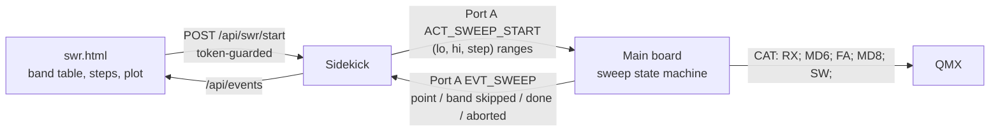

# RFC 0010: SWR sweep — tune an antenna in the field

* **Status:** Accepted 2026-09-30. Decisions: §6. Build order: §5.
* **Author / Lead:** Jeff Kalikstein, KB2SLO
* **Covers:** a Tools page that sweeps the amateur bands the operator picks, measures SWR through the QMX, and plots it; the firmware sequence, the Port A additions and the page that carry it.
* **Does not cover:** reading the QMX's Tune % over CAT (open, §7); a QDX (the operator has none); the ADV (a later slice, §5); the stop-the-radio review of [RFC 0007](0007-flash-and-update.md) §3.9, which this page does not wait for.
* **Replaces:** roadmap row `I8`, which becomes a pointer here.

---

## 1. Goal

Stated by the operator, 2026-09-30: **a useful SWR sweep an operator can tune an antenna with in the field.** It is not a copy of the QMX's own sweep screen.

* Band checkboxes, defaulting to the bands enabled in Settings (`active_bands`).
* A **Run SWR sweep** button; an estimated time shown first and counted down while it runs.
* One plot: frequency across, vertical lines at band boundaries, SWR from 1 to 6. **No point is drawn where there is no measurement.**
* Adjust the antenna, run again, see what changed (§4.3).

## 2. What is proven

Bench work on a QMX at firmware 1_04_003, 2026-09-30 (`tools/qmx_swr_probe.py`, `tools/qmx_swr_sweep.py`, `tools/qmx_swr_plot.py`). The sequence, the timing, what the radio refuses and why the Tune % matters are in [architecture/radio.md](../architecture/radio.md) (**QMX SWR Tune over CAT**). In short, per point: `RX;`, `MD6;`, `FA<hz>;`, `MD8;` (it keys itself), discard 300 ms, median of three `SW;` reads, about 0.75 s keyed; afterwards `RX;`, `MD6;`, the original `FA`.

With a real 40 m end-fed half-wave, a sweep read 40 m at 1.08-1.42, 20 m at 1.34-1.43 and 15 m at 1.60-1.73, and read 30 m (2.5) and 17 m (2.2-2.4) above 2, as that antenna should. The radio was not configured for 160, 12, 10 and 6 m, and refused them; 80 m gave one point. The sweep tool had reported a pass without saying so, which the page must not do (§4.2).

## 3. Design

**3.1 The phone owns the plan.** The webapp already holds the Region 2 band edges (`bandForKhz()`, [webapp.md](../architecture/webapp.md) **The dock**). It turns the ticked bands into `(lo_kHz, hi_kHz, step_kHz)` ranges, about 15-20 points per band by width, and **Fine** halves every step. The firmware holds no band table, so there is nothing to keep in agreement between C and JavaScript. The radio's own refusal of a frequency outside its configured bands is the hardware-side limit; it is not ours to duplicate.

**3.2 The main board runs the sequence** as a state machine in a new component, driven one step per tick so the USB, audio and Port A tasks keep running. It is `host_mock`-tested against a fake CAT: a refused `FA`, cancel at any state, the restore, and the caps. The radio operation is QMX-only, behind the existing `can_md8_tune` capability ([radio.md](../architecture/radio.md)); a QDX, or no radio, leaves the page's button disabled.

**3.3 Caps on the firmware side.** A request is refused above `SWR_SWEEP_MAX_POINTS` (200) points and `SWR_SWEEP_MAX_RANGES` (12) ranges. Every keyed phase is itself bounded, by the reply timeouts and by aborting after three silent queries in a row, so the point cap bounds the keyed time too (200 × about 0.85 s is under three minutes); a separate keyed-time cap would be a second rule that can never fire, so there is none.

**3.2a Who ticks, and the keyed backstop.** `start`, `tick` and `cancel` are called from one task (Port A handlers set a flag the ticking task turns into a cancel), and the tick runs at least every 100 ms. If it stopped while keyed, only the radio's own CAT timeout would un-key it (`QB1;`, `QC120;` on the bench unit: two minutes), so S2 puts a watchdog on the tick: a sweep whose tick is overdue by a second un-keys and aborts.

**3.3a The reply path.** The firmware's CAT link was send-only with a parser that kept the last `PC`/`SW` number. A sweep must also verify that `FA` took (the radio answers `?;` to a frequency it refuses, and `FA;` then reads back the old one), so the parser is extracted to `cat_reply_parser` (host-tested) and gains `FA`, and it skips the terminal display codes (`ESC[7m` ...) the radio appends to some replies, which would otherwise glue onto the next reply's prefix and hide it. Both boards use it.

**3.4 Port A v4** (a breaking wire change; all boards flashed together, as for v3):
* `PORTA_ACT_SWEEP_START`: a count and that many `(lo, hi, step)` kHz triples.
* **Cancel is `PORTA_ACT_TX_CANCEL`,** which already means "stop transmitting"; it also ends a sweep, so one stop control works on every surface.
* `PORTA_EVT_SWEEP`: one event per measured point (frequency, SWR in hundredths, the band), plus *band skipped* (the radio refused both edges), *done* and *aborted* (with a reason). The codec and its JSON are tested like the other events.

**3.5 The page keeps the result.** Events are polled and can be missed, so the main board does not hold the series; the page accumulates points as they arrive and marks any it never received as missing, not zero.

## 4. The page

### 4.1 Controls and time

Band checkboxes, one per band in `active_bands`, all ticked by default. A line reads "About *N* s" (points × 0.75 s), then **Run SWR sweep**. While it runs the countdown starts from the estimate and is corrected from the events (measured seconds per point × points left). **Stop** cancels at once. A fixed note says the QMX's Tune % should be 25% or more ([radio.md](../architecture/radio.md)): at 10% the reading is biased high and noisy enough to lose a small minimum.

### 4.2 The plot

* Frequency on the x axis across the swept bands only (a gap between bands is not drawn as range), with a **vertical line at each band boundary** and the band named.
* SWR from **1 to 6**. A reading above 6 is drawn on the top edge with a marker, so a 9.98 is shown, not clipped away.
* A dashed line at SWR 2; the minimum per band is marked and named.
* **No point where there is no measurement**, and the line breaks there. A band the radio refused is labelled **not swept**, so a missing band never reads as a pass.
* The plot carries the Tune % note and the time it was run.
* **Landscape is recommended, not enforced.** Up to about eight bands and a hundred points want the width, but a page cannot force an orientation on the phones in use (`screen.orientation.lock()` needs fullscreen and, as far as is known, does not exist in iOS Safari; confirm on the device in S3), and a gate would hide a result the operator just waited for. In portrait the controls and countdown show as usual with a hint, "Rotate your phone for a wider plot", and the plot draws at the width it has, thinning its band labels. Rotating during or after a run re-lays out the plot from the points already held; it never restarts or reruns a sweep (tested in S3).

### 4.3 Comparing runs

The previous result is kept in the phone's local storage and drawn faintly behind the new one, since the field loop is run, adjust the wire, run again. It is a per-phone convenience, never the record, and the page works without it.

### 4.4 Interaction with operating

The sweep interrupts reception: the radio is keyed and out of digital mode, so the slots it spans (two or three for a full run) are not decoded, and the page says so. Starting one **asks first** when a QSO is queued, a transmission is on the air or the beacon is running, in the wording and mechanism of a band change ("ends your QSO with K9ABC and stops the transmission on the air", `confirmRetune()`, [webapp.md](../architecture/webapp.md)); a "no" changes nothing. The request needs the pairing token like any transmit control ([system.md](../architecture/system.md), **Who may key the transmitter**). The radio's mode and frequency are restored after a finish, a Stop and an abort.

## 5. Slices

1. **S1, the sweep on the main board:** the state machine and the radio operation, `host_mock`-tested against a fake CAT. **P4 first**; the ADV's Port A handler is a separate copy (row `j4xh`), so it is a later slice.
2. **S2, Port A v4 and the sidekick:** the action and the event, their JSON, the HTTP routes.
3. **S3, the page:** `swr.html` linked from Tools, the plot function tested in node, and `sim_station` scripting a sweep so the page runs without a radio.
4. **S4, field checks per board**, in `TEST_PLAN.md` Pending.
5. **Later:** the ADV; reading the Tune % over CAT (§7).

It transmits and changes a wire protocol, so the firmware and protocol slices get a fresh-session review before they are committed (the project's handoff rule).

## 6. Decisions

Operator, 2026-09-30:
* **P4 first**, the ADV later.
* **The previous run is overlaid** in the first version.
* **About 15-20 points per band, with a Fine toggle** that doubles them.
* **A fixed Tune % note** ships first; reading it is open (§7).
* **Landscape recommended, not required** (§4.2), 2026-09-30.
* **Starting asks first** when it would end a QSO, transmission or beacon, rather than refusing.

## 7. Open

* **Can the Tune % be read over the Menu Manager (`MM`)?** The QMX manual's Menu Manager section has not been read. If it can, the plot carries the real figure, and a run below 25% warns.
* **The QMX's own terminal sweep** reads about 1.7 on 20 m where ours read about 1.4, on the same antenna at 25%; unreconciled. Capturing its serial output would show how it sweeps and why. Not a blocker for this RFC, but the Done-when below compares against the radio's own screen.
* **The radio's 80 m range** gave one point (4.000 MHz). Its band table is the radio's; the page shows what it gets.
* **Done-when for the feature:** a sweep from the page on a real QMX plots the ticked bands; at three spot frequencies the plotted SWR matches the QMX's own SWR Tune screen at the same Tune %; the radio is back on its original mode and frequency afterwards; a Stop during a sweep de-keys within a second (field).
