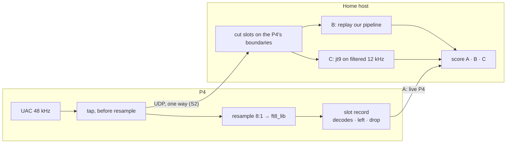

# RFC 0012: Home decode server — `jt9` beside the P4, data first

* **Status:** Draft 2026-10-04. Decided in discussion the same day: §8. The Ask: §7.
* **Author / Lead:** Jeff Kalikstein, KB2SLO
* **Covers:** streaming the P4's receive audio over its Ethernet to a host on the home LAN; a host program that replays our decode and runs `jt9` on the same samples; the paired-comparison data that results; keeping today's decode safe while the stream runs; and, as a later slice, `jt9`'s decodes feeding autoseq at home.
* **Does not cover:** the WSJT-X UDP protocol ([ROADMAP.md](../ROADMAP.md) I39); a Linux main board (I38), though its Pi could be the host here; PoE power; decoder changes themselves ([RFC 0006](0006-decode-performance.md)). Field operation is out of scope because this RFC must leave it unchanged.
* **Row:** [p83e](../ROADMAP.md).

---

## 1. Goal

**North star: better decodes on the air.** The P4 may not get there alone. Microcontroller decode tops out near 71% of `jt9 -d 3` (RFC 0006 §4.1), and the shipped two-pass decode finds 285/428 and 699/1,041 of `jt9`'s messages on the two corpora ([decode.md](../architecture/decode.md)).

Two goals, in order:

1. **Data.** Every home slot decoded by our firmware and by `jt9` on the same samples, from our real receive chain. Paired data is what RFC 0006's discordant-count method needs, and here it arrives continuously instead of from a fixed corpus.
2. **Better decodes on the air at home.** `jt9`'s decodes feed autoseq (S3, §5). That is a separate decision, made on goal 1's data.

**Hard constraint: today's decode does not get worse.** With the switch off, the station runs today's code paths. With it on, the gate in §3.3 shows no change before a slice ships turned on.

## 2. What exists

Facts are from the working tree at `f24182a`.

* **Time budget.** Decode starts after 79 blocks (12.64 s) inside the capture task and must finish by the 15.0 s boundary: a 2.36 s guard ([decode.md](../architecture/decode.md); trigger point is row B90). At that commit a no-message slot overran it by about 1 s and dropped samples. The fix is in [decode.md](../architecture/decode.md) (**Subtraction**), not yet confirmed on the air.
* **Receive path.** The QMX delivers 48 kHz, 24-bit stereo over UAC (`poe_p4/main/qmx_transport.cpp:44`). `components/resample` decimates 48 kHz mono to 6 kHz by taking every eighth sample, with no filter (`resample.h:22`; `FT8_SAMPLE_RATE` 6000, `ft8_audio_pipeline.cpp:29`). The ingest task writes into a 16,384-float ring, about 2.7 s at 6 kHz (`ft8_audio_pipeline.cpp:36`).
* **Tasks and cores.**
  - Core 1: `decode_audio`, priority 4 (`poe_p4/main/main.cpp:68`), and `audio_ingest`, priority 5, pinned to the same core (`ft8_audio_pipeline.cpp:119`).
  - Core 0: `usb_lib` and `uac_lib`, priority 5 (`qmx_transport.cpp:500`, `:508`), and the main loop that ticks Port A, autoseq and the TX scheduler (`main.cpp:70` on; core 0 is ESP-IDF's default main-task affinity).
  - `porta_rx` is not pinned (`components/porta/porta.cpp:1037`).
* **Memory.** PSRAM is not enabled. DMA buffers cannot use it anyway ([main_board.md](../architecture/main_board.md)). The 161 KB waterfall is a heap malloc, and t4/f2's 322 KB waterfall already cannot allocate ([decode.md](../architecture/decode.md)).
* **Ethernet.** The board has an Ethernet PHY and 802.3at PoE; "neither is used, by decision" (2026-09-16, [main_board.md](../architecture/main_board.md)).
* **Port A cannot carry audio.** It runs at 115200 baud, about 11.5 kB/s, and 230400 gave CRC errors and sequence drops ([main_board.md](../architecture/main_board.md)). Even the 6 kHz decimated stream as 16-bit samples is 12 kB/s.
* **Instruments.**
  - `SLOT … dec… left…` (`components/decode_pipeline/decode_pipeline.cpp:277`) and `BDRY … lost… drop…` (`components/ft8_audio_pipeline/ft8_audio_pipeline.cpp:192`) per slot.
  - The waterfall allocation size in the log.
  - A per-core busy measurement, `decode_core_busy`, in progress in the working tree (not committed at `f24182a`).
* **Offline measurement.**
  - `tools/decode_recall/report.py` scores the firmware's decode steps against pinned `jt9 -8 -d 3` truth. It matches on normalised message text, counts discordant decodes, and lists extras rather than scoring them false.
  - Host and device decode identically for every configuration tried ([decode.md](../architecture/decode.md)).
  - RFC 0006 P6 (row B86) plans "our chain" recordings from the QMX on a Mac.
  - Row dj5n collected 798 paired SNRs by hand.
* **`jt9`.**
  - `jt9 -h` on the operator's Mac (2026-10-04) offers file mode, `-d` depth, and QSO context: `-c` my call, `-x` their call, `-G`/`-g` grids, `-Q` QSO progress.
  - RFC 0006 measured about 1,450 ms per slot for `-d 3` and 440 ms for `-d 1` on one Apple M4 core.
  - It is GPL-3.0. Run as a separate, unmodified process beside our MIT code, as row I38 assumes.

## 3. Design

### 3.1 Shape

**P4 to host, one way in S1–S2.**

* **Audio:** the 48 kHz mono samples that enter `resample`, tapped before decimation. Each datagram carries a sequence number and the sample index of its first sample.
* **One record per slot:**
  - the slot epoch, plus a flag for an unset clock (row k33u)
  - the dial frequency
  - the firmware build and decoder configuration
  - `lost`, `drop`, `left` and `dec`
  - the sample index of the slot boundary
  - the P4's decodes: message, SNR, DT, frequency and pass

**On the host, three decodes per slot:**

* **A, live P4:** from the slot record.
* **B, host replay:** our `resample` and decode steps on the same samples, through the `decode_recall` build. When nothing was lost it should match A exactly, because host and device decode identically.
* **C, `jt9 -8 -d 3`:** on the same samples resampled to 12 kHz with a proper anti-alias filter, as WSJT-X's own input would be.

**What each gap means:**

* **A vs B is what real time costs us:** samples dropped and boundaries overrun (B90). The algorithm is held fixed.
* **B vs C is the algorithm plus the front end.** An optional B′, our decoder on the filtered 12 kHz audio, splits the two. That measures RFC 0006's "48 → 12 kHz, filtered" option on live audio.

**Scoring** follows `decode_recall`: normalised message text, discordant counts, extras listed and not scored false, and recall bucketed by `jt9`'s SNR.

* `jt9` is not ground truth. A second independent decoder (JTDX) would give RFC 0006's consensus scoring, the only kind that can score above WSJT-X (§7).
* **What `jt9` is told.** In S2 it gets our call and grid, as WSJT-X would have them for a station not in a QSO, and no QSO context. Its decodes that rely on that context are scored apart from the rest, if its output marks them the way WSJT-X's display does (`a1`…). Checking this is part of S2.

**Retention.**

* One row per slot, always.
* Audio kept for every slot where the decoders disagree, plus a sample of slots where they agree, in P6's corpus format. Storage location is shared with P6's open question.

**What it also feeds:**

* the paired SNRs for dj5n
* DT comparison for row I15
* hard cases for B86's corpus and for `decode_recall` regressions

### 3.2 Keeping today's decode safe

**The runtime switch.**

* It is a CONFIG key, token-guarded like every write ([system.md](../architecture/system.md)), and off by default.
* It is read at boot and takes effect on the next boot.
* With it off, the Ethernet driver is never installed, lwIP never starts, and no network buffers exist. The field station runs today's code paths. The image carries the code (§8).

**With the switch on:**

1. **The network lives on core 0.** On core 1, below decode, it would be starved for the decode window. Buffering 2.4 s at 192 kB/s (48 kHz float) is about 460 KB of internal RAM, which does not fit with PSRAM off. On core 0 it drains continuously.
2. **Priorities go below USB.** ESP-IDF's default puts lwIP's `tcpip` task at priority 18 (as on the sidekick, [sidekick.md](../architecture/sidekick.md)), above every P4 task, and the Ethernet receive task is high by default too. Both must sit below `usb_lib`/`uac_lib` (priority 5). The Ethernet interrupt is allocated on core 0 by installing the driver there.
3. **The TX scheduler shares core 0.** The main loop starts transmissions, so the gate measures TX start against the slot boundary.
4. **Core 1 gets one copy.** The only stream work on the decode core is a copy into a cross-core single-producer ring, inside the read `audio_ingest` already makes.
5. **The P4 never waits on the network.**
   - UDP, unicast to one configured host.
   - The stream ring is sized for LAN jitter: 100–200 ms, about 20–40 KB at 192 kB/s.
   - A full ring drops chunks and counts them. The host marks those slots unscorable.
   - The stream never holds the ingest ring.
6. **Memory.** Ethernet DMA buffers must be internal RAM. Keep their counts small, and log the largest free internal block at the waterfall allocation, with the switch on and off.
7. **LAN traffic arrives anyway.** ARP, mDNS and SSDP cost receive interrupts whether or not we stream. Use the controller's address filtering, no promiscuous mode, and keep the receive path on core 0.
8. **Unicast, not multicast.** Home WiFi carries multicast at low basic rates. A 1.5 Mbit/s multicast stream would load the WLAN the sidekick and phone use.

### 3.3 The gate

Alternate switch-on and switch-off hours on one band, then compare:

* **`lost` and `drop`:** no increase.
* **`left`:** the median moves by less than it differs between two switch-off hours.
* **Decode core busy:** unchanged. Core 0 busy leaves headroom (the number is set from S1's baseline, §7).
* **Largest free internal block** at the waterfall allocation: the allocation succeeds with margin (margin set from S1's baseline, §7).
* **TX start against the slot boundary:** unchanged. If no instrument exists for this, S1 adds one.

If any check fails, the switch stays off and the slice does not ship turned on.

### 3.4 Wire contract

One source of truth in code, per [README.md](../README.md) (**No prose specs**):

* The frame layout lives in a new component's header (`components/decode_stream/`, name provisional), and the encoder builds on the host.
* The host's parser is held to it by a test that feeds it frames from the C encoder in `host_mock`.
* The tap ring and framing logic live in that component. `poe_p4/main/` gets only board glue (Ethernet and PHY init), per [STYLE.md](../STYLE.md).

### 3.5 The host program

* `tools/decode_server/` (provisional), in Python like `tools/decode_recall/report.py`.
* It runs `jt9` from the operator's WSJT-X install as a separate process. We distribute nothing GPL.
* Every row records the `jt9` version, because RFC 0006 requires pinned truth.
* In S2 it is run by the operator from the repo, not a release artifact. It becomes a [RELEASE_PROCESS.md](../RELEASE_PROCESS.md) question only if S3 ships for other operators.

### 3.6 S3 sketch: `jt9`'s decodes on the air

This is decided only after S2's data shows a gap worth closing and a round trip that fits.

* **Timing.** `jt9 -d 3` takes about 1.45 s of one desktop core against the 2.36 s guard; the LAN adds little. Results that miss the reply decision go to the decode list only, like RFC 0006 P7's pass B.
* **QSO context.** The P4 sends my call, the partner's call and QSO progress for each slot, which `jt9` uses through `-c`/`-x`/`-Q`.
* **Merge.** The union of both engines' decodes, keyed on normalised text. Each decode is tagged with the engine(s) that found it.
* **Trust.**
  - Decodes now flow into the P4 and drive autoseq, which keys the transmitter. That conflicts with "nothing may change the device merely by being on the LAN" ([system.md](../architecture/system.md)).
  - The P4 would accept results only from the configured host, on the socket it opened. A LAN device that spoofs the host can still inject decodes; that is the same honest limit as the token.
  - The exposure depends on what autoseq answers unprompted. It is bounded against [autoseq.md](../architecture/autoseq.md) in S3's design, and needs a system.md amendment before S3 is accepted.

## 4. Alternatives

* **WSJT-X as the web app's backend, over its UDP protocol.** The read side is rich: Status, Decode and QSO Logged. The write side is thin (`Network/NetworkMessage.hpp`, checked 2026-10-04):
  - Reply acts only on a decode that "is a CQ or QRZ message".
  - No message sets the dial frequency or band, and none enables TX directly.
  - There is no sender validation.

  WSJT-X would also own autoseq and the log, so the web app would need two backends and capability checks on every surface.
* **A modified WSJT-X.** The GPL allows it. But we would maintain a fork of a large Qt/Fortran desktop app on three operating systems through every upstream release, operators would replace their install, and the two-backend problem would return. `jt9` already takes everything this design needs on its command line.
* **Stream through the sidekick.** Port A cannot carry it (§2), and Port A timing already affects decode: 57055c4 moved the slot-clock read so the UART is not inside the decode.
* **Record on a Mac** (RFC 0006 P6's "our chain"). It does not exercise the P4's own USB audio path, and it is not paired with live P4 decodes. If this RFC is accepted, P6's bullet gets a dated amendment pointing here.
* **Record on the P4.** There is no SD card, `storage` is LittleFS on flash, and a 48 kHz slot is about 1.4 MB.
* **A home-only build instead of a runtime switch.** It would be the only way to prove the field image unchanged byte for byte. Declined 2026-10-04 (§8).

## 5. Slices

Each slice states which verifiability category from [README.md](../README.md) applies.

1. **S1: Ethernet up, nothing sent.** The switch, DHCP, a link, the §3.2 priorities and pinning, and the heap log. Nothing is sent.
   - It measures what being on a LAN costs, apart from what sending costs.
   - Verification: the compiler and a host test for the config key. The gate is field-only (category 2).
   - **Done-when:** the §3.3 gate passes with the link up on a home LAN, and the baselines for §7 question 8 are recorded.
2. **S2: stream and host.** The tap, the stream ring, the wire contract, and `tools/decode_server/` with A/B/C scoring and retention.
   - Host-testable: the wire contract test, slot cutting, and scoring on a recorded stream.
   - Field: the gate with streaming on.
   - **Done-when:** the gate passes with streaming on, and a first report gives A/B/C discordant counts over at least 1,000 home slots.
3. **S3: `jt9`'s decodes back into autoseq at home** (§3.6). It needs its own acceptance after S2's report, including the system.md trust amendment.

## 6. What changes elsewhere on acceptance

* [main_board.md](../architecture/main_board.md): the 2026-09-16 Ethernet decision is reversed, scoped to an outbound link to one configured host. This graduates with S1.
* [system.md](../architecture/system.md): S1–S2 add an outbound-only LAN path from the P4. The phone still reaches the station only through the sidekick. S3 changes "Who may key the transmitter".
* RFC 0006 P6: a dated amendment pointing "our chain" here.
* [README.md](../../README.md) fork notes: audited when the switch reaches a web-app control.

## 7. Open questions — the Ask

1. Accept the design and the slice order?
2. Reverse the 2026-09-16 Ethernet decision, scoped as §6 says?
3. **The host.** Which machine, always on? A Mac that sleeps leaves gaps. For S2 the host only has to keep up on average, so I38's Pi might serve S2 even if it is too slow for S3.
4. **The stream format.** 48 kHz float (exact replay by construction, 192 kB/s) or packed 24-bit (144 kB/s, the host repeats the conversion)? Recommended: float, unless the S2 gate shows the packet cost matters.
5. **Where the switch and host address are set.** A web-app Settings control (then a README fork audit when it ships), or something lighter for what is, for now, an operator-only tool.
6. **A second decoder for consensus (JTDX):** in S2, or later?
7. **Retention:** what fraction of agreeing slots to keep, and the storage location (shared with P6).
8. **Gate thresholds:** core 0 headroom and heap margin. Proposed: set from S1's baseline.

## 8. Decisions

* **2026-10-04:** the north star is better decodes on the air; data comes first (S1–S2 before S3). The P4 alone may not reach it.
* **2026-10-04:** a runtime switch, off by default, not a separate home-only build. The field image carries the code but, with the switch off, never starts the network.
* **2026-10-04:** WSJT-X as the web app's backend, and a modified WSJT-X, are not pursued (§4).
