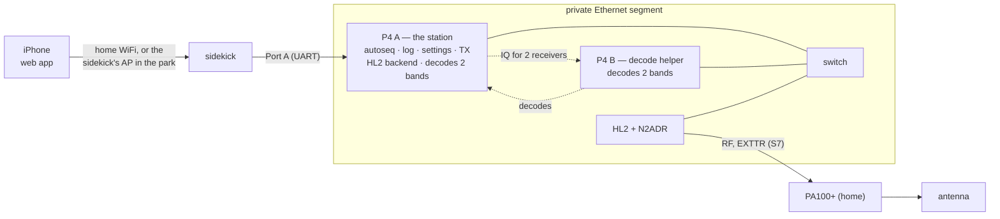

# RFC 0014: An HL2 on two P4s — four bands at home and in the park

* **Status:** Draft 2026-10-20; redirected 2026-10-30 from a host main board on a home computer to the P4 (§8). Decided in discussion: §8. The Ask: §7.
* **Author / Lead:** Jeff Kalikstein, KB2SLO
* **Covers:** a Hermes-Lite 2 (HL2) backend on the P4, receive and transmit, over the P4's Ethernet port; a second P4 that decodes two more bands, so the station listens on up to four bands at once and replies on the band a station was heard on; the safety requirements for HL2 transmit; the station at home first, then in the field for POTA; the Micro PA100+ last.
* **Does not cover:** a host main board on a computer (§4); SOTA (§3.12); the QMX station, which this RFC must leave unchanged; streaming P4 audio to a home host ([RFC 0012](0012-home-decode-server.md)); PSKReporter ([RFC 0013](0013-pskreporter.md)); renaming the project ([ROADMAP.md](../ROADMAP.md) I6).
* **Row:** [yw5x](../ROADMAP.md).
* **Prerequisite:** row p3x6 (decode from PSRAM), built and measured before this RFC is accepted (§8). It stands on its own and also serves the QMX build.

---

## 1. Goal

**North star (operator, 2026-10-20): operate FT8 from an iPhone anywhere in the house, asynchronously, on the home station** — HL2, N2ADR filter board, Micro PA100+, antenna. **Extended 2026-10-30: the same station in the park for POTA.** The operating mode: listen on up to four bands at once and reply to any CQ, on the band it was heard on.

**Constraints:**

* **One codebase, one main board.** The P4 stays the only main board ([main_board.md](../architecture/main_board.md)); the HL2 is a second radio backend beside the QMX, and the sidekick and web app serve the phone as they do today. [RFC 0011](rejected/0011-station-core.md) records what two copies of station logic did, so the second P4 holds no station state (§3.2).
* **The QMX station is unchanged.** A P4 running the QMX decodes and transmits exactly as today.
* **Offline field operation still holds** ([system.md](../architecture/system.md), constraint 1): in the park, everything runs over the sidekick's AP.
* **Each QSO on the air is a WSJT-X QSO** ([AGENTS.md](../../AGENTS.md), **WSJT-X is the on-air standard**). The station chooses the band; the messages and their sequence do not change.
* **Transmit ships off,** behind the requirements in §3.8.

## 2. What exists

Facts are from the working tree at `b693a5f` and from sources read on 2026-10-20 and 2026-10-30, each named where it is used.

### 2.1 In our code

* **The control seam is real.** The core talks to a radio only through `radio_control_ops_t` (`components/radio_control/include/radio_control_backend.h:8`) and its capabilities; there is no `if (QMX)` in the core ([radio.md](../architecture/radio.md)). One coupling: `radio_control_tone_lead_ms()` returns 0 for any backend that has `begin_cpfsk_tx` (`radio_control.cpp:102`), which also turns off the PTT lead and Min TX delay.
* **The receive seam is QMX-shaped and single-instance.**
  - The `read` callback is `qmx_audio_read_ft8_samples()` (`poe_p4/main/qmx_transport.cpp:576`), wired in at `main.cpp:35`; it ignores `max_samples`. The UAC format is fixed at 48 kHz, 24-bit stereo (`qmx_transport.cpp:44`).
  - `resample_48k_to_6k()` keeps every eighth sample with no filter (`components/resample/include/resample.h:27`; row B85).
  - `ft8_audio_pipeline_run()` has one static ingest ring (`ft8_audio_pipeline.cpp:36`), one `monitor_t` on real samples at a compile-time 6 kHz (`:28`, `:68`), and decodes inside the capture task (`:243`).
  - `components/ft8_lib/common/monitor.c` (our wrapper, not the vendor tree) keeps the window, FFT plan and waterfall in file statics (`:19`–`:23`, `:109`, `:157`, `:226`). `decode_monitor_results()` keeps candidates, results and the SNR state in function statics (`decode_pipeline.cpp:309`–`:346`). `decode_tx_state` holds one decode slot and one global `freq_osr`.
* **One band throughout.**
  - The station has one `band_sel` (`components/station/include/station.h:22`).
  - A transmission goes on `porta_p4_station_freq_hz()` (`poe_p4/main/tx_scheduler.cpp:222`), and autoseq's queue entries carry no band, so a reply to a decode heard on another band would go out on the selected band.
  - The log takes band and frequency from `band_sel` at log time and writes `radio_name = "QMX"` (`porta_host.cpp:188`–`:199`).
  - `dial_history` tracks one dial (`radio_control.cpp:73`).
* **Already multi-band-ready.** Port A's DECODE carries the dial frequency per decode (`components/porta_proto/include/porta_proto.h:252`), and the web app splits a slot's decodes into one batch per frequency (`webapp/app/app.html:3503`).
* **Host tests.** `host_mock` compiles `autoseq.cpp` and the pure decode helpers against shims for `esp_err`, `esp_log` and `esp_timer`; a codec component tests the same way. `tools/decode_bench/compare_decoders.py` scores ft8_lib against `jt9` over recorded slots.
* **Decode cost.** ft8_lib's shipped decode takes 1,747 ms per busy slot on the P4 ([decode.md](../architecture/decode.md)), and the P4 decodes about 70% of what `jt9` does.

### 2.2 The P4

Read from [main_board.md](../architecture/main_board.md) and [system.md](../architecture/system.md).

| Fact | Source |
|---|---|
| ESP32-P4 revision v1.3: the 400 MHz and PIE improvements of v3+ silicon do not apply. | main_board.md, **P4** |
| **32 MB PSRAM per the datasheet, not enabled** (`CONFIG_SPIRAM` unset). Plain CPU data could move there; DMA buffers cannot. | main_board.md |
| **Internal RAM.** The waterfall is a static 161,076 bytes, and the unused 80,538-byte buffer beside it is gone, so the heap holds about 80 KB more than on 2026-10-24, when 2.7 KB of new statics would have stopped the decoder. `tools/check_ram_budget.py` holds statics to a ratchet budget, with an estimated ceiling near 433,000 bytes. No device reading since. | [memory.md](../architecture/memory.md); `check_ram_budget.py` |
| **An Ethernet PHY and 802.3at PoE, unused by decision (2026-09-16).** ESP-IDF 5.5.5 has the board's IP101 PHY and the P4's EMAC. | main_board.md; this RFC's §4 before 2026-10-30 |
| Two cores: the main loop on core 0 (autoseq, the slot cycle, the armed TX, the radio), decode pinned to core 1. | main_board.md, **Tasks** |
| **Port A is a UART over Grove to the sidekick,** resting at 2,500,000 baud (about 250 kB/s); both main boards held 14 MB each way at that rate with no drops or CRC errors. One per P4. | [sidekick.md](../architecture/sidekick.md), **Port A**; main_board.md, **Grove** |
| **Build-time RAM, measured 2026-10-30** on `2f2caab` with ESP-IDF 5.5.5. The QMX image has 272,468 bytes of static DRAM against `check_ram_budget.py`'s 274,000, and 76,376 bytes of code in internal RAM. Linking Ethernet, `esp_netif`, lwIP and a UDP socket, never started, adds 2,704 bytes of static DRAM (lwIP 2,482) and 2,100 of internal-RAM code: **1,172 bytes over the budget.** The QMX path's own statics are 2,582 bytes of DRAM (2,474 in `qmx_transport.cpp`, 2,412 of it initialised data) and 1,040 of internal-RAM code (the USB host library); an HL2 image without them comes to about 272,600 bytes, under the budget, by subtraction, not built. The budget counts static DRAM only, but on the P4 internal-RAM code comes from the same memory, so the code growth likely counts too. Heap taken when a stack starts is not in these numbers: Ethernet's DMA buffers default to 30 × 512 bytes. | Two builds of `poe_p4`; `esp_idf_size --archives`, `--files` |
| **The sidekick joins home WiFi** (station mode, in daily use) **and runs its own AP in the field.** The phone reaches the station only through it. | system.md; operator, 2026-10-30 |
| **Field power:** one laptop power bank runs the station; the P4 from USB-C into PROG, the sidekick from the P4 over Grove, the QMX at 12 V through a USB-C PD trigger cable. | main_board.md, **Field power** |

### 2.3 The HL2

Read from the [HL2 wiki](https://github.com/softerhardware/Hermes-Lite2/wiki), the HL2 gateware and reference code, the openHPSDR documents, and other clients. These facts inform the design; the wire contract will be our codec's header and golden frames from the operator's radio (§3.3), not this table ([README.md](../README.md), **No prose specs**).

| Fact | Source |
|---|---|
| Discovery is `EF FE 02` plus 60 zero bytes, broadcast to UDP 1024; the reply's byte `0x0A` is the Board ID, `0x06` for an HL2. | Wiki [Protocol](https://github.com/softerhardware/Hermes-Lite2/wiki/Protocol), "Metis Discovery Reply"; Metis V1.33 revision 1.17 ("always listens on port 1024"); gateware `ethernet/network.v:428` |
| **Port 1025 is a command side channel, not a second IQ client.** A 1025 packet carries one command word and no IQ (`dsopenhpsdr1.v:317`–`:325`). IQ goes to one host: whichever sent to port 1024 last while the radio was stopped (`network.v:717`–`:728` at `41d75b8`). Which gateware first had 1025: not found. | Gateware `rtl/`; `software/hermeslite/README.md` |
| Frames: 1032-byte UDP payloads (`EF FE 01`, endpoint, 32-bit sequence number) holding two 512-byte frames, each `7F 7F 7F` + five control bytes. Receive is 24-bit I/Q per receiver plus a 16-bit mic word, ⌊504 / (6N + 2)⌋ samples per frame for N receivers; transmit is 16-bit L/R then 16-bit I/Q, 63 per frame. | openHPSDR USB_protocol V1.60; `software/ft8/rx4000.py:115`; `dsopenhpsdr1.v` PUSH states |
| No audio codec; the L/R slots are still sent, as zeros. | Wiki Protocol, "Additional Command and Control" |
| Standard gateware `hl2b5up_main`: 4 receivers and a transmitter. Receive-only variants: `cicrx` 10, `6rx` 6, `4000` 5. Rates 48, 96, 192 or 384 kHz. The wiki's prose says 9 for the skimming variant; the source says 10. | `gateware/variants/*/hermeslite.v:99`; wiki Protocol register 0x00 [25:24] |
| **TX has two dead-man layers in gateware.** PTT is a bit on every TX sample (`radio.v:976`): when samples stop, a 12 ms hang (register 0x17 [12:8], `:935`) then off (`:1040`–`:1047`). A hang of 31 is a software-PTT mode with no auto-unkey (`:1033`), by design ([issue #178](https://github.com/softerhardware/Hermes-Lite2/issues/178)). The watchdog clears `run` and PTT after 4,096 ticks without a downstream packet (`dsopenhpsdr1.v:128`, `:409`); Start bit 7 or register 0x39 disables it (`:399`). Its period in seconds: not found. | Gateware `rtl/` |
| Telemetry: temperature, forward and reverse power, PA current (RADDR 0x01–0x02; discovery reply 0x1C–0x23). No supply voltage. Temperature °C = (3.26 · code / 4096 − 0.5) / 0.01; current A = (3.26 · code / 4096) / 50 / 0.04 ÷ (1000 / 1270). Watts come from a per-hardware table (Quisk's `HL2FilterE3`: code ≈ 3,383 is 5.0 W). The sensing toroid is on the N2ADR card. Which word is forward depends on the sense transformer's polarity: Quisk takes the larger, and hl2_tcp reads them the other way from the wiki. | Wiki Protocol; [Quisk](https://github.com/jimahlstrom/quisk) `hermes/quisk_widgets.py:132`, `quisk_conf_defaults.py:500`; wiki Getting Started, "N2ADR Companion Filter Card"; [hl2_tcp](https://github.com/hotpaw2/hl2_tcp) `hl2_tcp.c:1001`, `:1007` |
| **N2ADR filters.** One byte over I2C to address 0x20 (an MCP23008), from register 0x00 [23:17]: b0 160 m, b1 80, b2 60/40, b3 30/20, b4 17/15, b5 12/10 low-pass, b6 the receive high-pass. Quisk sets the receive filter for the highest band among its receivers. **The schematic: "Bands 1 to 6 (LPF) normally bypassed".** No byte written is no transmit filter. | Wiki Protocol, "Filter Selection"; Quisk `quisk_conf_defaults.py:511`, `hermes/quisk_hardware.py:550`; `hardware/companions/n2adr/n2adr.sch` |
| LNA: register 0x0a bit 6 set gives −12 to +48 dB directly; clear gives the Hermes-style −12 to +20 dB attenuator, +20 dB by default. ADC overload is RADDR 0x00 [24]. | Wiki Protocol, "LNA Gain" |
| **EXTTR** (an RCA jack on the N2ADR card): open collector, pulled low during transmit; the PA supplies the pull-up, at most 28 V and 1 W (about 80 mA at 12 V). The driver is an NUD3124 (`hardware/hl/PA.sch`). The group has several reports of it failing and recommends a relay buffer. | Wiki [External Connections](https://github.com/softerhardware/Hermes-Lite2/wiki/External-Connections), "EXTTR"; [EXTTR failure](https://groups.google.com/g/hermes-lite/c/uTSjeJjsZnY), [Fried my Q5](https://groups.google.com/g/hermes-lite/c/iYSyxchkFxo) |
| **Protocol 1 has no authentication.** No sender check was found in the receive path; any host can stop the radio, and the next host to send while it is stopped gets the stream. | Gateware `ethernet/ip_recv.v`, `udp_recv.v`, `network.v:686` |
| **`radio-utils-emu` is not a faithful HL2.** Two receivers in its HL2 model, Hermes-style telemetry (exciter power and supply voltage, `protocol1.rs:398`–`:427`), up to 32 clients, and no watchdog or PTT-hang model found. MIT/Apache, first published May 2026. | [docs.rs](https://docs.rs/crate/radio-utils-emu/latest); `sp5tls/radio-utils` |

**Bandwidth, 4 receivers at 48 kHz:** 1,263 packets/s, 11.1 Mbit/s on the wire; transmit adds 381 packets/s, 3.3 Mbit/s. One receiver's raw IQ, 2 × 24 bits at 48 kHz, is 2.3 Mbit/s before framing.

### 2.4 The station (operator)

* An HL2 with the N2ADR filter board. Which enclosure and I/O board: §7.
* The PA100+ keys when its 3.5 mm PTT input is grounded; today the QMX's PTT output does it (bench-verified, [radio.md](../architecture/radio.md)). It senses the band from RF and has its own SWR protection.
* **Two P4 units** (2026-10-30).

### 2.5 First contact: the operator's HL2

Read on 2026-10-30 from the operator's HL2, receive only, from a laptop with a discovery probe and SparkSDR 2.0.992. Gateware source is `softerhardware/Hermes-Lite2` at `41d75b8` unless another commit is named.

The discovery reply, 60 bytes, with the MAC zeroed here; S1 commits it as a golden frame with a codec test:

```
ef fe 02 00 00 00 00 00 00 4a 06 00 00 00 00 00
00 00 00 04 45 02 00 00 00 00 00 03 03 d3 00 0a
00 0b 00 00 00 00 0a 00 04 00 00 00 00 00 00 00
00 00 00 00 00 00 00 00 00 00 00 00
```

| Fact | Source |
|---|---|
| **Byte map** (offset = 9 + 0x32 − the case label): 2 status, `02` stopped and `03` running; 3–8 MAC; 9 `VERSION_MAJOR`; 10 `0x06` for an HL2; 13–16 the EEPROM static IP; 19 receivers; 20 bandscope bits and `BOARD[5:0]`; 21 `VERSION_MINOR`; 28–29 temperature; 30–31 `fwdpwr`; 32–33 `revpwr`; 38 `tx_buffer_latency`; 40, low five bits, `ptt_hang_time`. | `rtl/usopenhpsdr1.v:250`–`:306` (last changed `a5ab5e4`, 2021) |
| **This unit:** gateware **74.2**, `BOARD` 5, 4 receivers, no static IP stored. Master has been 74.3 since `41d75b8` (2026-10-26, "Fix for lost IP when ethernet cable is removed", in `dhcp.v` and `network.v`); 74.2 is `883a338` (2023-12-31). No published 74.3 build was found; the GitHub Releases page's newest is 68p4 (2020). | The reply; `rtl/hermeslite_core.v:142`–`:143`; commit history |
| **Telemetry agrees with §2.3's formula:** bytes 28–29, `0x03D3`, give 27.9 °C; SparkSDR showed 27.8 °C in the same hour. `fwdpwr` 10 and `revpwr` 11, not transmitting. One sample. | The reply; SparkSDR |
| **Transmit settings in the reply differ from §2.3's defaults:** `tx_buffer_latency` 10 and `ptt_hang_time` 4, where §2.3 has 20 ms and 12 ms. The fields' units were not read, and whether a client had configured the radio since power-on is unknown. | The reply |
| **No DHCP lease: 169.254.MAC[15:8].MAC[7:0].** On a LAN with a DHCP server the unit got no lease (why: not found) and took that address, which `apipa_ip` computes. A broadcast on the laptop's LAN subnet found nothing; with a 169.254/16 address added on the same interface it answered, and so did a unicast discovery to the radio's address. | `rtl/ethernet/network.v:91`, `:182`–`:191`; probe |
| **Discovery while running: unexplained.** The source sets status `03` while running and does not gate discovery on `run` (`usopenhpsdr1.v:146`, `:266`), but one broadcast probe while SparkSDR streamed got no reply. | Probe |

**What it means here:** on a segment with no DHCP server, the HL2's address follows from its MAC, and the P4 needs a link-local address of its own to reach it (§3.1). S1 settles the transmit-settings difference and discovery while running before S2 relies on §2.3 (§3.8, 5).

### 2.6 Prior art: RigPi

RigPi (Howard Nurse, W6HN; MIT) serves a station from a Raspberry Pi to a browser. Read on 2026-10-30 from `hlnurse/rigpi` (RigPi 4, `5671683`) and `hlnurse/rigpi-sdr` (RigPi 5 with RigPi-SDR, a snapshot of a live Pi, `7c0c913`). The vendor pages (rigpi.net, rigpi.com) were read only through search results.

| Fact | Source |
|---|---|
| **No HL2 code.** The vendor's pages list "Hermes Lite" among supported SDRs; the source has no Protocol 1 client and no `hermes`, `hpsdr` or `hl2` outside cached data files. An HL2 reaches RigPi only receive-only, through an OpenWebRX that owns the radio. | `rigpi-sdr` tree; `pi/sdr_web/sdr_web_server_minimal.py` |
| **FT8 is receive-only on one band per SDR,** through KK5JY's `ft8modem` running `jt9`. Transmitting FT8 means WSJT-X on the Pi's desktop. No autonomous sequencing. | `pi/sdr_web/ft8modem_manager.py:23`, `:57`, `:202`; RigPi 4 `README.md` |
| **Who may key the transmitter.** Request values reach shell commands without validation, most endpoints check no session, and the SDR server listens on `0.0.0.0`: anything on the LAN that can reach the Pi can drive the radio. | `html/programs/`; `sdr_web_server_minimal.py:7529` |
| **A guarded transmitter (HackRF, voice).** Off unless an administrator enables it; frequency within an amateur-band list; one transmission at a time; a 5 s heartbeat from the browser; a 600 s maximum. Missing audio is filled with zero IQ to keep the stream running. | `sdr_web_server_minimal.py:3745`–`:3975` |

**What it means here:** nothing to reuse for the codec, and nothing else can share the HL2 with us, since Protocol 1 streams IQ to one client (§2.3). The transmit guard informs §3.8 (11, 12); the keying findings are what §3.8 and §3.9 avoid.

## 3. Design

### 3.1 Shape



* **No new main board.** P4 A is the station as today, with the HL2 in place of the QMX. P4 B decodes the bands A gives it and returns the decodes; it holds no station state, has no Port A, and never sends to the HL2 (§3.8, 13).
* **One P4 is a complete HL2 station** for one or two bands; the second P4 adds bands three and four. The first slices use one.
* **A private Ethernet segment:** the HL2 and the P4s on a small switch, nothing else. Neither P4 routes and the sidekick has no Ethernet, so the home LAN cannot reach the radio (§3.9). With one P4 the switch is not needed: a cable from the P4 to the HL2.
* **Addresses are link-local.** With no DHCP server on the segment the HL2 takes 169.254.MAC[15:8].MAC[7:0] (§2.5); the P4s take link-local addresses too, and A finds the HL2 by discovery on 169.254/16, then talks to it by unicast. Fixed addresses instead: §7.
* **The radio follows the Radio setting** (row cgc4, the P4 follows the Radio setting): the QMX and the HL2 are two `radio_control_ops_t` backends. **Proposed: chosen at boot, and a change reboots.** Only the chosen radio's stack is installed, the USB host or Ethernet and lwIP, so the other allocates nothing; a live swap would free and reallocate a stack's buffers on the heap. **One image with both stacks** adds about 2.7 KB of statics (§2.2, measured on `2f2caab`) to a build now at 352,996 bytes: just under the 356,000 budget and far under its estimated ceiling, by addition, not built ([memory.md](../architecture/memory.md)). Which: §7.

### 3.2 One codebase: what changes in components

1. **A receive source with N channels** of real audio at the pipeline's rate, each with its dial frequency, a dropped-sample count and readiness. The QMX is one channel (wrapping `qmx_audio_*`); the HL2 is 1–4.
2. **Per-channel decode state** (§3.5): the single-instance statics in §2.1 become per channel. The QMX keeps one channel and must decode byte for byte as today, which the recall floors and the `tx_e2e` goldens check.
3. **The HL2 codec and backend** (§3.3), host-tested in `host_mock`.
4. **The decode-helper role** (§3.5): P4 B runs the decode components and a small protocol to A, and nothing of the station. Whether it is a separate build or one image with a role setting: §7.
5. **The web app** changes only where bands do (§3.10). The sidekick, pairing and the API are unchanged.

### 3.3 The HL2 backend

* **The codec,** `components/hl2_proto` (name provisional): discovery, frames, control registers, 24-bit receive and 16-bit transmit packing, sequence numbers, telemetry. Host-tested; the wire contract is its header plus golden frames recorded from the operator's HL2 in S1, starting with §2.5's discovery reply.
* **Our own code,** written from the protocol documents and the gateware's behaviour. Nothing is copied from Quisk (GPL) or another client; their formulas are facts we cite.
* **Ethernet on the P4:** the EMAC, the IP101 PHY and lwIP, one UDP socket to the HL2. Four receivers are 1,263 packets/s into P4 A; transmit adds 381 out. The EMAC's DMA buffers stay in internal RAM (§2.2).
* **Radio control:** a new `radio_control_ops_t` table and capabilities, as radio.md's **Adding a radio** describes. The tone lead becomes its own property instead of following `begin_cpfsk_tx` (`radio_control.cpp:102`): an HL2 takes symbols like a QDX but needs the PTT lead when it keys a PA.
* **Gateware:** the standard `hl2b5up_main`. The receive-only variants cannot transmit.

### 3.4 Receive front end

* **Real audio from IQ.** Set each receiver's NCO near the dial plus 1.5 kHz, low-pass the complex samples, decimate, shift back and take the real part: upper-sideband audio, as a receiver's audio output would be. The monitor stage, the fitted SNR constant ([decode.md](../architecture/decode.md), **SNR**), the recall harness and the corpora all stay as they are.
* **6 kHz out,** the pipeline's compile-time rate, so the decode is the firmware's own.
* **This low-pass is the anti-alias filter row B85 asks for,** on this path. A host test sweeps a tone across the band for passband flatness and image rejection.
* **Its cost on the P4,** per channel at 48 kHz in, is unmeasured; S1 measures it.

### 3.5 Several bands on two P4s

* **Per channel:** a ring, a monitor, block gains, the slot state and the dial. That means removing the single-instance statics in §2.1 (`monitor.c`, `decode_monitor_results()`, `decode_tx_state`, the global `freq_osr`). The refactor is host-testable.
* **Memory: a second band needs PSRAM.** A band's waterfall is 161,076 bytes, static in internal RAM today ([memory.md](../architecture/memory.md)). A second would put the statics near 514,000 bytes, past the budget's estimated ceiling of about 433,000 (§2.2). PSRAM is 32 MB. The waterfall, rings and decode working sets move there; DMA buffers do not. Whether decode slows from PSRAM, and whether enabling it changes the QMX build: row p3x6, a prerequisite of this RFC.
* **CPU:** a busy band is 1,747 ms of one core (§2.1), so two bands are about 3.5 s. The QSO band decodes first, in time for a reply in the next slot; the others after it. Whether two bands, the front end and the HL2's packet rate fit on one P4: S3.
* **P4 B's samples:** A forwards the raw IQ of B's two receivers over UDP, about 5 Mbit/s. A has every sample, so it keeps the QSO band itself and gives B two others, slot by slot. B's decodes return to A by UDP; a decode later than the slot's deadline is dropped and counted (§3.11). A switch that mirrors the HL2's port to B instead would cost A nothing: §7.
* **Port A carries all four bands' decodes** to the sidekick, at about 250 kB/s (§2.2); S4 records its load at four busy bands.
* **The receive filter is shared.** The N2ADR byte serves every receiver, so it is set for the highest band listened to, as Quisk does. The lower bands get looser filtering, so ADC overload is counted per slot.
* **Every band is deaf for our TX slot** (§3.7).
* **Four bands is the ceiling:** the standard gateware has four receivers (§2.3, §2.5), so a third P4 adds nothing.

### 3.6 Decode engine: ft8_lib

* **ft8_lib only,** the firmware's decoder. `jt9` cannot run on the P4, so this direction gives up the share of decodes `jt9` finds and ft8_lib misses (about 30%, §2.1).
* **AP decoding during a QSO** (row qauk) is the in-firmware route to part of that gain, on the replies that finish a QSO.
* **Recorded HL2 slots are scored offline** with `compare_decoders.py` against `jt9`, which keeps the gap measured.
* **The encoder stays ft8_lib's,** proved bit for bit against `ft8code` by row I40's goldens before S2 transmits.

### 3.7 Transmit

* **P4 A only, one band at a time.** Decoding skips our TX slot on every band, as it skips it on the one band today (`tx_slot_idx`, [decode.md](../architecture/decode.md)).
* **The waveform:** GFSK with BT 2.0 for FT8 and 1.0 for FT4, the first and last symbols ramped, as ft8_lib's `demo/gen_ft8.c` (`:16`, `:28`, `:49`) and WSJT-X make it. Complex baseband at 48 kHz, offset by the audio offset from a TX NCO at the dial, written ahead into the HL2's transmit buffer (register 0x17, default 20 ms). The first tone goes out at the slot start plus 0.5 s, as on the QMX ([radio.md](../architecture/radio.md), **TX timing on a QMX**).
* **PTT before RF.** PTT rides every transmit sample, so A keys with silent samples for the Min TX delay before the first tone: the QMX's `TX;`-then-`TA` sequence, which gives the HL2's own T/R relay, and in S7 the PA's, time to switch before RF.
* **The filter before every key-down.** The N2ADR transmit LPF for the band, then the receive byte again afterwards.
* **The clock** is the P4's soft clock, set from the phone as today ([time.md](../architecture/time.md)).

### 3.8 Safety requirements

1. **Transmit is off by default.** It is enabled on this hardware only after the S2 bench procedure (10 below) has passed and is recorded in [TEST_PLAN.md](../TEST_PLAN.md).
2. **SWR protection in the client.** Γ = √(P_rev / P_fwd), with forward the larger of the two readings (§2.3). Evaluated only above a minimum forward power (Quisk uses 0.05 W, `quisk_widgets.py:172`); K consecutive readings over the limit trip it; it latches transmit off until the operator resets it in the web app. Power comes from a calibration table, Quisk's `HL2FilterE3` until this unit is calibrated. With the PA in line this guards the HL2's output into the PA and the barefoot case; the antenna side is the PA's own protection (§2.4).
3. **A drive cap.** Register 0x09 [31:28] has 16 steps; a compile-time maximum clamps every setting.
4. **Never sent while transmit is enabled:** a PTT hang of 31, or either watchdog-disable bit. The codec refuses to encode them, host-tested.
5. **Stream loss** relies on the gateware's two layers (§2.3), and the bench proves them: pull the Ethernet cable and reset P4 A mid-transmission into a dummy load, and record how long RF takes to stop and the watchdog's period.
6. **A runaway transmitter** is bounded by row u4dw's cap (TX watchdog).
7. **A filter write that fails stops the transmission.** Whether the MCP23008 can be read back over the HL2's I2C read is unverified; S2 finds out.
8. **A private segment for the radio** (§3.9).
9. **The PA's keying (S7).** Before EXTTR is connected, measure the PA's PTT line: the voltage with nothing connected and the current with it shorted to ground, against EXTTR's 28 V and 1 W. A relay buffer if it is over, or as the group recommends.
10. **The bench procedure (S2):** a dummy load through an attenuator; the occupied bandwidth of a transmission against WSJT-X's; harmonics and spurs through each band's LPF; RF start and stop against the slot boundary.
11. **A transmit frequency outside the allowed band is refused.** Replying on the band heard lets a decode choose the TX NCO (§3.10), so before key-down the backend checks the dial plus the audio offset, and the signal's bandwidth, against a band table, and refuses to key otherwise. Host-tested, including an entry whose band and frequency disagree. Which edges: §7. RigPi's HackRF path has the same check (§2.6).
12. **A gap in transmit samples ends the transmission.** A never fills a gap with samples that carry PTT: that would hold the transmitter keyed and defeat the gateware's first dead-man layer (§2.3), which is what RigPi's zero-IQ fill would do on an HL2 (§2.6). If the writer falls behind by more than a set time, or the HL2 reports a transmit-buffer underflow (§3.11), the transmission stops, PTT drops, and the slot is counted and marked unclean. Host-tested against a stalled writer. No browser heartbeat: transmission is autonomous by design (§1), so the station-side bound is item 6.
13. **P4 B never sends to the HL2.** Its build links no HL2 command, start or stop path, which the linker map and `nm` prove; with a role setting instead of a build, a host test.

### 3.9 Who may key the transmitter

* **The pairing token controls our API, not the radio.** Protocol 1 has no authentication, so anything that can send the HL2 a UDP packet can stop it, start it and key it, and anything that restarts it takes the stream from us, which we see as a stream loss (§2.3).
* **Hence a private segment** holding only the HL2 and our P4s (§3.1), and a P4 B that cannot send to the radio (§3.8, 13). The phone's path is unchanged: through the sidekick, behind the token ([system.md](../architecture/system.md), **Who may key the transmitter**).

### 3.10 Operating several bands

* **Two settings:** the bands listened to (up to four) and the band we CQ on (one).
* **Reply on the band heard.** Every queue entry carries its band. A transmission sets the HL2's TX NCO and the N2ADR transmit filter for its entry; no receiver moves. Until a slice gives entries a band, a reply off the TX band is refused.
* **Autoseq advances a QSO only on decodes heard on that QSO's band.**
* **The log** takes the QSO's band and frequency, and the radio's name from the backend.
* **Our transmissions blind every band.** While we call CQ on even slots, every band is heard only in odd slots; a station calling in even slots on another band is invisible until we stop. The web app says so.
* **The web app** already shows a slot's decodes as one batch per frequency. Grouping and filtering by band is web-app work for [RFC 0009](0009-operate-station-surface.md)'s rows.

### 3.11 Losses and timing are visible

* **Sequence gaps are detected and zero-filled** with the known number of samples, so the timeline and each block's date hold, and the slot is marked unclean.
* **Per-slot counters** on the SLOT and BDRY lines: sequence gaps, samples zero-filled, ring drops, ADC overload, the HL2's transmit-buffer underflow and overflow flag (RADDR 0x00 [15:14]), and P4 B's late or missing decodes.
* **Blocks are dated by their audio** as today ([decode.md](../architecture/decode.md), **The time budget**). The HL2's sample clock is not UTC; samples are never counted across slots.

### 3.12 In the park

* **The same stack in AP mode** ([system.md](../architecture/system.md), constraint 1): sidekick, P4s, switch and HL2, no internet. Activator mode ([RFC 0008](0008-activator-mode.md)) is unchanged; four bands add park-to-park contacts heard on other bands, and hunters who count again on each band (RFC 0008 §4.6).
* **Power:** the HL2 at 12 V from the bank, as the QMX is today; the P4s on USB-C; the switch's supply. The HL2's receive current and the total are unmeasured. The P4s are 802.3at PoE devices, so a PoE switch could feed both: §7.
* **Antenna:** replying on the band heard needs an antenna that transmits on each band listened to. A band the antenna cannot transmit on is listen-only, and the station must know which (§7).
* **POTA, not SOTA.** On a summit the weight and the cabling favour the QMX station; SOTA is not a goal.

## 4. Alternatives

* **A host main board on a home computer** (this RFC's design until 2026-10-30, on a Mac mini and then a ThinkPad T14). It runs `jt9` and four bands with room to spare, but needs a third main board (the station actions as a shared component, an OS seam for decode, one API contract for two servers, pairing on the host), and it stays home: nothing for the park.
* **One P4 only.** One or two bands, no helper protocol and no switch. It is the first slices. The second P4 then gives four bands if S3 fits two on one P4, and two otherwise.
* **Two clients on the HL2 directly.** Not possible: Protocol 1 sends IQ to one host, and port 1025 carries none (§2.3).
* **A start packet with a forged broadcast source,** so the HL2 sends its stream to every P4. Untested, and it breaks §3.9.
* **Other software** (WSJT-X or SparkSDR with a remote front end). Not this project: it loses our autoseq, log and phone UI.
* **RigPi with the HL2** (§2.6). No HL2 client, receive-only FT8 on one band, and anything on the LAN can drive the radio; it would also hold the HL2's one IQ stream.
* **A complex FFT in place of real audio.** It replaces the front of the monitor stage, refits the SNR constant and moves the recall floors.
* **Receiving on other bands while we transmit.** The front end and the ADC see our own 5 W; WSJT-X is half-duplex too.
* **Receive-only gateware for more bands** (`cicrx`, 10 receivers). It cannot transmit; a listen-only station is not the goal.
* **Several bands on the QMX through IQ mode.** Not possible. The QMX has one band-pass filter, one Quadrature Sampling Detector driven by one Si5351 LO, and a 48 ksps stereo ADC (PCM1804), so it sees at most 48 kHz around one frequency; the QMX+ has the same electrical design (Hans Summers, G0UPL, ["Bringing SSB to QMX"](https://qrp-labs.com/images/qmx/fdim/G0UPL.pdf), FDIM; [qrp-labs.com/qmx](https://qrp-labs.com/qmx)). Its IQ mode (firmware 1_00_024 on) streams that window raw, in the 48 kHz stereo format `qmx_transport.cpp` already takes, which holds FT8 and FT4 on some bands: several channels on one band through this RFC's I/Q front end (§3.4), row ay9g. Hopping bands each slot over CAT needs no firmware change, but hears each band half the time.
* **`radio-utils-emu` as the conformance test.** It differs from the HL2 in receivers, telemetry, client count and the dead-man (§2.3). A smoke-test peer only.
* **SparkSDR on the same HL2 as a live reference.** Port 1025 carries no IQ. Alternate hours instead, or score recorded slots against `jt9` (§3.6).

## 5. Slices

Each slice states which verifiability category from [AGENTS.md](../../AGENTS.md) applies.

0. **Prerequisite, not a slice: row p3x6, decode from PSRAM** (§8). Slice numbers below are unchanged.
1. **S1: the HL2 on one P4, receive, one band.** The codec component; the radio chosen at boot, with one image or two builds as §7 decides; Ethernet up with a link-local address; discovery; one receiver streaming; the receive source with one channel and the front end; golden frames; telemetry. `radio-utils-emu` as a smoke test in CI.
   - Verification: codec host tests (category 1); what the HL2 and the P4 do, and the QMX station's decode and TX unchanged, field (category 2).
   - **Done-when:** an iPhone on home WiFi shows the HL2's decodes on Operate through the sidekick; golden frames committed with a codec test; which telemetry word is forward on this unit, the watchdog's period and §2.5's two discrepancies recorded here; recorded HL2 slots scored with ft8_lib against `jt9`; the QMX build within its RAM budget and its recall floors unchanged; the QMX station still decodes and transmits (field).
2. **S2: transmit, barefoot.** Waveform, PTT lead, filter, drive cap, SWR latch, stream loss, transmit off by default; ft8_lib's encoder proved against `ft8code` (row I40) first.
   - Verification: the safety policy host-tested (category 1); everything RF on the bench (category 2).
   - **Done-when:** the §3.8 bench procedure passes into a dummy load and is recorded in TEST_PLAN; then a QSO on the air at 5 W (field).
3. **S3: two bands on one P4.** Per-channel capture and decode, PSRAM, the per-slot loss counters, the shared filter byte.
   - Verification: the refactor host-tested, the QMX's decode byte-identical (category 1); an hour on the air (category 2).
   - **Done-when:** two bands decode for an hour with every loss counter at zero or explained, or the finding, recorded here, that one P4 holds one band, after which S4 gives two bands, not four (field).
4. **S4: the second P4.** The decode-helper role, its protocol with A, the slot-by-slot band assignment, Port A's load at four bands.
   - Verification: the helper protocol host-tested, and §3.8 item 13 proved (category 1); an hour on the air (category 2).
   - **Done-when:** four bands decode for an hour with every loss counter, P4 B's late decodes included, at zero or explained (field).
5. **S5: reply on the band heard.** Queue entries with a band, autoseq matching on it, the log's band, the CQ band setting, the web app.
   - Verification: autoseq and queue in `host_mock` (category 1); on the air (category 2).
   - **Done-when:** listening on four bands, a tap on a CQ on one of them completes a QSO on that band and logs it there (field).
6. **S6: in the park.** AP mode with the HL2; the field power measured; listen-only bands.
   - **Done-when:** a POTA activation on the HL2 station, with the power draw recorded (field).
7. **S7: the PA100+ at home.** The PTT-line measurement, the relay lead, the PA's band sensing on the first symbol.
   - **Done-when:** a QSO through the PA, with the PTT measurements recorded (field).

## 6. What changes elsewhere on acceptance

* [main_board.md](../architecture/main_board.md): the Ethernet PHY is used, reversing the 2026-09-16 decision; PSRAM is enabled (row p3x6); the HL2 backend and the decode-helper role (S1, S4); field power with the HL2 (S6).
* [system.md](../architecture/system.md): the radio on a private Ethernet segment, and the decode helper; **Who may key the transmitter** gains the segment (§3.9).
* [radio.md](../architecture/radio.md): the HL2 backend and the tone-lead property (S2). [decode.md](../architecture/decode.md): channels, PSRAM, the helper and the SLOT line's fields (S3, S4).
* [RFC 0008](0008-activator-mode.md): nothing changes; four bands feed its counting rules as they stand.
* [TEST_PLAN.md](../TEST_PLAN.md): the **Automated** table gains the codec checks as they land; Pending rows as slices ship.
* [README.md](../../README.md): the HL2 as a supported radio when S1 ships.
* [ROADMAP.md](../ROADMAP.md): yw5x becomes a pointer at this RFC, and each slice a row when it is next. Rows this touches: cgc4 (the P4 follows the Radio setting), u4dw (TX watchdog), I40 (encoder against `ft8code`), B85 (anti-alias decimator), qauk (AP decoding in a QSO).

## 7. Open questions — the Ask

1. **Accept the direction** — the HL2 on the P4, a second P4 for bands three and four — and the slice order?
2. **Images:** the QMX and the HL2 in one image, chosen at boot (§3.1), or two builds? And P4 B: its own build, which can prove it never sends to the HL2 (§3.8, 13), or a role setting?
3. **P4 B's samples:** forwarded by A, or a switch that mirrors the HL2's port to B? Mirroring needs a managed switch whose mirror port can still send B's decodes back.
4. **Addresses:** link-local throughout, or fixed addresses (the HL2 can store one in its EEPROM)?
5. **PSRAM:** enabled for the QMX build too, or only where the HL2 runs? Row p3x6 measures it and answers.
6. **The HL2's gateware:** update to 74.3, whose change is in DHCP and address handling, before S1, or stay on 74.2? Its enclosure and I/O board?
7. **A CQ in progress** when we reply on another band: pause it, cancel it, or keep it?
8. **Bench instruments** for the §3.8 procedure: dummy load, attenuator, a second receiver or a spectrum analyser?
9. **The transmit band table** (§3.8, 11): the full allocations for the operator's licence class, or only the FT8 segments around each calling frequency?
10. **In the park:** power the P4s by PoE from the switch? How does the operator mark a band listen-only for the antenna in use?

## 8. Decisions

* **2026-10-30:** decode from PSRAM (row p3x6) is a prerequisite of this RFC, not a slice of it: acceptance waits for its Done-when. It does not prove four bands; whether one P4 holds two is S3's finding, and one P4 stays a complete one- or two-band HL2 station if not. t4/f2 (row n2e7) depends on p3x6 and is not part of this RFC (operator).
* **2026-10-30:** the HL2 runs on the P4, and a second P4 decodes two more bands; home first, then the park for POTA; SOTA is not a goal. The host main board on a home computer is dropped (operator).
* **2026-10-20:** the north star is operating from the iPhone anywhere in the house; the P4 is not the point (operator). *Superseded in part 2026-10-30: the P4 is now the station.*
* **2026-10-20:** the mode is listening on 3–4 bands and replying to any CQ on the band it was heard on (operator).
* **2026-10-20:** the PA comes last; the slices before it run barefoot (operator).
* **2026-10-20:** the station: the N2ADR is fitted; the PA100+ keys on a grounded PTT, senses the band and has its own SWR protection (operator).
