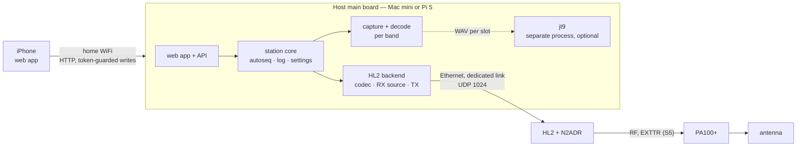

# RFC 0014: Home station — a host main board with a Hermes-Lite 2

* **Status:** Draft 2026-10-20. Decided in discussion the same day: §8. The Ask: §7.
* **Author / Lead:** Jeff Kalikstein, KB2SLO
* **Covers:** a third main board: the station core (capture, decode, autoseq, log, station settings, the event model) built for a computer on the home LAN, a Mac mini or a Raspberry Pi 5, serving the web app and its API itself; a Hermes-Lite 2 (HL2) backend for it, receive and transmit; listening on 3–4 bands at once and replying on the band a station was heard on; `jt9` as an optional second decode engine; the safety requirements for HL2 transmit; the Micro PA100+ last.
* **Does not cover:** an HL2 backend on the P4 (§4); the field station (P4, sidekick, QMX), which this RFC must leave unchanged; streaming P4 audio to a home host ([RFC 0012](0012-home-decode-server.md)); PSKReporter, beyond one question in §7 ([RFC 0013](0013-pskreporter.md)); renaming the project ([ROADMAP.md](../ROADMAP.md) I6).
* **Row:** [yw5x](../ROADMAP.md).

---

## 1. Goal

**North star (operator, 2026-10-20): operate FT8 from an iPhone anywhere in the house, asynchronously, on the home station** — HL2, N2ADR filter board, Micro PA100+, antenna. The operating mode: listen on 3–4 bands at once and reply to any CQ, on the band it was heard on. The P4 is not the point; driving the station from the phone is.

**Constraints:**

* **One codebase.** The home station runs the same autoseq, log, station settings and web app as the field station. Nothing the P4 or the sidekick does gets a second copy on the host (§3.2): [RFC 0011](rejected/0011-station-core.md) records what two copies of station logic did.
* **The field station is unchanged.** [system.md](../architecture/system.md)'s offline and AP-mode constraints keep applying to it. The home station is home-only.
* **Each QSO on the air is a WSJT-X QSO** ([README.md](../README.md), **WSJT-X is the on-air standard**). The station chooses the band; the messages and their sequence do not change.
* **Transmit ships off,** behind the requirements in §3.8.

## 2. What exists

Facts are from the working tree at `b693a5f` and from sources read on 2026-10-20, each named where it is used.

### 2.1 In our code

* **The control seam is real.** The core talks to a radio only through `radio_control_ops_t` (`components/radio_control/include/radio_control_backend.h:8`) and its capabilities; there is no `if (QMX)` in the core ([radio.md](../architecture/radio.md)). One coupling: `radio_control_tone_lead_ms()` returns 0 for any backend that has `begin_cpfsk_tx` (`radio_control.cpp:102`), which also turns off the PTT lead and Min TX delay.
* **The receive seam is QMX-shaped and single-instance.**
  - The `read` callback is `qmx_audio_read_ft8_samples()` (`poe_p4/main/qmx_transport.cpp:576`), wired in at `main.cpp:35`; it ignores `max_samples`. The UAC format is fixed at 48 kHz, 24-bit stereo (`qmx_transport.cpp:44`).
  - `resample_48k_to_6k()` keeps every eighth sample with no filter (`components/resample/include/resample.h:27`; row B85).
  - `ft8_audio_pipeline_run()` has one static ingest ring (`ft8_audio_pipeline.cpp:36`), one `monitor_t` on real samples at a compile-time 6 kHz (`:28`, `:68`), and decodes inside the capture task (`:243`).
  - `components/ft8_lib/common/monitor.c` (our wrapper, not the vendor tree) keeps the window, FFT plan and waterfall in file statics (`:19`–`:23`, `:109`, `:157`, `:226`). `decode_monitor_results()` keeps candidates, results and the SNR state in function statics (`decode_pipeline.cpp:309`–`:346`). `decode_tx_state` holds one decode slot and one global `freq_osr`.
* **One band throughout.**
  - The station has one `band_sel` (`components/station/include/station.h:22`).
  - A transmission goes on `porta_p4_station_freq_hz()` (`poe_p4/main/tx_scheduler.cpp:222`), and autoseq's queue entries carry no band, so a reply to a decode heard on another band would go out on the selected band.
  - The log takes band and frequency from `band_sel` at log time and writes `radio_name = "QMX"` (`porta_host.cpp:188`–`:199`).
  - `dial_history` tracks one dial (`radio_control.cpp:73`).
* **Already multi-band-ready.** Port A's DECODE carries the dial frequency per decode (`components/porta_proto/include/porta_proto.h:252`), and the web app splits a slot's decodes into one batch per frequency (`webapp/app/app.html:3503`).
* **What builds on a host today.** `host_mock` compiles `autoseq.cpp` and the pure decode helpers (sample ring, slot deficit, retry, SNR, sync) against shims for `esp_err`, `esp_log` and `esp_timer`. `decode_pipeline.cpp` and `ft8_audio_pipeline.cpp` use FreeRTOS and `heap_caps` and are not host-built; `tools/decode_recall` runs the firmware's decode steps through `test_apps/decode_bench`'s own C core (`bench_run_slot()`, `main/bench_core.c:119`). The Port A host actions — config, CQ, queue, reply, log files, clock, tune, sweep, status — are P4 board code in `poe_p4/main/porta_host.cpp` (876 lines).
* **The web app's API has two implementations.** The sidekick's `host_link.c` (1,888 lines) registers 18 `/api` routes that translate HTTP into Port A; pairing, the app bundle, the web root and WiFi are in other files (12 routes in `wifi_prov.c`). `host_mock/sim_station.cpp` (657 lines) is a hand-written copy of 12 of the routes, with a fixed token, for tests (row gfe7).
* **Decode cost.** ft8_lib's shipped decode takes 1,747 ms per busy slot on the P4 and 16.3 ms on one Apple M4 core ([decode.md](../architecture/decode.md)). `jt9` takes about 1,450 ms per slot at `-d 3` and 440 ms at `-d 1` on one M4 core ([RFC 0006](0006-decode-performance.md) §4.1). `tools/decode_bench/compare_decoders.py` times `jt9` over the corpora.
* **WSJT-X on the operator's Mac.** `jt9` reads WAV files or, as WSJT-X drives it, a shared-memory segment (`-s`), and takes QSO context (`-c`, `-x`, `-g`, `-Q`; RFC 0012 §2). `ft8code` prints a message's payload, CRC, parity and its 79 channel tones (checked 2026-10-20). Both are GPL-3.0.

### 2.2 The HL2

Read from the [HL2 wiki](https://github.com/softerhardware/Hermes-Lite2/wiki), the HL2 gateware and reference code, the openHPSDR documents, and other clients. These facts inform the design; the wire contract will be our codec's header and golden frames from the operator's radio (§3.3), not this table ([README.md](../README.md), **No prose specs**).

| Fact | Source |
|---|---|
| Discovery is `EF FE 02` plus 60 zero bytes, broadcast to UDP 1024; the reply's byte `0x0A` is the Board ID, `0x06` for an HL2. | Wiki [Protocol](https://github.com/softerhardware/Hermes-Lite2/wiki/Protocol), "Metis Discovery Reply"; Metis V1.33 revision 1.17 ("always listens on port 1024"); gateware `ethernet/network.v:428` |
| **Port 1025 is a command side channel, not a second IQ client.** A 1025 packet carries one command word and no IQ (`dsopenhpsdr1.v:317`–`:325`). IQ goes to one host: whichever sent to port 1024 last while the radio was stopped (`network.v:686`–`:697`). Which gateware first had 1025: not found. | Gateware `rtl/`; `software/hermeslite/README.md` |
| Frames: 1032-byte UDP payloads (`EF FE 01`, endpoint, 32-bit sequence number) holding two 512-byte frames, each `7F 7F 7F` + five control bytes. Receive is 24-bit I/Q per receiver plus a 16-bit mic word, ⌊504 / (6N + 2)⌋ samples per frame for N receivers; transmit is 16-bit L/R then 16-bit I/Q, 63 per frame. | openHPSDR USB_protocol V1.60; `software/ft8/rx4000.py:115`; `dsopenhpsdr1.v` PUSH states |
| No audio codec; the L/R slots are still sent, as zeros. | Wiki Protocol, "Additional Command and Control" |
| Standard gateware `hl2b5up_main`: 4 receivers and a transmitter. Receive-only variants: `cicrx` 10, `6rx` 6, `4000` 5. Rates 48, 96, 192 or 384 kHz. The wiki's prose says 9 for the skimming variant; the source says 10. | `gateware/variants/*/hermeslite.v:99`; wiki Protocol register 0x00 [25:24] |
| **TX has two dead-man layers in gateware.** PTT is a bit on every TX sample (`radio.v:976`): when samples stop, a 12 ms hang (register 0x17 [12:8], `:935`) then off (`:1040`–`:1047`). A hang of 31 is a software-PTT mode with no auto-unkey (`:1033`), by design ([issue #178](https://github.com/softerhardware/Hermes-Lite2/issues/178)). The watchdog clears `run` and PTT after 4,096 ticks without a downstream packet (`dsopenhpsdr1.v:128`, `:409`); Start bit 7 or register 0x39 disables it (`:399`). Its period in seconds: not found. | Gateware `rtl/` |
| Telemetry: temperature, forward and reverse power, PA current (RADDR 0x01–0x02; discovery reply 0x1C–0x23). No supply voltage. Temperature °C = (3.26 · code / 4096 − 0.5) / 0.01; current A = (3.26 · code / 4096) / 50 / 0.04 ÷ (1000 / 1270). Watts come from a per-hardware table (Quisk's `HL2FilterE3`: code ≈ 3,383 is 5.0 W). The sensing toroid is on the N2ADR card. Which word is forward depends on the sense transformer's polarity: Quisk takes the larger, and hl2_tcp reads them the other way from the wiki. | Wiki Protocol; [Quisk](https://github.com/jimahlstrom/quisk) `hermes/quisk_widgets.py:132`, `quisk_conf_defaults.py:500`; wiki Getting Started, "N2ADR Companion Filter Card"; [hl2_tcp](https://github.com/hotpaw2/hl2_tcp) `hl2_tcp.c:1001`, `:1007` |
| **N2ADR filters.** One byte over I2C to address 0x20 (an MCP23008), from register 0x00 [23:17]: b0 160 m, b1 80, b2 60/40, b3 30/20, b4 17/15, b5 12/10 low-pass, b6 the receive high-pass. Quisk sets the receive filter for the highest band among its receivers. **The schematic: "Bands 1 to 6 (LPF) normally bypassed".** No byte written is no transmit filter. | Wiki Protocol, "Filter Selection"; Quisk `quisk_conf_defaults.py:511`, `hermes/quisk_hardware.py:550`; `hardware/companions/n2adr/n2adr.sch` |
| LNA: register 0x0a bit 6 set gives −12 to +48 dB directly; clear gives the Hermes-style −12 to +20 dB attenuator, +20 dB by default. ADC overload is RADDR 0x00 [24]. | Wiki Protocol, "LNA Gain" |
| **EXTTR** (an RCA jack on the N2ADR card): open collector, pulled low during transmit; the PA supplies the pull-up, at most 28 V and 1 W (about 80 mA at 12 V). The driver is an NUD3124 (`hardware/hl/PA.sch`). The group has several reports of it failing and recommends a relay buffer. | Wiki [External Connections](https://github.com/softerhardware/Hermes-Lite2/wiki/External-Connections), "EXTTR"; [EXTTR failure](https://groups.google.com/g/hermes-lite/c/uTSjeJjsZnY), [Fried my Q5](https://groups.google.com/g/hermes-lite/c/iYSyxchkFxo) |
| **Protocol 1 has no authentication.** No sender check was found in the receive path; any host can stop the radio, and the next host to send while it is stopped gets the stream. | Gateware `ethernet/ip_recv.v`, `udp_recv.v`, `network.v:686` |
| **`radio-utils-emu` is not a faithful HL2.** Two receivers in its HL2 model, Hermes-style telemetry (exciter power and supply voltage, `protocol1.rs:398`–`:427`), up to 32 clients, and no watchdog or PTT-hang model found. MIT/Apache, first published May 2026. | [docs.rs](https://docs.rs/crate/radio-utils-emu/latest); `sp5tls/radio-utils` |

**Bandwidth, 4 receivers at 48 kHz:** 1,263 packets/s, 11.1 Mbit/s on the wire; transmit adds 381 packets/s, 3.3 Mbit/s.

### 2.3 The station (operator, 2026-10-20)

* An HL2 with the N2ADR filter board. Which build, enclosure and I/O board: §7.
* The PA100+ keys when its 3.5 mm PTT input is grounded; today the QMX's PTT output does it (bench-verified, [radio.md](../architecture/radio.md)). It senses the band from RF and has its own SWR protection.
* The host: a Mac mini (M4) or a Raspberry Pi 5. No published `jt9` timing for a Pi 5 was found.

## 3. Design

### 3.1 Shape

* **A third main board,** `host_station/` (name provisional) beside `poe_p4/` and `sidekick/`. It holds board glue only — sockets, threads, the clock, files, start-up — and the logic lives in components, as [STYLE.md](../STYLE.md) (**Structure**) asks of every board.
* **Portable POSIX C++17, not macOS-specific,** so Linux CI builds and tests it and a Pi 5 stays an option. Only the service set-up (launchd, systemd) is per OS.
* **It serves the web app and the API itself.** No sidekick and no Port A at home.
* **Two network interfaces:** Ethernet straight to the HL2 with fixed addresses (the HL2 keeps a fixed IP in its EEPROM: wiki Protocol, "Configuration EEPROM"), and WiFi or the home LAN for the phone. Why the radio gets its own link: §3.9.
* **Run from the repo by the operator** in the early slices, as RFC 0012 §3.5 proposes for its host program. A release is a [RELEASE_PROCESS.md](../RELEASE_PROCESS.md) question only if it ever ships to someone else.

### 3.2 One codebase: what moves into components

1. **The station actions.** The board-independent parts of `porta_host.cpp` (config get and set, CQ, queue tries, parity, cancel and reply, log files, clock set, factory-reset policy, the status snapshot) move to a component that both main boards call. The P4 keeps its radio and USB glue. This is what STYLE.md's **One main board** rule already asks of logic that is not specific to the board's hardware.
2. **Capture and decode on a host.** `decode_pipeline.cpp` and `ft8_audio_pipeline.cpp` get a small OS seam (a task or thread, a sleep, a heap) so the same code runs on FreeRTOS and POSIX. `decode_bench`'s own core stays the device benchmark.
3. **The API contract.** Two ways to keep one source of truth:
   - **(a) Shared routes.** Route handling (HTTP request to station action; event to JSON) moves out of `host_link.c` into a component behind a small server interface. The sidekick wraps ESP-IDF's `httpd` and reaches the action over Port A; the host wraps a POSIX server and calls the action in-process.
   - **(b) A contract test.** Two servers, held to one route table and golden responses by a test.

   **Recommended: (a).** `sim_station` then becomes the host station with a scripted radio instead of a third copy. Its cost is a refactor of the sidekick's largest file, which is field-checked on the sidekick.
4. **The web app** learns what the host offers from one field in `/api/config` and hides what only a sidekick has: AP mode, WiFi set-up, bundle install and update, firmware update, the pairing button. The origin changes (`http://<host>.local:<port>`), so pairing is per origin; Settings' token field (`58f2e1b`) already takes a pasted token.
5. **Pairing on the host.** The token and its rules are unchanged: writes need it, reads are open, credentials stay guarded ([system.md](../architecture/system.md), **Who may key the transmitter**). Retrieval cannot be a button press. Proposed: the host prints a one-time pairing link on its console at start (§7).

### 3.3 The HL2 backend

* **The codec,** `components/hl2_proto` (name provisional): discovery, frames, control registers, 24-bit receive and 16-bit transmit packing, sequence numbers, telemetry. Host-tested; the wire contract is its header plus golden frames recorded from the operator's HL2 in S0.
* **Our own code,** written from the protocol documents and the gateware's behaviour. Nothing is copied from Quisk (GPL) or another client; their formulas are facts we cite.
* **Radio control:** a new `radio_control_ops_t` table and capabilities, as radio.md's **Adding a radio** describes. The tone lead becomes its own property instead of following `begin_cpfsk_tx` (`radio_control.cpp:102`): an HL2 takes symbols like a QDX but needs the PTT lead when it keys a PA.
* **The receive source:** a new interface for N channels of real audio at the pipeline's rate, each with its dial frequency, a dropped-sample count and readiness. The QMX is one channel (wrapping `qmx_audio_*`); the HL2 is 1–4.
* **Gateware:** the standard `hl2b5up_main`. The receive-only variants cannot transmit.

### 3.4 Receive front end

* **Real audio from IQ.** Set each receiver's NCO near the dial plus 1.5 kHz, low-pass the complex samples, decimate, shift back and take the real part: upper-sideband audio, as a receiver's audio output would be. The monitor stage, the fitted SNR constant ([decode.md](../architecture/decode.md), **SNR**), the recall harness and the corpora all stay as they are.
* **12 kHz out,** the rate `jt9` takes. ft8_lib runs its 12 kHz configuration, scored by `report.py` against the floors before it is used, or 6 kHz to match the firmware exactly (§7).
* **This low-pass is the anti-alias filter row B85 asks for,** on this path. A host test sweeps a tone across the band for passband flatness and image rejection.

### 3.5 Several bands at once

* **Per channel:** a ring, a monitor, block gains, the slot state and the dial. That means removing the single-instance statics in §2.1 (`monitor.c`, `decode_monitor_results()`, `decode_tx_state`, the global `freq_osr`). The refactor is host-testable; the P4 keeps one channel and must decode byte for byte as today, which the recall floors and the `tx_e2e` goldens check.
* **Scheduling:** the band with a QSO in progress decodes first, the others after it. ft8_lib costs tens of milliseconds a band on a host.
* **The receive filter is shared.** The N2ADR byte serves every receiver, so it is set for the highest band listened to, as Quisk does. The lower bands get looser filtering, so ADC overload is counted per slot.
* **Every band is deaf for our TX slot** (§3.7).

### 3.6 Decode engines: ft8_lib and `jt9`

* **ft8_lib always,** the field station's decoder.
* **`jt9` optional:** a separate, unmodified process from the operator's WSJT-X install, which is also how WSJT-X runs it. Nothing GPL goes in our tree or is linked into our binary (RFC 0012 §3.5). One WAV per slot and band to start; shared memory later if start-up cost matters.
* **QSO context** (`-c`, `-x`, `-g`, `-Q`) for the band with a QSO in progress gives WSJT-X's a-priori decoding at home, the gain row qauk (AP decoding during a QSO) describes.
* **Merge:** the union of both engines, keyed on normalised text, each decode tagged with the engine that found it (RFC 0012 §3.6). The SLOT line carries per-engine counts, which is continuous paired data for RFC 0006.
* **Time budget.** A decode must land in time for a reply in the next slot. On an M4, `jt9 -d 3` is about 1.45 s of one core per band, and four bands run on four cores. On a Pi 5 it is unmeasured; scaled naively it is several seconds a busy slot. If it is too slow: `-d 3` on the QSO band only and `-d 1` or ft8_lib on the others, `jt9`'s threads (`-m`), or an early pass on a partial slot as WSJT-X makes. S0 measures it.
* **The encoder stays ft8_lib's,** proved bit for bit against `ft8code` by row I40's goldens before S2 transmits.

### 3.7 Transmit

* **One band at a time.** Decoding skips our TX slot on every band, as it skips it on the one band today (`tx_slot_idx`, [decode.md](../architecture/decode.md)).
* **The waveform:** GFSK with BT 2.0 for FT8 and 1.0 for FT4, the first and last symbols ramped, as ft8_lib's `demo/gen_ft8.c` (`:16`, `:28`, `:49`) and WSJT-X make it. Complex baseband at 48 kHz, offset by the audio offset from a TX NCO at the dial, written ahead into the HL2's transmit buffer (register 0x17, default 20 ms). The first tone goes out at the slot start plus 0.5 s, as on the QMX ([radio.md](../architecture/radio.md), **TX timing on a QMX**).
* **PTT before RF.** PTT rides every transmit sample, so the client keys with silent samples for the Min TX delay before the first tone: the QMX's `TX;`-then-`TA` sequence, which gives the HL2's own T/R relay, and in S5 the PA's, time to switch before RF.
* **The filter before every key-down.** The N2ADR transmit LPF for the band, then the receive byte again afterwards.
* **The clock** is the host's NTP-disciplined system clock. Proposed: decode auto-sync off on the host, since it exists to remove the residue of a browser set ([time.md](../architecture/time.md)).

### 3.8 Safety requirements

1. **Transmit is off by default.** It is enabled on this hardware only after the S2 bench procedure (10 below) has passed and is recorded in [TEST_PLAN.md](../TEST_PLAN.md).
2. **SWR protection in the client.** Γ = √(P_rev / P_fwd), with forward the larger of the two readings (§2.2). Evaluated only above a minimum forward power (Quisk uses 0.05 W, `quisk_widgets.py:172`); K consecutive readings over the limit trip it; it latches transmit off until the operator resets it in the web app. Power comes from a calibration table, Quisk's `HL2FilterE3` until this unit is calibrated. With the PA in line this guards the HL2's output into the PA and the barefoot case; the antenna side is the PA's own protection (§2.3).
3. **A drive cap.** Register 0x09 [31:28] has 16 steps; a compile-time maximum clamps every setting.
4. **Never sent while transmit is enabled:** a PTT hang of 31, or either watchdog-disable bit. The codec refuses to encode them, host-tested.
5. **Stream loss** relies on the gateware's two layers (§2.2), and the bench proves them: pull the Ethernet cable and kill the host process mid-transmission into a dummy load, and record how long RF takes to stop and the watchdog's period.
6. **A runaway transmitter** is bounded by row u4dw's cap (TX watchdog).
7. **A filter write that fails stops the transmission.** Whether the MCP23008 can be read back over the HL2's I2C read is unverified; S2 finds out.
8. **A dedicated link to the radio** (§3.9).
9. **The PA's keying (S5).** Before EXTTR is connected, measure the PA's PTT line: the voltage with nothing connected and the current with it shorted to ground, against EXTTR's 28 V and 1 W. A relay buffer if it is over, or as the group recommends.
10. **The bench procedure (S2):** a dummy load through an attenuator; the occupied bandwidth of a transmission against WSJT-X's; harmonics and spurs through each band's LPF; RF start and stop against the slot boundary.

### 3.9 Who may key the transmitter

* **The pairing token controls our API, not the radio.** Protocol 1 has no authentication, so anything that can send the HL2 a UDP packet can stop it, start it and key it. A second SDR program that restarts the HL2 takes the stream from us, which we see as a stream loss (§2.2).
* **Hence a dedicated Ethernet link** between the host and the HL2. The home LAN never reaches the radio.
* **system.md needs an amendment:** a second station profile, whose radio sits on a link the operator controls.

### 3.10 Operating several bands

* **Two settings:** the bands listened to (up to four on the standard gateware) and the band we CQ on (one).
* **Reply on the band heard.** Every queue entry carries its band. A transmission sets the HL2's TX NCO and the N2ADR transmit filter for its entry; no receiver moves. Until a slice gives entries a band, a reply off the TX band is refused.
* **Autoseq advances a QSO only on decodes heard on that QSO's band.**
* **The log** takes the QSO's band and frequency, and the radio's name from the backend.
* **Our transmissions blind every band.** While we call CQ on even slots, every band is heard only in odd slots; a station calling in even slots on another band is invisible until we stop. The web app says so.
* **The web app** already shows a slot's decodes as one batch per frequency. Grouping and filtering by band is web-app work for [RFC 0009](0009-operate-station-surface.md)'s rows.

### 3.11 Losses and timing are visible

* **Sequence gaps are detected and zero-filled** with the known number of samples, so the timeline and each block's date hold, and the slot is marked unclean.
* **Per-slot counters** on the SLOT and BDRY lines: sequence gaps, samples zero-filled, ring drops, ADC overload, and the HL2's transmit-buffer underflow and overflow flag (RADDR 0x00 [15:14]).
* **Blocks are dated by their audio** as today ([decode.md](../architecture/decode.md), **The time budget**). The HL2's sample clock is not UTC; samples are never counted across slots.

## 4. Alternatives

* **An HL2 backend on the P4.** One band fits: 381 packets/s, and ESP-IDF 5.5.5 has the board's IP101 PHY and the P4's EMAC. Several bands do not without PSRAM (about 230 KB a band against a largest free block of about 51 KB), decoding past the slot boundary (about 8 s of one core for four busy bands), and reversing [main_board.md](../architecture/main_board.md)'s 2026-09-16 Ethernet decision; and the P4 decodes about 70% of what `jt9` does and cannot run it. At home none of the P4's reasons apply (USB host for the QMX, working offline). Kept open: the codec and the receive source are portable.
* **The host does the radio and decode; the P4 and the sidekick serve the UI.** Two boxes holding station state, a new protocol between them, and the P4 adding nothing.
* **Other software** (WSJT-X or SparkSDR with a remote front end). Not this project: it loses our autoseq, log and phone UI.
* **WSJT-X's decoder linked into our binary.** The host binary would become GPL-3, and the decoder is Fortran inside a Qt build. As a process it is unmodified and replaceable.
* **A complex FFT in place of real audio.** It replaces the front of the monitor stage, refits the SNR constant and moves the recall floors, and `jt9` takes real audio anyway.
* **Receiving on other bands while we transmit.** The front end and the ADC see our own 5 W; WSJT-X is half-duplex too.
* **`radio-utils-emu` as the conformance test.** It differs from the HL2 in receivers, telemetry, client count and the dead-man (§2.2). A smoke-test peer only.
* **SparkSDR on the same HL2 as a live reference.** Port 1025 carries no IQ. Alternate hours instead, or `jt9` on the same samples (§3.6).
* **A separate repo.** Every shared piece — the web app, the API, autoseq, the log, the decode — would become a cross-repo contract. Reopen if the host links GPL code, grows its own UI, or ships to others on its own cadence.

## 5. Slices

Each slice states which verifiability category from [README.md](../README.md) applies.

0. **S0: a host spike on the real HL2.** The codec component and a small host program: discovery, one and four receivers, IQ and 12 kHz WAV recording, golden frames, telemetry readings. `radio-utils-emu` as a smoke test in CI.
   - Verification: codec host tests (category 1). What the HL2 does is field (category 2).
   - **Done-when:** golden frames committed with a codec test; which telemetry word is forward on this unit, and the watchdog's period, recorded here; recorded HL2 slots scored with our front end and ft8_lib against `jt9`; `jt9 -d 1/2/3` timed on a Pi 5 with `compare_decoders.py`, or recorded as not run.
1. **S1: the host main board, receive only, one band.** The station-actions component, the OS seam, the API contract (§3.2), host pairing, the web app's capability flag; the HL2 receive source with one channel; ft8_lib.
   - Verification: host tests (category 1); the sidekick after the route refactor, and the P4's decode and TX unchanged (category 2).
   - **Done-when:** an iPhone on home WiFi shows the HL2's decodes on Operate from the host; the P4 station still decodes and transmits (field).
2. **S2: transmit, barefoot.** Waveform, PTT lead, filter, drive cap, SWR latch, stream loss, transmit off by default; ft8_lib's encoder proved against `ft8code` (row I40) first.
   - Verification: the safety policy host-tested (category 1); everything RF on the bench (category 2).
   - **Done-when:** the §3.8 bench procedure passes into a dummy load and is recorded in TEST_PLAN; then a QSO on the air at 5 W (field).
3. **S3: several bands.** Per-channel capture and decode, the per-slot loss counters, the shared filter byte; `jt9` and the merge.
   - Verification: the refactor host-tested, the P4's decode byte-identical (category 1); an hour on the air (category 2).
   - **Done-when:** four bands decode for an hour with every loss counter at zero or explained.
4. **S4: reply on the band heard.** Queue entries with a band, autoseq matching on it, the log's band, the CQ band setting, the web app.
   - Verification: autoseq and queue in `host_mock` (category 1); on the air (category 2).
   - **Done-when:** listening on four bands, a tap on a CQ on one of them completes a QSO on that band and logs it there (field).
5. **S5: the PA100+.** The PTT-line measurement, the relay lead, the PA's band sensing on the first symbol.
   - **Done-when:** a QSO through the PA, with the PTT measurements recorded (field).

## 6. What changes elsewhere on acceptance

* [system.md](../architecture/system.md): a second station profile, home-only, whose host serves the app and API itself; pairing retrieval there; **Who may key the transmitter** gains the radio link (§3.9). Constraint 1 stays the field station's.
* [STYLE.md](../STYLE.md): **One main board** becomes two (P4 and host), and says where host glue lives.
* [main_board.md](../architecture/main_board.md): a host main board section (graduates with S1). [time.md](../architecture/time.md): its clock (S1). [webapp.md](../architecture/webapp.md): the capability flag and the origin (S1). [radio.md](../architecture/radio.md): the HL2 backend and the tone-lead property (S2). [decode.md](../architecture/decode.md): the host's engines and the SLOT line's fields (S3).
* [RFC 0012](0012-home-decode-server.md): its host program and §3.6 here share the `jt9` code; RFC 0012 stays about the P4 and the QMX.
* [TEST_PLAN.md](../TEST_PLAN.md): the **Automated** table gains the codec and host-station checks as they land; Pending rows as slices ship.
* [README.md](../../README.md) fork notes: audited when S1 gives the operator a new way to run the station.
* [ROADMAP.md](../ROADMAP.md): yw5x becomes a pointer at this RFC, and each slice a row when it is next. Rows this touches: cgc4 (the P4 follows the Radio setting), u4dw (TX watchdog), I40 (encoder against `ft8code`), B85 (anti-alias decimator), qauk (AP decoding in a QSO).

## 7. Open questions — the Ask

1. **Accept the design** — a host main board in this repo — and the slice order?
2. **Mac mini or Pi 5,** now or after S0's timing?
3. **The API contract:** shared routes (a) or a contract test (b)?
4. **Host pairing:** a one-time link printed on the host's console at start?
5. **A CQ in progress** when we reply on another band: pause it, cancel it, or keep it?
6. **Decode at home:** ft8_lib only, or `jt9` from S3? At what depth on which bands?
7. **The front end's rate for ft8_lib:** 12 kHz, scored first, or 6 kHz to match the firmware?
8. **The HL2:** which build, enclosure and I/O board? Its gateware version (S0 reads it).
9. **Bench instruments** for the §3.8 procedure: dummy load, attenuator, a second receiver or a spectrum analyser?
10. **PSKReporter from the host** ([RFC 0013](0013-pskreporter.md) Ask 4): the host has internet and can send UDP. Allow it as an exception to the inversion, at home only?

## 8. Decisions

* **2026-10-20:** the north star is operating from the iPhone anywhere in the house; the P4 is not the point (operator).
* **2026-10-20:** the mode is listening on 3–4 bands and replying to any CQ on the band it was heard on (operator).
* **2026-10-20:** the PA comes last; S0–S4 run barefoot (operator).
* **2026-10-20:** the station: the N2ADR is fitted; the PA100+ keys on a grounded PTT, senses the band and has its own SWR protection (operator).
